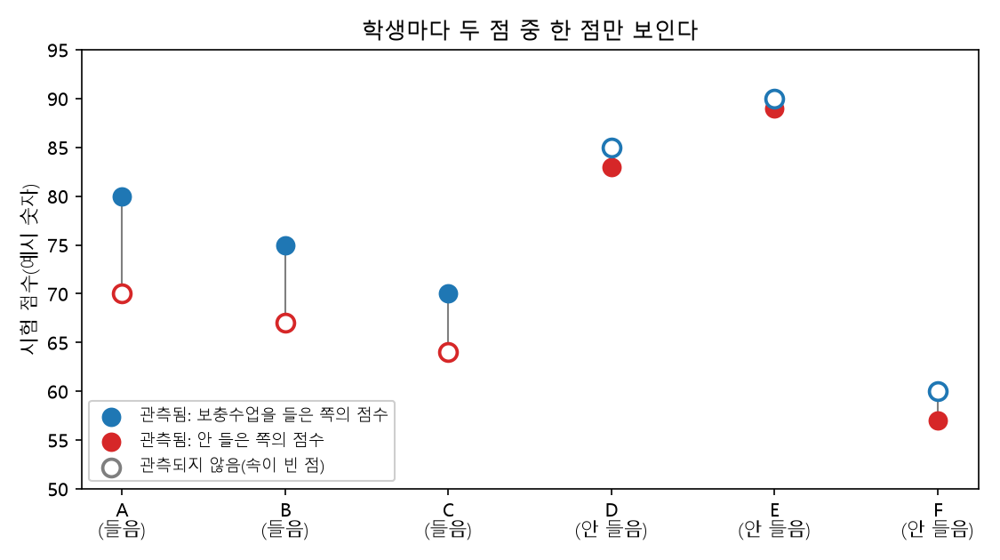
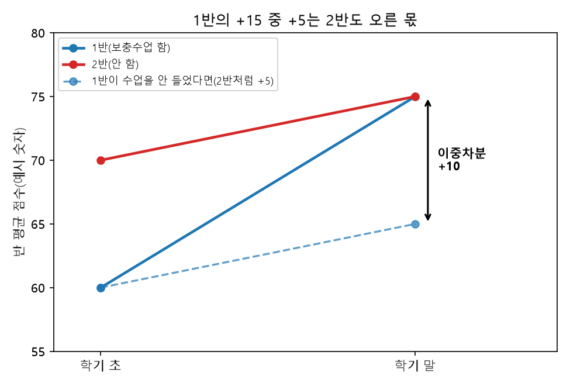
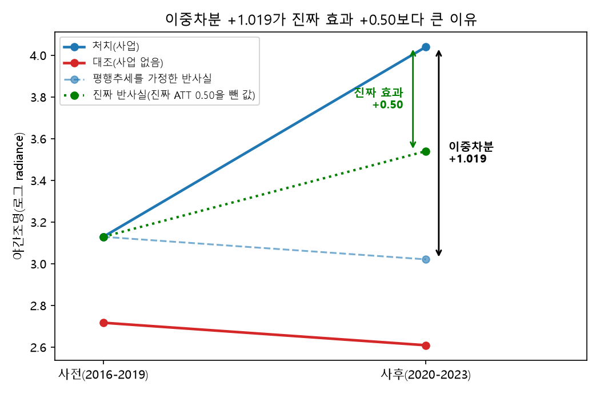
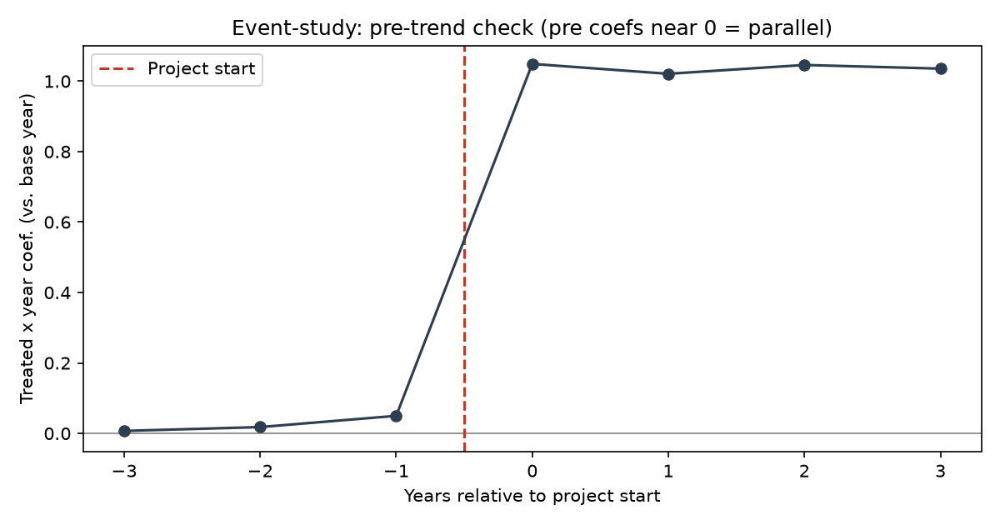
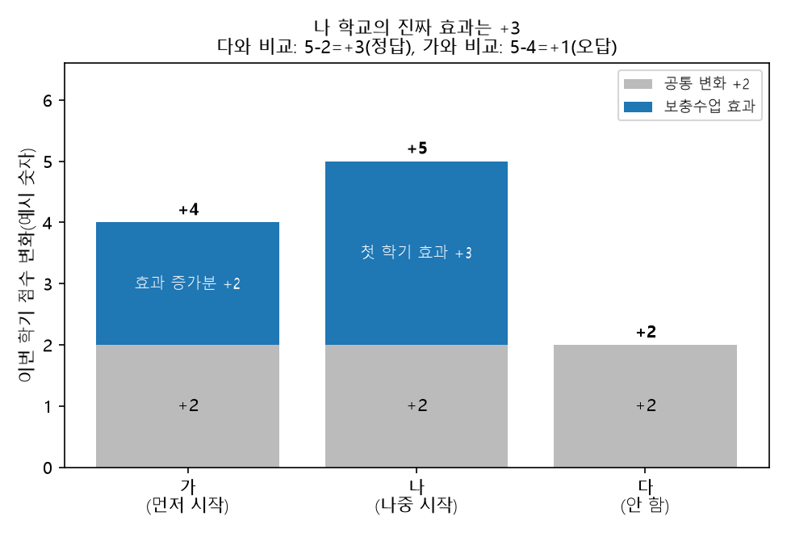
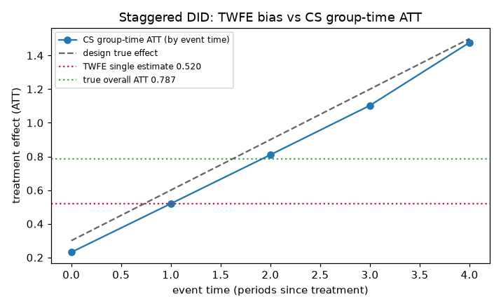

# 9장 정책효과의 인과추정

> - 실습 결과로 인용한 숫자는 모두 `lecture_practice/chapter9/code/`의 코드를 실제로 실행해 화면에 찍힌 값임
> - 원리를 설명하려고 만든 숫자는 **예시 숫자**라고 따로 표시함

## 0. 이 장에서 배우는 것

□ 산업단지가 들어선 A읍의 밤 불빛이 4년 뒤 더 밝아졌음. **이 사업 덕분이라고 말할 수 있을까?**  
  ○ 그렇게 말하려면 "산업단지가 **없었다면** 같은 해 A읍이 얼마나 밝았을지"를 알아야 함  
  ○ 그런데 A읍에는 산업단지가 이미 들어섰으므로 그 값은 영원히 관측되지 않음. 이 관측되지 않는 값을 **반사실**이라 부름  
  ○ 반사실을 다른 자료로 대신 채워 넣는 작업이 **인과추정**임  

□ 이 장의 원리는 세 가지임  

1. **비교 대상을 잘못 고르면 효과가 엉뚱하게 나옴** — 사업 지역은 원래부터 다른 지역과 달랐음(1~2절)
2. **수준이 아니라 변화량끼리 비교함** — 이중차분법(3절)
3. **비교 대상을 제대로 고름** — 원래 다른 만큼은 공변량으로 통제하고(5절), 이미 처치받은 지역은 비교 대상에서 뺌(6절)

□ 실습은 코드 세 개로 진행함  

| 순서 | 실행할 파일 | 확인할 것 | 걸리는 시간 |
| ---: | --- | --- | --- |
| 1 | `9-0-simdata-prep.py` | 실습 자료 만들기(정답 효과를 미리 심어 둠) | 수 초 |
| 2 | `9-1-nightlight-did-dml.py` | 단순 비교 → 이중차분 → 공변량 통제로 오차가 줄어드는 과정 | 약 10초 |
| 3 | `9-2-staggered-did.py` | 지역마다 사업 시작 시점이 다를 때 생기는 오차 | 수 초 |

## 1. 단순 비교가 틀리는 이유

### 1.1 흔히 쓰는 두 가지 비교

□ 사업 효과를 재려고 할 때 흔히 쓰는 비교는 둘임. 둘 다 틀릴 수 있음  
  ○ **전후 비교** — 같은 지역의 사업 전과 사업 후를 비교함. 그 사이 경기가 좋아졌다면 경기 변화까지 사업 효과로 계산됨  
  ○ **지역 간 비교** — 사업 지역과 사업이 없는 지역을 비교함. 두 지역이 원래부터 달랐다면 그 차이까지 사업 효과로 계산됨  

□ 산업단지는 아무 곳에나 짓지 않음. 교통이 좋고 성장 가능성이 높은 곳을 골라 지정함  
  ○ 그러면 사업 지역이 더 밝은 이유가 사업 때문인지, 원래 좋은 곳을 골랐기 때문인지 구별되지 않음  
  ○ 원래 다른 대상을 골라 처치했기 때문에 생기는 오차를 **선택 편향**이라 부름  

### 1.2 예시: 보충수업을 스스로 신청한 학생

○ 지역 대신 학생을, 사업 대신 방과후 보충수업을, 야간조명 대신 시험 점수를 넣어 봄(아래 표는 **예시 숫자**)  
  ○ 학생 6명 중 A·B·C는 보충수업을 **스스로 신청**했고 D·E·F는 신청하지 않았음  
  ○ 한 학생이 보충수업을 "들은 세계"와 "안 들은 세계"를 동시에 살 수는 없음. 그래서 **굵은 숫자만 실제로 관측됨**  

| 학생 | 보충수업 | 들었을 때 점수 | 안 들었을 때 점수 | 개인 효과 |
| --- | :---: | ---: | ---: | ---: |
| A | 들음 | **80** | 70 | +10 |
| B | 들음 | **75** | 67 | +8 |
| C | 들음 | **70** | 64 | +6 |
| D | 안 들음 | 85 | **83** | +2 |
| E | 안 들음 | 90 | **89** | +1 |
| F | 안 들음 | 60 | **57** | +3 |



**그림 1** 표를 그림으로 옮김. 학생마다 점이 둘인데 실제로 보이는 것은 속이 찬 점 하나뿐임. 보충수업을 들은 A·B·C는 안 들었을 때의 점(속이 빈 빨간 점)이, 안 들은 D·E·F는 들었을 때의 점(속이 빈 파란 점)이 보이지 않음

□ 관측된 굵은 숫자만으로 평균을 비교해 봄  
  ○ 들은 학생 평균 (80+75+70)/3 = 75, 안 들은 학생 평균 (83+89+57)/3 ≈ 76.3  
  ○ 차이 ≈ **−1.3점**. "보충수업을 들으면 점수가 떨어진다"는 결론이 나옴  

□ 표의 모든 칸을 아는 우리는 이 결론이 틀렸다는 것을 앎. 들은 학생 셋은 모두 점수가 올랐음  
  ○ 들은 학생은 수업을 **안 들었어도** 평균 (70+67+64)/3 = 67점이었음. 안 들은 학생 평균 76.3점보다 원래 9.3점 낮았음  
  ○ 이 **원래 차이 −9.3점이 선택 편향**임. 점수가 낮아 걱정인 학생이 보충수업을 신청했기 때문에 생김  

> **원리 1.** 단순 비교 값 = 진짜 효과 + 선택 편향. 이 예시에서는 −1.3 ≈ (+8) + (−9.3)

## 2. 무엇의 평균인가: ATT·ATE·ATU

□ 1.2의 표에서 "개인 효과"를 평균하는 방법은 **누구를 모아 평균하는가**에 따라 셋임  

| 이름 | 누구를 평균하는가 | 예시 계산 | 답하는 질문 |
| --- | --- | --- | --- |
| **ATT**(처치집단 평균 효과) | 실제로 처치를 받은 사람 | (10+8+6)/3 = **+8점** | 보충수업을 계속 운영할까? |
| **ATE**(평균 처치 효과) | 전체 | (10+8+6+2+1+3)/6 = **+5점** | 전교생에게 의무화하면? |
| **ATU**(비처치집단 평균 효과) | 처치를 안 받은 사람 | (2+1+3)/3 = **+2점** | 안 들은 학생까지 넓히면? |

□ 세 값이 다른 이유는 **효과가 큰 학생이 스스로 신청했기 때문임**  
  ○ ATT가 +8점이라고 "전교생에게 시키면 8점 오른다"고 말하면 틀림. 전교생 기준은 +5점, 안 들은 학생 기준은 +2점임  
  ○ 개인 효과가 모두 같거나 대상을 **추첨**으로 정하면, 효과가 큰 학생이 한쪽에 몰리지 않으므로 세 값이 기댓값으로 같아짐  

○ 이 장의 실습 코드는 모두 **ATT**를 추정함. 다음 절의 이중차분법이 추정하는 값이 ATT이기 때문임  
○ 정책 지역에 적용하면 — "사업을 계속할까"에는 ATT를, "아직 안 받은 지역으로 확대할까"에는 ATU를 써야 함  

## 3. 이중차분법의 원리

### 3.1 예시: 두 반의 학기 초·학기 말 점수

○ 이번에는 학생 개인이 아니라 반 평균으로 봄. 1반은 보충수업을 했고 2반은 하지 않았음(**예시 숫자**)  

| 반 | 학기 초 | 학기 말 | 변화량 |
| --- | ---: | ---: | ---: |
| 1반(보충수업 함) | 60 | 75 | +15 |
| 2반(안 함) | 70 | 75 | +5 |
| 반끼리 차이 | −10 | 0 | **+10** |



**그림 2** 파란 실선이 1반의 실제 변화(+15), 빨간 선이 2반의 변화(+5)임. 파란 점선은 "1반도 수업 없이 2반처럼 +5만 올랐다면"의 경로이고, 학기 말에 실제값(75)과 점선(65)이 벌어진 **+10**이 이중차분임

□ 세 가지 계산을 나란히 놓음  
  ○ **학기 말끼리 비교**: 75 − 75 = 0. "효과 없음"으로 나옴. 1반이 원래 10점 낮았다는 사실을 무시했음  
  ○ **1반의 전후 비교**: 75 − 60 = +15. 2반도 보충수업 없이 5점 올랐으므로, 학기 동안 모두가 오른 몫 5점이 섞였음  
  ○ **이중차분**: 1반 변화량 − 2반 변화량 = 15 − 5 = **+10**  

□ 이중차분은 차이를 두 번 뺌  
  ○ 첫 번째 뺄셈(학기 말 − 학기 초)으로 반마다 원래 점수 수준을 지움  
  ○ 두 번째 뺄셈(1반 − 2반)으로 모두가 함께 오른 몫을 지움  
  ○ 표의 맨 아랫줄로 계산해도 같음: 학기 말 차이 0 − 학기 초 차이 (−10) = +10. **어느 방향으로 빼도 같은 값이 나오므로 검산에 씀**  

### 3.2 평행추세 가정

□ 이중차분이 맞으려면 가정이 하나 필요함 — **"보충수업이 없었다면 1반도 2반처럼 5점 올랐을 것"**  
  ○ 이것을 **평행추세** 가정이라 부름. 처치가 없었다면 두 집단의 변화량이 같았을 것이라는 가정임  
  ○ 1반의 "보충수업이 없었던 세계"는 관측되지 않으므로 **이 가정은 자료로 직접 확인할 수 없음**  

□ 가정이 깨지는 예  
  ○ 1반 학생들이 학기 초에 막 공부를 시작해서, 보충수업이 없었어도 2반보다 빨리 오를 학생들이었다면 1반의 +15에는 그 몫이 섞임  
  ○ 이때 이중차분 +10은 진짜 효과보다 큼  
  ○ 5절 실습 1에서 실제로 이 일이 일어남  

### 3.3 이중차분 계산 순서(매뉴얼)

1. 자료에 **네 칸**이 다 있는지 확인함 — 처치집단의 사전·사후, 비교집단의 사전·사후. 하나라도 없으면 이중차분을 쓸 수 없음
2. 각 집단의 사전 평균과 사후 평균을 구함
3. 각 집단의 변화량(사후 − 사전)을 구함
4. 두 변화량의 차를 구함. 이 값이 ATT 추정치임

## 4. 실습 준비

□ 저장소 루트에서 패키지를 설치함. 이 장은 GPU와 인터넷이 필요 없음  

```bash
cd geoai_public   # 저장소 루트 — 이 장의 명령은 모두 여기서 실행함
pip install -r lecture_practice/requirements-student.txt
```

□ 실습 자료를 만듦. 다른 코드는 모두 이 코드가 만든 파일을 읽으므로 **반드시 먼저 실행함**  

```bash
python lecture_practice/chapter9/code/9-0-simdata-prep.py
```

○ 성공하면 마지막 줄에 다음이 찍힘  

```text
[완료] 실습 데이터를 data/ 폴더에 저장했다.
```

□ 실습 자료는 **시뮬레이션**임. 진짜 효과를 미리 정해 두고 자료를 만들었음  
  ○ 실제 정책 자료에서는 진짜 효과를 아무도 모름. 시뮬레이션에서는 정답을 알기 때문에 **각 방법이 정답에 얼마나 가까운지 채점할 수 있음**  
  ○ 실제 평가에는 이 정답지가 없다는 점을 기억해 둠. 그래서 7절의 점검표가 필요함  

## 5. 실습 1: 산업단지 사업과 야간조명

□ 상황 설정  
  ○ 격자(지도를 같은 크기로 나눈 칸) 300개, 2016~2023년 8년 자료, 2020년에 일부 격자에서 사업 시작  
  ○ 결과변수는 위성이 잰 **야간조명**(밤 불빛 밝기, 로그값). 불빛이 밝아지면 공장·상점이 늘었다고 봄  
  ○ 미리 심어 둔 **진짜 ATT는 +0.50**  
  ○ 사업 지역은 일부러 성장 가능성이 높은 격자를 골라 정했음(1.1의 선택 편향을 재현함)  

```bash
python lecture_practice/chapter9/code/9-1-nightlight-did-dml.py
```

### 5.1 단순 비교와 이중차분

○ 화면 윗부분에 집단별 평균이 찍힘  

```text
=== [1층] 처치/대조 평균 야간조명(로그 radiance) ===
           사전(2016-2019)  사후(2020-2023)
대조(사업 없음)          2.717          2.609
처치(사업)             3.129          4.040

단순 사후 비교(처치-대조): +1.431  ← 선택 편향 포함

=== [3층] DID 추정 ===
DID(treated:post): +1.019 (SE=0.029, p=0.0000)
```

□ 3.3의 순서대로 직접 계산해 봄  

| 집단 | 사전 | 사후 | 변화량 |
| --- | ---: | ---: | ---: |
| 처치(사업) | 3.129 | 4.040 | +0.911 |
| 대조(사업 없음) | 2.717 | 2.609 | −0.108 |
| 차이 | +0.412 | +1.431 | **+1.019** |



**그림 3** 위 표의 값을 그린 것임. 이중차분은 처치집단이 대조집단처럼 움직였을 경로(하늘색 점선, 3.021)와 실제값(4.040)의 차이 +1.019를 효과로 읽음. 그런데 이 자료의 진짜 효과는 +0.50이라 진짜 반사실은 3.540(초록 점선)임. 사업 지역이 원래 더 빨리 성장할 곳이어서 두 경로 사이에 약 +0.52의 차이가 남았음

○ **사후끼리 비교**: +1.431. 진짜값 +0.50의 약 3배임. 사업 전부터 있던 차이 +0.412가 그대로 섞였음  
○ **이중차분**: 0.911 − (−0.108) = +1.019. 거꾸로 빼도 1.431 − 0.412 = 1.019로 같음  
○ 이중차분으로 오차가 줄었지만 **여전히 진짜값의 약 2배**임. 3.2에서 말한 평행추세 위반 때문임 — 사업 지역은 사업이 없었어도 더 빨리 성장할 곳이었음  

### 5.2 사전추세 확인

□ 평행추세는 직접 확인할 수 없지만, **사업 전 기간**에 두 집단이 나란히 움직였는지는 볼 수 있음  
  ○ 사업 시작 전 각 연도에 "처치집단과 대조집단의 차이가 얼마나 달라졌나"를 계산하고, 그 값이 0 근처인지 봄(**사전추세 검정**, event-study라고도 부름)  

```text
event-study 사전(pre-treatment) 상호작용 계수 최대 |값|: 0.050 (사전추세 평행(필요조건 충족))
```



**그림 4** 가로축은 사업 시작 연도를 0으로 둔 경과 연도, 세로축은 처치집단과 대조집단의 차이가 기준 연도보다 얼마나 달라졌는지임. 시작 전(−3~−1)은 0 근처(최대 0.050)이고 시작 해에 약 1.05로 뛰어오름(그림 안 글자는 영어로 되어 있음)

○ 사업 전 차이의 변화는 최대 0.050으로 작았음. 사업 전에는 두 집단이 나란히 움직였다는 뜻임  
○ **그런데도 이중차분은 진짜값의 2배였음.** 사업 지역의 높은 성장 가능성이 사업 **이후에** 나타났기 때문임. 사업 전 자료에는 그 흔적이 없음  

> **원리 2.** 사전추세 검정 통과는 필요조건일 뿐임. 통과해도 사업 이후에 생긴 차이는 걸러내지 못함

### 5.3 공변량을 통제하면

□ 남은 오차를 줄이려면 성장 가능성과 관련된 정보(도시화 정도, 교통 등)를 **공변량**으로 넣어 통제함  
  ○ "도시화 정도가 같은 격자끼리 비교하면 사업 효과만 남는다"는 생각임  

○ 화면 아래쪽 통제 방법별 결과에서 다음 세 줄을 봄  

```text
방법                                ATT 추정       진짜값과 오차
naive(통제 없음)                       1.019        +0.519
OLS(선형 통제)                         0.506        +0.006
DML(무작위 KFold CV)                  0.512        +0.012
```

> - DML 줄의 셋째 자리는 실행 환경에 따라 0.511~0.512로 달라질 수 있음
> - 화면에는 Moran's I 진단과 DML(공간 블록 CV) 줄도 찍히지만 이 장에서는 다루지 않음

□ 결과 읽기  
  ○ 통제하지 않은 값(naive) 1.019가 통제 후 0.51 근처로 내려왔음. **진짜값 +0.50에 거의 도달함**  
  ○ 1.019 − 0.506 = 0.513이 공변량이 설명하던 선택 편향의 크기임  

□ **DML**(이중기계학습)은 머신러닝으로 공변량을 통제하는 방법임. 원리는 "공변량으로 설명되는 몫을 결과와 처치 양쪽에서 빼고, 남은 부분끼리 비교한다"임  

1. 공변량으로 야간조명 변화를 예측하고, 실제값 − 예측값(**결과 잔차**)을 구함
2. 공변량으로 "사업을 받았을 확률"을 예측하고, 실제 처치 여부 − 예측값(**처치 잔차**)을 구함
3. 결과 잔차를 처치 잔차에 회귀한 기울기가 효과 추정치임

○ 예: 도시화가 많이 된 격자는 사업도 잘 받고 불빛도 잘 늘어남. 1·2단계에서 도시화로 설명되는 몫을 지우면, 3단계에는 "도시화 수준을 감안하고도 사업을 더 받은 격자가 불빛도 더 늘었나"만 남음  

□ 이 자료에서는 선형 회귀(OLS)만으로도 진짜값에 도달했음  
  ○ 결론은 "DML이 필요했다"가 아니라 "**공변량 통제가 필요했고, 이 자료에서는 선형 통제로 충분했다**"임  
  ○ DML은 공변량이 많고 결과와의 관계가 곡선·상호작용 형태일 때 씀. 실무에서는 두 방법을 모두 돌려 결과가 가까우면 이해하기 쉬운 쪽을 보고함  
  ○ 두 방법 모두 "관측하지 못한 다른 원인은 없다"는 가정 위에서만 맞음. **예측을 잘하는 모형이라고 인과효과를 옳게 잡는다는 보장은 없음**  

## 6. 실습 2: 지역마다 시작 시점이 다를 때

### 6.1 원리: group-time ATT

□ 실제 정책은 지역마다 시작 시점이 다른 경우가 많음. 올해 일부 시군, 2년 뒤 다른 시군이 시작하는 식임  
  ○ 이때는 효과 하나를 한 번에 구하지 않음. **3절의 작은 이중차분을 여러 번 계산한 뒤 평균함**  
  ○ 이 방법이 **CS group-time ATT**임(Callaway와 Sant'Anna, 2021). group은 시작 시점이 같은 지역 묶음, time은 시점을 뜻함  

□ 계산 순서(매뉴얼)  

1. 시작 시점이 같은 지역끼리 묶음. 3기에 시작한 묶음을 g=3, 5기에 시작한 묶음을 g=5로 부름
2. 묶음 g의 시점 t마다 이중차분을 한 번 계산함. 기준 시점은 시작 직전(g−1)이고, 비교 대상은 **한 번도 시작하지 않은 지역**임
   - ATT(g,t) = (묶음 g의 t 시점 값 − g−1 시점 값) − (미도입 지역의 t 시점 값 − g−1 시점 값)
3. 이렇게 얻은 ATT(g,t)를 모아 평균함. 전부 평균하면 **전체 ATT**, 시작 후 경과기간이 같은 것끼리 평균하면 **경과기간별 효과**가 됨

□ 비교 대상을 미도입 지역으로만 제한하는 이유  
  ○ 예시: 세 학교의 이번 학기 점수 변화(**예시 숫자**). 모든 학교가 공통으로 2점씩 오르고, 보충수업 효과는 첫 학기 +3점, 다음 학기에 +2점이 더 붙음  

| 학교 | 보충수업 시작 | 이번 학기 점수 변화 | 변화의 구성 |
| --- | --- | ---: | --- |
| 가 | 지난 학기(먼저 시작) | +4 | 공통 +2, 효과 증가분 +2 |
| 나 | 이번 학기(나중 시작) | +5 | 공통 +2, 첫 학기 효과 +3 |
| 다 | 안 함 | +2 | 공통 +2 |



**그림 5** 표의 "변화의 구성"을 쌓은 막대로 그림. 회색은 모든 학교가 공통으로 오른 몫이고 파란색이 보충수업 효과임. 가 학교의 파란 부분에는 효과가 계속 커지는 몫(+2)이 들어 있어서, 가를 비교 대상으로 쓰면 나의 효과가 5 − 4 = +1로 작게 계산됨

○ 나 학교의 이번 학기 진짜 효과는 +3임  
○ **안 한 학교(다)와 비교**하면 5 − 2 = **+3**. 정답임. group-time ATT는 이 비교만 씀  
○ **먼저 시작한 학교(가)와 비교**하면 5 − 4 = **+1**. 가 학교의 변화에는 효과가 계속 커지는 몫 +2가 들어 있어서, 그만큼 효과가 작게 계산됨  

> **비교: TWFE.** 지역과 연도를 함께 통제하는 표준 회귀(TWFE, 양방향 고정효과 회귀)를 한 번 돌려 계수 하나를 얻는 방법도 있음. 이 회귀는 계산 중에 위 표의 "가와 나의 비교"를 섞어 쓰므로, 효과가 시간이 지날수록 커지는 정책에서는 효과를 작게 추정함

### 6.2 실행과 결과 읽기

```bash
python lecture_practice/chapter9/code/9-2-staggered-did.py
```

○ 자료는 3기에 시작한 지역 100개(g=3), 5기에 시작한 지역 100개(g=5), 시작하지 않은 지역 100개, 0~7기 8개 기간이며, **진짜 ATT는 0.7875**  

□ 먼저 6.1의 2단계 결과인 ATT(g,t) 여덟 줄을 봄  

```text
[CS] group-time ATT(g,t) (미도입 통제군, 기준기 g-1)
  g=3 t=3 (event +0): ATT(g,t) = 0.2897
  g=3 t=4 (event +1): ATT(g,t) = 0.5519
  g=3 t=5 (event +2): ATT(g,t) = 0.8219
  g=3 t=6 (event +3): ATT(g,t) = 1.1031
  g=3 t=7 (event +4): ATT(g,t) = 1.4770
  g=5 t=5 (event +0): ATT(g,t) = 0.1724
  g=5 t=6 (event +1): ATT(g,t) = 0.4879
  g=5 t=7 (event +2): ATT(g,t) = 0.7982
```

○ 첫 줄 `g=3 t=3`은 "3기에 시작한 묶음의 3기 효과"임. 2기(시작 직전)에서 3기까지의 변화량을 미도입 지역의 같은 기간 변화량과 비교한 값임  
○ `event +0`은 시작한 바로 그 시점, `event +1`은 1기 뒤라는 뜻임. g=3 묶음은 3~7기 다섯 줄, g=5 묶음은 5~7기 세 줄이 나옴  
○ 같은 묶음 안에서 값이 0.29 → 0.55 → 0.82 → 1.10 → 1.48로 커짐. 시작 후 시간이 지날수록 효과가 커지는 자료임  

□ 다음은 6.1의 3단계, ATT(g,t)를 모아 평균한 결과임  

```text
[CS] overall ATT (처치 관측 가중) = 0.7128
  진짜값(0.7875)과 오차 = -0.0747

[CS] 이벤트-스터디 (경과기간별 동적 효과)
  event +0: 0.2311  (설계 기대 = 0.3000)
  event +1: 0.5199  (설계 기대 = 0.6000)
  event +2: 0.8101  (설계 기대 = 0.9000)
  event +3: 1.1031  (설계 기대 = 1.2000)
  event +4: 1.4770  (설계 기대 = 1.5000)
```

○ **전체 ATT 0.7128**은 여덟 줄의 평균임. 두 묶음 모두 지역이 100개라 각 줄을 같은 비중으로 평균함: (0.2897+0.5519+0.8219+1.1031+1.4770+0.1724+0.4879+0.7982) ÷ 8 ≈ 0.7128  
○ **경과기간별 효과**는 event 번호가 같은 줄끼리 평균함. event +0은 (0.2897 + 0.1724) ÷ 2 ≈ 0.2311  
○ event +3·+4는 g=3 묶음에만 있으므로 그 묶음의 값이 그대로 나옴  

□ 마지막으로 TWFE와 나란히 봄  

```text
요약: 추정량별 overall ATT (진짜값 = 0.7875)
  TWFE (양방향고정효과)               0.5203  (오차 -0.2672)
  CS group-time ATT            0.7128  (오차 -0.0747)
```

○ 같은 자료인데 CS는 0.7128, TWFE는 0.5203임. TWFE는 진짜값의 약 34%(0.2672 ÷ 0.7875)를 놓쳤음  
○ 실행하면 `lecture_practice/chapter9/data/fig_9_2_staggered_did.png`에 두 추정을 비교한 그림이 저장됨  



**그림 6** 파란 실선이 CS의 경과기간별 효과, 회색 점선이 설계상 진짜 효과, 빨간 점선이 TWFE가 내놓은 값 하나(0.520), 초록 점선이 진짜 전체 ATT(0.787)임. 진짜 효과는 시간이 지날수록 커지는데 TWFE는 수평선 하나만 내놓아, 진짜 전체 ATT보다 낮음(그림 안 글자는 영어로 되어 있음)  

> **매뉴얼.** 시작 시점이 지역마다 다르면 group-time ATT로 계산하고, 전체 ATT와 경과기간별 효과를 함께 보고함. TWFE 계수 하나를 최종 값으로 쓰지 않음

## 7. 결과를 보고하기 전 점검표

### 7.1 먼저: 인과추정이 필요한 질문인가

□ 우산을 챙길지는 비가 올지 **예측**만 정확하면 되고, 기우제를 지낼지는 "기우제가 비를 부르는가"라는 **인과**에 달려 있음(Kleinberg 외, 2015)  
  ○ "취약 지역을 어디부터 지원할까"처럼 **어디에 배분할지**를 묻는 질문은 대체로 예측으로 충분함  
  ○ "이 사업이 효과가 있었나"처럼 **이미 한 일의 효과**를 묻는 질문에서만 인과추정이 필요함  
  ○ 인과추정에는 처치 여부가 결과와 무관하게 정해진 부분(추첨, 기준점수, 외부에서 정한 시작 시점 등)이 자료에 있어야 함. 없으면 "인과효과"라고 말하지 말고 **예측·우선순위까지만 보고하는 것이 정직한 결론임**  

### 7.2 분석 점검표

| 점검 항목 | 확인 방법 | 이 장의 어디서 |
| --- | --- | --- |
| 비교 대상이 원래 달랐나 | 사업 전 평균을 처치·비교 집단끼리 비교함 | 1절, 5.1 |
| 평행추세 | 사업 전 기간의 추세 차이가 0 근처인지 봄(통과해도 충분조건 아님) | 3.2, 5.2 |
| 공변량 통제 | 통제 전후 추정치를 나란히 보고함 | 5.3 |
| 시작 시점 | 지역마다 다르면 group-time ATT로 계산 | 6절 |
| 결과변수 | 정책이 바꾸려는 것을 재는 변수인가 | 아래 □ |

□ 결과변수는 **정책이 바꾸려는 대상을 직접 재는 변수**여야 함  
  ○ 산업단지 효과는 야간조명, 대기오염 규제 효과는 이산화질소(NO₂) 농도, 산림보호 효과는 산림 면적 변화로 봄  
  ○ 야간조명은 원래 불빛이 거의 없는 농촌·산림에서는 경제활동을 잘 재지 못함. 이런 곳에서 효과가 0으로 나오면 "효과 없음"이 아니라 "변수가 맞지 않음"일 수 있음  

### 7.3 보고서에 넣을 다섯 항목

| 항목 | 담는 내용 | 실습 1의 예 |
| --- | --- | --- |
| 추정치 | 숫자와 단위, 어떤 방법으로 얻었나 | 로그 야간조명 +0.512(DML) |
| 불확실성 | 표준오차 또는 신뢰구간 | 표준오차 0.032 |
| 민감도 | 방법·설정을 바꿨을 때 값이 움직인 범위 | 0.506~0.512(OLS·DML 두 방식) |
| 정책 함의 | 이 값이 어떤 결정에 쓰이나 | 기존 사업 지역의 사업 유지 판단(ATT) |
| 보류 조건 | 이 결론을 쓰면 안 되는 상황 | 아래 ○ |

○ 가장 자주 빠지는 항목이 **보류 조건**임. 실습 1의 보류 조건은 셋임  
    – 불빛이 거의 없는 농촌 지역에는 이 결과를 쓰지 않음(7.2 결과변수)  
    – 아직 사업을 받지 않은 지역으로 넓힐 때는 ATT가 아니라 ATU가 필요함(2절)  
    – 관측하지 못한 다른 원인이 의심되면 결론을 보류함(5.3)  

## 8. 핵심 요약

○ **효과를 재려면 "처치가 없었다면"의 값(반사실)이 필요하고, 그 값은 관측되지 않음.** 인과추정은 그 값을 다른 자료로 대신 채우는 작업임 (0절)  
○ **단순 비교 값 = 진짜 효과 + 선택 편향.** 보충수업 예시에서 진짜 효과 +8점이 단순 비교로는 −1.3점이 됨 (1.2)  
○ **ATT·ATE·ATU는 누구를 평균하느냐가 다르고, 답하는 질문도 다름.** ATT가 크다고 확대 효과도 크지는 않음 (2절)  
○ **이중차분은 변화량끼리 비교해 원래 수준 차이와 공통 변화를 함께 지움.** 실습 1에서 사후 비교 +1.431이 이중차분으로 +1.019가 됨 (3절, 5.1)  
○ **사전추세 검정을 통과해도 사업 이후에 생긴 차이는 남음.** 공변량을 통제하자 0.506으로 진짜값 0.50에 도달함 (5.2, 5.3)  
○ **시작 시점이 지역마다 다르면 시작 시점별 작은 이중차분(group-time ATT)을 계산해 평균함.** CS 0.7128, TWFE 0.5203, 진짜값 0.7875 (6절)  
○ **보고서에는 추정치와 함께 보류 조건을 적음** (7.3)  

## 9. 과제

```bash
python scripts/submit.py 9 --id 학번 --name 이름
```

□ 실행하면 `submissions/` 폴더에 `제출_9장_학번.md`가 생성되고 실행 결과가 붙어 있음  
  ○ **눈여겨볼 곳은 단순 비교 추정치와 이중차분·공변량 통제(OLS·DML) 추정치의 격차**  

○ 빈칸 세 개를 채움  

1. 눈에 띈 숫자 하나를 그대로 옮겨 적고, 왜 눈에 띄었는지 한 문장으로
2. 그 숫자가 왜 그렇게 나왔는가
3. **단순 비교 값을 사업 성과로 보고하면 무엇이 부풀려지는가? 추정치와 함께 반드시 적어야 할 것을 하나 들어라**

○ **3번이 이 과제의 핵심**. 1·2번은 로그를 보면 답이 나오지만 3번은 그렇지 않음  

> - **막혀도 제출함**
> - 실행이 실패하면 오류 메시지가 파일에 담기고, 질문이 "어디서 막혔나"로 바뀜
> - 실행 성공 여부로 점수를 매기지 않음
