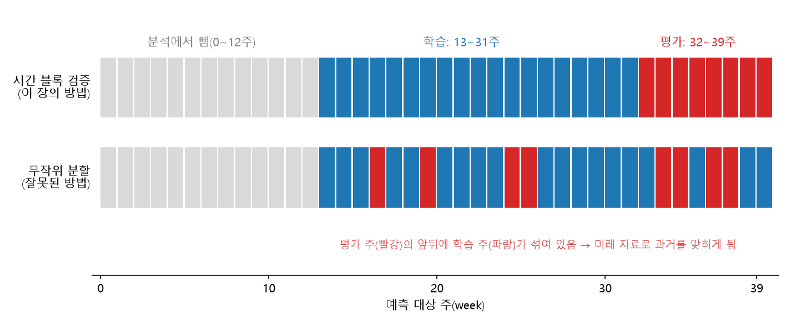
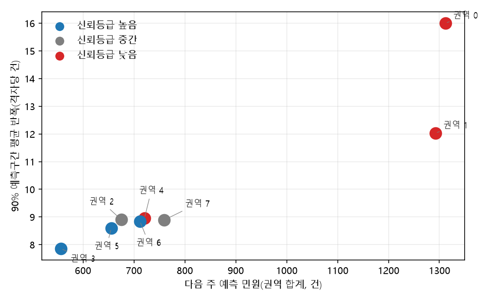

# 10장 도시 서비스 배분, 어디가 부족하고 어디로 몰리고 어디에 둘 것인가

> - 실습 결과로 인용한 숫자는 모두 `lecture_practice/chapter10/`의 코드를 실제로 실행해 화면에 찍힌 값임
> - 원리를 설명하려고 만든 숫자는 **예시 숫자**라고 따로 표시함

## 1. 이 장의 핵심 질문

1. **어느 구역이 부족한가.** 접근성과 인구를 어떻게 하나의 우선순위로 만드는가
2. **다음 주 수요는 어디에 몰리는가.** 그 예측을 얼마나 믿을 것인가
3. **어디에 열고 어디까지 담당하는가.** 예측이 정확해도 배치가 정해지지 않는 이유는 무엇인가
4. **집행한 개입이 정말 효과가 있었는가.** 시행 전과 후를 비교하면 되는 것인가

□ 네 질문은 따로 노는 질문이 아님  
  ○ **부족한 곳을 찾고(진단) → 다음에 몰릴 곳을 맞히고(예측) → 어디에 무엇을 둘지 정하고(결정) → 정한 것이 실제로 통했는지 확인함(검증)**  
  ○ 같은 절차가 시청에서는 생활SOC 배치에, 배달업체에서는 배달 권역 설계에 쓰임. **측정하는 대상과 계산 도구는 같고, 무엇을 최소화·최대화할지가 다름**  

□ 실습은 코드 하나로 진행함. 6~7절의 민원 예측과 예측구간을 `10-2-civil-complaint-forecast.py`로 직접 실행함(11절). 자료는 저장소 `lecture_practice/chapter10/data/`에 들어 있어 먼저 실행할 코드가 없음. 4·8·9절은 원리만 다룸  

## 2. 도입 사례: 인구가 많은 곳이 1순위가 아닌 이유

□ 가상 도시의 격자 세 칸을 예로 봄 (예시 숫자). 가장 가까운 시설까지 15분 넘게 걸리면 사각지대로 봄  

| 격자 | 인구 | 가장 가까운 시설까지 | 15분 초과분 | 초과분 × 인구 | 순위 |
| :---: | ---: | ---: | ---: | ---: | :---: |
| A | 6,000명 | 45분 | 30분 | 180,000 | 1 |
| B | 5,500명 | 47분 | 32분 | 176,000 | 2 |
| C | 9,700명 | 30분 | 15분 | 145,500 | 3 |

□ C는 인구가 A보다 1.6배 많지만 순위는 가장 낮음. 시설까지 초과한 시간이 A의 절반(15분 대 30분)이기 때문임  
  ○ **"인구가 많은 곳"과 "접근성이 나쁜 곳"이 곱해져야 우선순위가 정해짐** — 이 계산이 4.4의 결손 점수임  

## 3. 질문의 형태와 공간 단위

### 3.1 네 가지 질문 유형

○ 같은 도시 자료를 쓰더라도 질문의 형태에 따라 필요한 계산 방법이 다름  

| 질문 유형 | 물음의 형태 | 필요한 방법 | 이유 |
| --- | --- | --- | --- |
| 현황 | 지금 어디의 서비스 수준이 낮은가 | 결정론적 계산 | 시설 위치와 인구가 주어지면 값이 하나로 정해짐. 학습할 미지의 대상이 없음 |
| 예측 | 다음 회차에 수요가 어디로 몰리는가 | 학습 모델 | 대상이 아직 관측되지 않았고, 이웃 확산과 시간 지속성이 겹쳐 단순 외삽으로 맞지 않음 |
| 인과 | 이 개입이 결과를 바꾸었는가 | 식별 설계 | 처치 여부가 무작위가 아니므로 예측을 아무리 정확히 해도 답이 나오지 않음 |
| 결정 | 어디에 무엇을 두고 어디까지 담당하는가 | 최적화 | 목적함수와 제약이 답을 정함. 예측이 정확해도 배치는 정해지지 않음 |

○ 이 장은 네 유형을 접근성(현황, 4절), 민원 예측(예측, 6~7절), 배달 권역(결정, 8절), 규제 경계(인과, 9절) 순으로 다룸. 실습은 예측 유형 하나로 함  
○ **가장 자주 뒤집히는 판정이 첫 행임.** 좌표와 도로망만 있으면 이동시간이 하나로 정해지는데, 이걸 학습 모델로 근사하면 정확한 값을 부정확한 예측으로 바꾸는 셈이 됨  
○ 앞 질문의 답이 뒤 질문의 답을 정하지도 않음. **접근성이 가장 나쁜 격자가 시설 입지의 정답은 아님.** 입지는 후보 집합·개설 개수·목적함수가 함께 주어져야 정해지고, 접근성 진단은 수요 가중치를 만드는 입력 하나를 제공할 뿐임  

### 3.2 공간 단위를 정하지 않으면 지표가 흔들린다

□ 도시에는 크기가 다른 공간 단위가 층을 이루며 공존함 — 격자, 행정동, 블록·필지·건물, 생활권  
  ○ 격자는 크기가 균일해 구역 간 비교의 기준이 되고, **행정동은 예산과 인력이 실제로 배정되는 단위**임  
  ○ 이 어긋남에서 **수정가능면적단위문제**(MAUP)가 생김. 같은 현실을 어떤 크기·모양의 칸으로 집계하느냐에 따라 결론이 달라지는 성질이며, 자료가 바뀐 것이 아니라 집계 칸이 바뀐 것임  
  ○ **격자에서 계산한 값을 행정동으로 단순 평균 내면 구역 안의 최악 격자가 사라짐.** 이 계산은 오류 메시지 없이 통과함  

□ 대응은 두 단계 구조임 — 현상의 단위(격자)에서 계산하고, 집행의 단위(행정동)로 집계함  
  ○ 이때 무엇으로 가중평균할지를 정해야 함  

| 가중치 | 계산 결과의 뜻 | 고르는 조건 |
| --- | --- | --- |
| 면적(모두 동일) | 구역의 평균 물리 조건 | 사람 수와 무관한 결정(토지이용 규제) |
| 인구 | 주민 노출을 반영한 수준 | 이용자 수가 편익을 정하는 결정(시설 공급) |
| 취약인구 | 대응이 필요한 인구 기준 수준 | 특정 집단의 피해가 결정을 좌우하는 경우(폭염·돌봄) |
| 건물 수 | 대상 시설물 기준 수준 | 작업량이 건물 수에 비례하는 결정(정비·점검) |

> **주의.** 집계 결과를 보고할 때 어떤 가중치로 평균했는지 적지 않으면, "구역 평균 접근성 20분"이 무엇을 평균한 값인지 알 수 없음. 평균과 함께 구역 내 최댓값, 임계값 초과 격자 수를 같은 표에 남기면 이 손실을 줄일 수 있음

## 4. 서비스 수준을 하나의 숫자로 만들기

### 4.1 이동시간의 세 계산 방식

□ 접근성을 거리가 아니라 이동시간으로 측정하는 이유는 **같은 500m가 장소마다 다른 시간이 되기 때문**임  
  ○ 평지의 500m는 도보 7분이지만, 하천을 건너 우회해야 하는 500m는 20분이 될 수 있음  

| 방식 | 계산 | 오차의 성격 |
| --- | --- | --- |
| 직선거리 | 좌표 간 유클리드 거리 ÷ 보행속도 | 실제 이동거리를 항상 과소평가함 |
| 네트워크 거리 | 도로망 그래프의 최단경로 | 정확하지만 계산량이 큼 |
| 우회계수 근사 | 직선거리 × 1.2~1.5 | 지역 평균은 맞지만 개별 격자의 편차를 지움 |

○ 도로망 그래프를 구성하고 최단경로를 계산하는 절차는 2장에서 이미 다룸. 여기서는 세 방식 가운데 무엇을 고를지의 판정만 다룸  
○ 우회계수 근사는 지역 전체의 평균 이동거리는 맞추지만, 하천·급경사·철도가 가로막는 개별 격자를 놓침  

> **주의.** 사각지대 진단처럼 최악의 격자를 찾는 작업에서 우회계수 근사를 쓰면, 정작 찾아야 할 격자가 근사에서 평범한 값으로 나타남

### 4.2 접근성 지표는 하나가 아니다

○ 이동시간 행렬을 얻은 뒤에도 "접근성이 얼마인가"의 답은 하나로 정해지지 않음  

| 지표 | 계산 | 반영하는 것 |
| --- | --- | --- |
| 최근접 | 격자에서 같은 종류 시설까지의 최솟값 | 물리적 근접성 |
| 누적기회 | 임계 시간 안 시설 개수 | 선택지의 개수 |
| 2SFCA(2단계 유동권역법) | 시설 정원을 배후 인구로 나눈 몫을 격자별로 합산 | 규모·거리·이용 경쟁 |

○ 최근접은 계산이 간단하고 "가장 가까운 도서관까지 24분"처럼 설명하기 쉬움. 다만 시설 정원이나 이용 경쟁을 반영하지 못함  
○ 2SFCA는 시설에 정원이 있고 여러 구역이 같은 시설을 나눠 쓸 때 이 경쟁을 지표에 반영함 — **두 격자가 어린이집에서 5분·12분 거리에 있어도, 배후 인구가 다르면 실제 이용 기회는 역전될 수 있음**  
○ 2SFCA의 정식 계산과 산출 예는 4장에 있음  
○ 판정 조건 세 가지: 시설에 정원 같은 용량 제약이 있는가, 여러 구역이 그 시설을 나눠 쓰는가, 계산 과정을 시민에게 설명해야 하는가. 세 조건이 모두 아니오라면 최근접으로 충분하고, 앞의 두 조건이 그렇다면 2SFCA로 넘어감  

### 4.3 임계값과 Gini 계수

□ 접근성 값을 얻은 뒤에는 정책이 쓸 수 있는 형태로 바꿈. 첫 장치는 **임계값**임  
  ○ 15분을 넘으면 사각지대로 표시함. **이 15분은 계산에서 나오지 않고 정책 목표에서 옴** — 정부가 「생활SOC 3개년 계획(2020–2022)」에서 제시한 도보 10분 목표에 여유를 둔 값임(관계부처 합동, 2019)  

□ 두 번째 장치는 **Gini 계수**임. 사각지대 인구 비율은 임계값 하나만 보므로 **임계 안쪽의 격차를 잡지 못함**  
  ○ **Gini 계수는 접근성이 주민 사이에 얼마나 고르지 않게 나뉘어 있는지를 0~1 숫자 하나로 나타낸 값**임. 모든 주민의 접근성이 같으면 0이고, 한 곳에만 몰려 있을수록 1에 가까워짐  
  ○ 사각지대 비율은 "15분을 넘는 사람이 몇 %인가"만 세므로, 5분 사는 사람과 14분 사는 사람을 똑같이 "안쪽"으로 묶음. Gini는 이 안쪽의 차이까지 반영함  
  ○ 계산 순서는 다음과 같음: 격자를 접근성 순으로 줄 세움 → 인구와 접근성을 각각 앞에서부터 더해 가며 누적 비율을 구함 → 이 두 비율을 그린 선(로렌츠 곡선)이 "모두 같은 경우"의 대각선에서 얼마나 벗어났는지 면적을 구해 두 배로 함  

### 4.4 결손 점수

□ 세 번째 장치가 2절에서 본 **결손 점수**임. **"기준보다 얼마나 더 멀리 가야 하는가"에 "그 길을 가야 하는 사람이 몇 명인가"를 곱한 값**이며, 점수가 클수록 시설을 먼저 지어야 하는 격자임  

Dᵢ = max(0, 접근성ᵢ − 임계값) × 인구ᵢ

○ 식의 각 부분은 다음과 같음: 접근성은 가장 가까운 시설까지의 시간(분), 임계값은 15분, 인구는 그 격자에 사는 사람 수임. 접근성에서 임계값을 뺀 값이 **기준을 넘긴 시간**(초과분)임  
○ 예(예시 숫자): 시설까지 20분이고 인구가 1,000명이면 초과분은 20 − 15 = 5분, 점수는 5 × 1,000 = 5,000임  
○ `max(0, …)`는 음수를 0으로 바꾸는 장치임. 시설까지 10분이면 10 − 15 = −5가 되는데, 이미 기준 안이라 채울 결손이 없으므로 점수를 0으로 둠  
○ 2절의 격자 C는 인구가 가장 많아도 초과분이 A의 절반이라 점수가 낮고 순위도 뒤임  

□ **곱셈으로 묶었을 때 생기는 성질은 두 가지임**  
  ○ 둘 중 하나가 0이면 점수도 0임. 인구가 0명인 격자는 접근성이 아무리 나빠도 순위에서 빠지고, 접근성이 기준 안인 격자는 인구가 아무리 많아도 순위에서 빠짐  
  ○ 점수의 단위가 "분 × 명"이라 값 자체는 의미가 없음. 180,000이 무엇을 뜻하는지 해석하지 않고, **격자끼리 크고 작음을 비교해 순위를 매기는 데만 씀**  

## 5. 민원 자료는 문제량이 아니라 신고량을 측정한다

### 5.1 세 값의 구분

○ 이 절에는 실행할 명령이 없음 — 6절에서 예측에 쓸 자료가 무엇을 측정한 자료인지 먼저 판정하는 절차이며, 이 판정을 건너뛰면 6~7절의 예측 성능을 잘못 읽게 됨  

□ 앞 절의 지표는 시설 위치·인구처럼 측정 오차가 작은 자료로 계산함. 이번 절부터는 자료의 성격이 달라짐  
  ○ 민원 접수 기록은 **주민이 불편을 인지하고 신고 창구에 접근해 내용을 입력하는 과정**을 거쳐 만들어짐. 그래서 기록에 남은 건수와 실제로 존재하는 문제의 양이 같지 않음  
  ○ 이 차이를 표기법으로 구분함 — yᵢ는 실제 문제의 양, yᵢᵒᵇˢ는 접수되어 자료에 남은 양, ŷᵢ는 모형이 산출한 예측값  
  ○ **모형은 yᵢᵒᵇˢ로 학습하고 yᵢᵒᵇˢ를 예측함.** 그래서 예측 성능이 아무리 좋아져도 그 지표가 측정하는 것은 "신고량을 얼마나 잘 맞혔는가"이지 "문제량을 얼마나 잘 맞혔는가"가 아님  

□ 두 값이 벌어지는 경로는 세 가지임  
  ○ **인지의 차이** — 통행량이 많은 구역에서 더 자주 눈에 띔  
  ○ **신고 수단 접근성의 차이** — 스마트폰 이용률이 낮은 고령 인구 비중이 높은 구역에서 접수가 상대적으로 줄어듦  
  ○ **신고 성향의 차이** — 반복 민원인 소수가 접수의 상당 부분을 차지  

### 5.2 편향이 있는지 확인하는 절차

□ "편향이 있다"는 서술만으로는 다음 단계로 넘어갈 수 없음. 이 자료에서 편향이 실제로 나타나는지 확인해야 함  

1. **접수량을 인구·연령 구성으로 나눈 지표를 만듦** — 격자별 접수 건수를 그대로 비교하지 않고 인구 1,000명당 접수율을 구해 65세 이상 인구 비율과 대조함. 접수율이 고령 비율과 뚜렷한 음의 관계를 보이면 접수량이 문제량보다 신고 성향을 더 많이 반영한다는 신호임
2. **자원 투입량과 접수량의 시차 상관을 확인함** — 특정 구역에 점검·순찰 인력을 늘린 뒤 몇 주 동안 그 구역의 접수량이 오르는지 봄. 오른다면 접수량의 변화 가운데 일부는 문제의 변화가 아니라 관측 강도의 변화임
3. **자원을 늘리지 않은 구역과 비교함** — 투입이 일정했던 구역들의 접수량 추세를 기준선으로 두고, 투입을 늘린 구역의 추세가 그 기준선에서 벗어나는지 봄

> **주의.** 민원 건수는 문제의 양이 아니라 신고의 양을 측정함. 접수량으로만 자원을 배분하면 신고가 활발한 구역에 자원이 쏠리고, 그 구역에서 인지·기록이 늘어 다음 회차 접수량이 다시 오름. 접수량을 인구·연령 구성으로 나눈 지표를 함께 보고, 신고가 저조한 구역은 접수 자료와 별개의 점검 대상으로 둠

## 6. 다음 주 수요를 예측한다

### 6.1 단순 외삽으로 안 되는 이유

○ 6~7절의 모델 실행과 출력은 11절 실습에 있음 — 여기서는 원리와 판정 절차만 다룸  

□ 다음 주 접수 건수를 단순 추세로 맞히기 어려운 이유는 두 성질이 겹치기 때문임  
  ○ **시간 지속성** — 도로 파임이나 무단투기의 원인은 한 주 만에 사라지지 않으므로, 이번 주 접수가 많았던 격자는 다음 주에도 많을 가능성이 높음  
  ○ **공간 확산** — 한 도로구간이 파이면 차량이 옆 구간으로 몰려 그 구간도 곧 손상되고, 소음원 주변은 권역 단위로 접수가 오름  

### 6.2 시공간 피처와 시간 블록 교차검증

□ 입력 피처는 세 묶음임 — 자기 시차(격자 자신의 t, t−1, t−2 시점 값), 공간 시차(이웃 격자들의 t 시점 평균값), 고정 공변량(도로 밀도 등 시간에 안 변하는 값)  
  ○ **예측 시점에 존재하지 않는 값은 피처로 쓸 수 없음** — 다음 주를 예측하는 시점에 다음 주의 이웃 값은 없으므로, 공간 시차는 t 시점까지만 씀  

□ 검증 방식도 예측 방향에 맞춰야 함. 시계열을 무작위로 나눠 학습·검증하면 **미래 자료로 학습해 과거를 맞히는 구성**이 되어 버림  
  ○ **시간 블록 교차검증**은 시점 경계로 자료를 나눔 — 전체 주차의 앞 70%를 학습, 뒤 30%를 평가로 두고, 평가 구간에서만 성능을 계산함  

□ 이 장의 자료로 나누면 다음과 같음. 자료는 40주이고 앞 12주(0~11주)는 분석에서 뺌. 한 행은 "t주의 값으로 t+1주를 맞히는" 문제 하나임  

| 구분 | 예측 대상 주 | 피처를 읽는 주 | 행 수 | 하는 일 |
| --- | :---: | :---: | ---: | --- |
| 학습 | 13~31주 | 12~30주 | 4,864 | 모형을 맞춤 |
| 평가 | 32~39주 | 31~38주 | 2,048 | 학습에 쓰지 않은 뒤쪽 주에서 성능을 계산함 |



**그림 1** 위쪽 줄이 이 장의 시간 블록 검증임. 시간 순서대로 앞부분(파랑)을 학습에, 뒷부분(빨강)을 평가에 씀. 아래쪽 줄은 같은 주들을 무작위로 나눈 경우이며 빨강 위치는 설명용 예시임. 이 경우 평가 주 앞뒤에 학습 주가 섞여, 모형이 그 주의 미래 모습을 이미 본 채로 그 주를 맞히게 되므로 점수가 실제 성능보다 좋게 나옴

> **주의.** 시계열을 무작위로 분할하면 코드는 정상 종료하고 성능 지표는 오히려 좋아짐. 학습·평가 구간의 시점 경계를 명시하고, 각 피처가 예측 시점에 실제로 관측 가능한지 한 줄로 확인하는 습관이 필요함

### 6.3 공간 시차가 정말 도움이 되는가

□ "공간 자료를 다룬다"는 이유만으로 공간 시차를 넣으면 근거 없이 복잡도만 올라감  
  ○ 판정 절차는 **같은 검증 설계에서 공간 시차를 뺀 모형과 넣은 모형을 나란히 비교하는 것**임  

○ 비교 결과는 11.2에서 실행해 확인함. 코드는 피처 목록만 바꿔 같은 함수를 두 번 부름  
○ 공간 시차를 넣어도 개선 폭이 0에 가까우면 더 단순한 모형으로 물러서는 것이 맞는 판단임. 공간 시차는 비교에서 개선이 확인될 때만 유지함  

## 7. 예측을 얼마나 믿을 것인가

### 7.1 예측값에 오차 범위를 붙인다

□ 예측값 하나만으로는 사람을 배치할 수 없음. 다음 주 700건으로 예측한 권역이 두 곳인데 한 곳은 실제로 650~750건, 다른 곳은 400~1,000건 사이일 것 같다면 같은 방식으로 배치할 수 없음 (예시 숫자)  
  ○ 그래서 예측값에 "실제 값이 이 범위에 들어올 확률이 90%"라는 **예측구간**을 붙임. 구간의 반쪽 길이를 **반폭**이라 함. 예측 700건에 반폭 50건이면 구간은 650~750건임 (예시 숫자)  
  ○ **정규화 conformal 예측**은 지난 예측의 오차를 모아 구간 폭을 정하는 방법임. 맞히기 쉬운 격자는 좁게, 어려운 격자는 넓게 잡으려고 격자마다 예상 오차 크기(σ̂)를 따로 구해 폭에 반영함  

반폭 = q × σ̂

○ q는 "지난 오차 ÷ 예상 오차 크기" 값 가운데 90%가 그 아래에 들어오는 값임. 예: σ̂ = 4건인 격자의 q가 2.2이면 반폭은 2.2 × 4 = 8.8건임 (예시 숫자)  

### 7.2 예측이 큰 권역은 오차 범위도 넓어지기 쉽다

○ 격자별 반폭을 권역 단위로 쓰려면 권역 안 격자의 평균 반폭을 구하고, 8개 권역을 반폭이 작은 쪽부터 3등분해 신뢰등급 높음·중간·낮음을 붙임(반폭이 작을수록 신뢰등급이 높음)  

□ 민원이 많이 접수되는 권역은 주마다 오르내리는 폭도 큼. 그래서 틀리는 폭이 커지고 σ̂와 반폭도 커짐. 값이 클수록 흔들림도 커지는 자료에서는 이 일이 반복됨  
  ○ 그래서 예측 순위와 신뢰등급을 따로 읽지 않고 함께 보고 조치를 정함. 규칙은 12.1에서 정리하고, 실제 결과는 11.3에서 확인함  

## 8. 어디에 열고 어디까지 담당하는가

### 8.1 결정 문제는 무엇을 정해야 하는가

□ 앞의 두 절에서 현재 서비스 수준, 다음 주 수요, 예측의 오차 범위를 얻었음. 그래도 "시설을 어디에 열고 어디까지 담당할지"는 정해지지 않음  
  ○ 다음 주 수요를 한 건도 틀리지 않게 맞혀도 거점 10곳을 놓을 조합은 수없이 많고, 그중 하나를 고르는 기준은 자료가 아니라 목적과 제약임  
○ 결정 문제는 네 가지를 적어야 풀 수 있음 — ① 무엇을 정하는가(결정변수, 예: 어느 후보지에 거점을 열지) ② 무엇을 줄이거나 늘리는가(목적함수) ③ 넘으면 안 되는 한계(제약, 예: 거점당 라이더 수) ④ 밖에서 주어지는 값(파라미터, 예: 수수료)  

### 8.2 같은 후보지에서 목적이 다르면 다른 곳을 고른다

○ **p-median**은 거점을 p곳 열 때 모든 수요지의 "수요 × 도달시간"을 더한 값(총 도달시간)이 가장 작도록 고름. 모든 사람의 평균 이동시간을 줄이는 방법임  
○ **최대커버**는 정해 둔 시간 T(예: 5분) 안에 닿는 수요의 합이 가장 크도록 고름. T분 안에 들어오는 사람 수를 늘리는 방법임  

□ 두 방법은 같은 후보지에서 다른 답을 냄  
  ○ p-median은 도달시간이 6분이든 20분이든 그 값을 그대로 계산에 넣음  
  ○ 최대커버는 T분 안이냐 밖이냐만 봄. T분 밖의 수요는 6분이든 20분이든 똑같이 0으로 셈. 그래서 이미 밖인 수요를 더 멀리 두더라도 다른 수요를 T분 안으로 넣을 수 있으면 이득이 됨  

□ 예 (예시 숫자): 거점 한 곳을 후보지 X나 Y 중 한 곳에 둠. 마을 A·B·C의 수요와 각 후보지까지 걸리는 시간은 다음과 같고, 기준 시간 T는 5분임  

| 마을 | 수요 | X까지 | Y까지 |
| :---: | ---: | ---: | ---: |
| A | 100명 | 4분 | 3분 |
| B | 100명 | 6분 | 4분 |
| C | 60명 | 6분 | 20분 |
| 총 도달시간(수요 × 시간의 합) | | 1,360 | 1,900 |
| 5분 안에 닿는 수요 | | 100명(A) | 200명(A·B) |

○ 총 도달시간은 X가 100 × 4 + 100 × 6 + 60 × 6 = 1,360, Y가 100 × 3 + 100 × 4 + 60 × 20 = 1,900임. **p-median은 X를 고름.** 주민 260명의 평균 이동시간은 X가 5.2분, Y가 7.3분임  
○ 5분 안에 닿는 수요는 X가 100명, Y가 200명임. **최대커버는 Y를 고름.** Y를 고르면 C 주민 60명은 20분을 가야 하지만, 최대커버는 C를 6분이든 20분이든 똑같이 "5분 밖"으로 셈  
○ 같은 자료에서 답이 갈린 이유는 계산 실수가 아니라 목적의 차이임. 모든 주민의 평균 이동시간을 줄일지, 기준 시간 안에 드는 주민을 늘릴지는 자료가 아니라 정책이 정함  

> **주의.** p-median은 후보가 많아지면 정확한 답을 찾는 시간이 급격히 늘어나는 문제(NP-hard)임. 시간을 줄이려고 근사 방법(정점 치환, Teitz & Bart, 1968)을 쓰기도 하는데 정확한 답보다 목적함숫값이 나쁠 수 있음

### 8.3 거점의 처리 한계에 가까워지면 비용이 오른다

□ 앞의 두 방법은 거점이 처리할 수 있는 양에 한계가 없다고 가정함. 실제로는 거점마다 일할 수 있는 라이더 수가 정해져 있고, 한계에 가까워지면 비용이 오름  
  ○ **이용률 ρ**는 거점이 받은 주문을 처리하는 데 필요한 라이더 시간을 거점이 낼 수 있는 라이더 시간으로 나눈 값임. 1이면 라이더 시간을 전부 쓰는 상태임  
  ○ ρ가 1에 가까워질수록 주문이 기다리는 시간(대기)이 빠르게 늘어남. 대기의 크기를 나타내는 간단한 식이 ρ/(1−ρ)임. ρ = 0.80이면 0.80 ÷ 0.20 = 4.0, ρ = 0.90이면 0.90 ÷ 0.10 = 9.0으로, 이용률이 0.10 올랐을 뿐인데 값이 두 배 넘게 됨  
  ○ 대기시간은 비용에 직접 더하지 않음. 라이더가 일하는 시간(점유시간)에 인건비가 이미 들어 있으므로 대기시간을 더하면 같은 인건비를 두 번 계산하게 됨. 대신 이용률이 높을수록 임률을 올리는 방식(할증)으로만 비용에 반영함  

### 8.4 어디까지 배달하면 이익이 남는가 — 원가 컷라인

□ 거점 위치가 정해져도 어디까지 주문을 받을지는 정해지지 않음. 먼 곳을 받으면 이동에 시간이 들고, 그 시간에 다른 주문을 처리하지 못함  
  ○ 계산은 네 단계임 — ① 점유시간 = 고정시간 + 왕복 주행시간 ÷ 묶음계수 ② 원가 = 임률 × 점유시간 + 변동비 ③ 건당 기여이익 = 수수료 − 원가 ④ 구역 기여이익 = 건당 기여이익 × 주문량  
  ○ **묶음계수**는 한 번 나갈 때 함께 배달하는 평균 건수임. 주문이 촘촘한 곳일수록 커지고 일정 값에서 더 오르지 않음  
  ○ 예(예시 숫자, 4,500·300·6·400은 이 장의 가정값): 편도 주행 4분, 묶음계수 1.0이면 점유시간 6 + 2 × 4 ÷ 1.0 = 14분, 원가 300 × 14 + 400 = 4,600원, 기여이익 4,500 − 4,600 = −100원임  

□ 기여이익이 0이 되는 편도 주행시간 τ(분)를 구하면 이익이 남는 한계선(손익분기)이 나옴  

수수료 = 임률 × (고정시간 + 2τ/b) + 변동비
4,500 = 300 × (6 + 2τ/b) + 400
2,300 = 600τ/b → τ = 3.83b

○ 묶음계수 b가 1.0이면 편도 3.83분, 2.0이면 7.67분까지 배달해도 이익이 0 이상임.  
○ b가 구역마다 다르므로 이 한계선은 원 하나가 아니라 띠 모양이 됨.  

> **주의.** 기여이익이 0보다 작으면 받지 않는다는 규칙은 "받아서 손해 보는 것"과 "거절해서 못 버는 것"을 같은 무게로 본 것임. 거절하면 고객이 떠나거나 평판이 나빠지는 손실이 생기는데 이를 계산에 넣으면 컷라인이 바깥으로 밀림. 이 손실을 추정할 자료가 없으면 지금 구한 경계를 가장 안쪽의 보수적 경계로 적는 것이 안전함

## 9. 개입이 정말 효과가 있었나

### 9.1 단순 비교가 통하지 않는 이유

□ 정책을 시행한 뒤에는 결과가 정말 바뀌었는지 확인해야 함. 확인하지 않으면 효과가 없는 정책을 다음에도 반복함  
  ○ 부동산 규제를 예로 봄. 투기과열지구는 가격이 이미 오른 지역에 지정되므로 규제지역과 비규제지역의 평균 가격을 비교하면 규제 효과와 원래 있던 지역 차이(입지·학군)가 섞임  
  ○ 규제지역이 비싼 이유가 규제 때문인지 원래 입지가 좋아서인지 단순 비교로는 가를 수 없음. 이런 섞임을 **선택 편향**이라 하며 표본을 늘려도 사라지지 않음  

### 9.2 경계선 양쪽을 비교한다

□ 규제 경계선이 지나가는 동네에서 길 이쪽 집은 규제지역, 건너편 집은 비규제지역임  
  ○ 길 하나를 사이에 둔 두 집은 학군, 역까지 거리, 주변 상가가 거의 같음. 다른 것은 규제 여부뿐임  
  ○ 이때 두 집의 가격이 다르면 그 차이를 규제 때문이라고 볼 근거가 생김  

□ **회귀불연속 설계**(RDD)는 이 구조를 이용함. 경계선을 지나는 순간 규제 여부가 갑자기 바뀌므로, 그 지점에서 가격이 갑자기 달라지는지(불연속)를 봄  

□ 계산은 다섯 단계임  

1. **경계까지의 거리를 구함** — 각 거래에서 경계선까지의 최단거리를 구하고 규제지역은 음수, 비규제지역은 양수로 표시함(배정변수)
2. **경계 근처 거래만 고름** — 경계에서 h(km) 이내 거래만 씀. 이 h를 **대역폭**이라 함
3. **가까울수록 큰 가중치를 줌** — 경계에 가까운 거래는 크게, 대역폭 끝에 있는 거래는 0으로 셈(삼각커널)
4. **양쪽에 직선을 하나씩 맞춤** — 경계 왼쪽(규제)과 오른쪽(비규제) 거래에 가중치를 반영해 각각 직선을 맞춤(지역선형)
5. **경계 지점에서 두 직선의 높이 차이를 구함** — 이 차이가 경계 근처의 규제 효과 추정치임

○ 이 방법이 맞게 작동하는지 보려면 참 효과를 미리 심어 둔 가상 자료로 추정해 보고 정답과 비교함. 실제 거래 자료에는 정답이 없어 이런 채점을 할 수 없음  

### 9.3 추정치를 믿기 전에 확인할 네 가지

□ 추정치 하나만으로는 결론을 낼 수 없음. 다음 네 가지를 모두 확인해야 믿을 수 있음.  

1. **대역폭을 바꿔 본다** — 좁게 잡으면 조건이 비슷한 거래만 비교하지만 거래 수가 적어 값이 흔들리고, 넓게 잡으면 거래 수는 늘지만 조건이 다른 거래가 섞임. 대역폭을 바꿔도 값이 비슷해야 함
2. **다른 모형과 비교한다** — 경계 양쪽 전체에 곡선(다항식)을 맞추면 차수(2차, 4차, 6차)에 따라 추정치가 달라짐. 어느 차수가 맞는지 미리 알 수 없으므로 차수를 고르는 일이 결론을 정해 버림(Gelman & Imbens, 2019). 지역선형은 이 선택을 대역폭 하나로 줄임
3. **경계 근처에 거래가 몰렸는지 본다(McCrary 검정)** — 규제를 피하려고 거래가 경계 한쪽에 몰리면 경계 양쪽의 거래 수가 갑자기 달라짐. 그러면 경계 양쪽 집이 같은 조건이라는 전제가 깨짐
4. **가짜 경계에서 효과가 나오는지 본다(placebo 검정)** — 규제와 상관없는 곳에 가짜 경계를 긋고 같은 계산을 하면 차이가 없어야 함. 진짜 경계에서만 차이가 나와야 규제 효과로 읽을 수 있음

> **주의.** 표본을 늘리려고 대역폭을 넓히면 경계에서 먼 거래가 섞여 들어가는데, 표준오차(추정치가 흔들리는 정도)는 오히려 줄어들어 추정이 좋아진 것처럼 보임. 대역폭을 여러 값으로 바꾼 표를 함께 제시하고, 표준오차와 참값에서 벗어난 정도를 나란히 읽어야 함

### 9.4 이 추정치로 무엇을 말할 수 있는가

□ 네 가지를 통과한 추정치는 "**경계 근처에서** 규제가 가격을 낮췄다"는 해석을 뒷받침함. 이 해석이 맞는 범위는 좁음  

| 무엇을 | 판단 |
| --- | --- |
| 말할 수 있는 것 | 경계 근처에서 규제가 가격에 준 효과의 방향과 크기 |
| 말하면 안 되는 것 | 전국 규제 효과, 규제 지정 자체를 곧 효과로 보는 해석 |

□ 범위가 좁은 이유는 세 가지임  
  ○ **여러 정책이 함께 바뀜** — 시군구 경계에서는 규제뿐 아니라 학군 배정, 재산세, 조례도 함께 바뀌므로 가격 차이가 규제 때문인지 알 수 없음  
  ○ **규제지역이 마음대로 정해지지 않음** — 투기과열지구는 가격이 많이 오른 지역에 지정됨  
  ○ **경계 근처만 알 수 있음** — 이 방법이 알려 주는 것은 경계 바로 옆 거래의 효과이며, 경계에서 먼 지역의 효과는 알 수 없음  

○ 9.2에서 "두 집이 조건이 같다"고 한 전제도 경계에서 멀어지면 성립하지 않음. 경계에서 먼 두 집은 학군도 상권도 다를 수 있기 때문임  

## 10. 실습 준비

□ 저장소 루트에서 패키지를 설치함. GPU와 인터넷이 필요 없고 노트북에서 실행이 수 초 안에 끝남  

```bash
cd geoai_public   # 저장소 루트 — 이 장의 명령은 모두 여기서 실행함
pip install -r lecture_practice/requirements-student.txt
```

□ 실습 자료는 저장소의 `lecture_practice/chapter10/data/`에 **이미 들어 있음**. 내려받을 것이 없고 먼저 실행할 코드도 없음  

| 파일 | 내용 |
| --- | --- |
| `complaint_road.parquet` | 격자 256개(16×16)의 도로·활동 밀도(0~1) |
| `complaint_obs.parquet` | 40주 × 256격자의 주별 민원 건수(10,240행) |

□ 이 자료는 **가상 자료**임. 사람이 구조를 정해 놓고 만들었으므로 정답을 알고, 방법이 정답을 찾아내는지 채점할 수 있음. 실제 민원 자료에는 이런 정답이 없음  
  ○ 만든 규칙: 민원 ~ 푸아송(1.2 + 4.0 × 도로 + 0.35 × 직전 주 자기 건수 + 0.35 × 직전 주 이웃 평균) × 계절성(진폭 0.25) × 신고 성향(0.7~1.3, 자료에는 저장하지 않음). 난수 시드는 42이고, 만든 코드는 저장소에 없고 만들어진 파일만 들어 있음  
  ○ 0.35 × 직전 주 이웃 평균이 **공간 확산**임. 이 항을 넣어 만들었으므로 "이웃의 지난주 값이 예측에 도움이 된다"가 정답임. 0.35 + 0.35 = 0.70 < 1이라 건수가 끝없이 커지지 않음  
  ○ 신고 성향은 같은 문제라도 지역마다 신고가 많거나 적은 정도이며, 자료에 저장하지 않았으므로 모형은 볼 수 없음 — 5절의 "접수량 ≠ 문제량"을 자료에 넣은 것임  

## 11. 실습: 민원 수요 예측과 예측구간

□ 상황 설정: 격자 256개 × 40주의 가상 민원 자료로 다음 주 접수 건수를 예측함. 앞 12주는 자료가 안정되기 전이라 빼고 12~39주만 씀. 이 건수는 접수량이지 문제량이 아님(5절)  

### 11.1 자료 불러오기

```python
road = pd.read_parquet(DATA + "complaint_road.parquet")   # 격자 256개: 도로·활동 밀도(0~1)
obs = pd.read_parquet(DATA + "complaint_obs.parquet")     # 주(t) × 격자(cell)별 민원 건수

print(obs.head(3).to_string(index=False))
print(obs.shape, obs["count"].sum())
```

```text
 t  cell  count
 0     0      4
 0     1      9
 0     2      6
(10240, 3) 187076
```

○ 10,240행은 40주 × 256격자이고 187,076건은 앞 12주를 포함한 전체 합임. 예측은 "t주까지의 값으로 t+1주의 `count`를 맞히는 것"이므로 표를 격자별로 한 칸씩 밀어 자기 시차(self_t, self_t1, self_t2)와 이웃 시차(neigh_t, neigh_t1)를 만듦  

### 11.2 공간 시차의 효과와 예측구간

```bash
python lecture_practice/chapter10/code/10-2-civil-complaint-forecast.py
```

○ 6.3의 판정 절차대로 코드가 피처 목록만 바꿔 같은 함수를 두 번 부름(자기 시차만 / 자기 시차 + 공간 시차). 아래는 그 결과와 7.1의 예측구간 결과임  

```text
[2층 AI] 다음 주 민원 예측: 시공간 피처 유무 비교 (시간 블록 CV 70/30)
  시간 시차만(자기 과거)   R² =  0.753 | MAE = 6.510
  +공간 시차(이웃 과거)    R² =  0.813 | MAE = 5.498
    (개선  R² +0.059, MAE +1.012)

  피처 중요도(설명가능성):
    self_t    0.589
    neigh_t   0.364
    self_t2   0.018
    neigh_t1  0.017
    road      0.007
    self_t1   0.005

[불확실성] 정규화 conformal 예측구간(90%, 시간블록 OOF 근사)과 신뢰등급
  90% 예측구간 경험적 포함률(OOF) = 0.901  (목표 0.90)
  구간 반폭(건): 중앙값 8.82, 범위 [5.41, 119.80]
```

□ 화면에 나온 값에서 읽을 것  
  ○ 공간 시차를 더하면 R²가 0.753에서 0.813으로 오르고 MAE가 6.510건에서 5.498건으로 줄어듦. R²는 예측이 실제 변동을 얼마나 설명하는지(0~1), MAE는 평균 몇 건 빗나갔는지임. **두 지표가 같은 방향으로 움직였으므로 개선이 우연이 아니라고 판단함**  
  ○ 이웃의 직전 값(neigh_t 0.364)이 자기 직전 값(self_t 0.589) 다음으로 중요하고 나머지 피처는 모두 0.02 아래임. 이 자료는 공간 확산을 넣어 만들었으므로 결과가 정답과 맞음. 실제 민원 자료에는 정답이 없으므로 이 비교를 직접 해 봐야 공간 시차를 넣을 근거가 생김  
  ○ 90% 구간에 실제 값이 들어간 비율은 0.901로 목표 0.90과 거의 같음. 반폭은 중앙값 8.82건인데 가장 좁은 격자는 5.41건, 가장 넓은 격자는 119.80건으로 **22배 넘게 차이남**  
  ○ 이 구간 계산은 교육용 근사임. 정식 방법은 자료를 학습·보정·시험으로 나누는데 여기서는 평가 구간의 잔차를 σ̂ 모형과 q 계산에 함께 써서 포함률이 실제보다 조금 높게 나올 수 있고, 로그에도 같은 경고가 찍힘  

### 11.3 권역 우선순위와 신뢰등급

```text
  불확실성을 반영한 다음 주 권역 우선순위:
 region  pred_next_week_complaints  priority_rank  mean_pi_half  low_conf_cells confidence
      0                     1311.7              1         16.00              20         낮음
      1                     1292.3              2         12.03              20         낮음
      7                      759.1              3          8.89              10         중간
      4                      720.7              4          8.96               9         낮음
      6                      711.6              5          8.85               7         높음
      2                      675.1              6          8.90               9         중간
      5                      655.4              7          8.59               7         높음
      3                      556.4              8          7.86               3         높음
```

□ 화면에 나온 값에서 읽을 것  
  ○ `mean_pi_half`는 권역 안 격자의 평균 반폭, `low_conf_cells`는 그 권역에서 반폭이 큰 쪽 3분의 1에 든 격자 수임  
  ○ **예측이 가장 큰 두 권역(0, 1)이 동시에 신뢰등급 낮음임.** 7.2의 구조가 그대로 나타나며 그림 2에서 두 권역이 오른쪽 위에 떨어져 있음  
  ○ 권역 4(평균 반폭 8.96건)는 권역 7(8.89건)과 거의 같은데 등급이 낮음임. 반폭을 3등분해 등급을 붙이므로 경계 근처에서는 작은 차이로 등급이 바뀜. 등급은 순서를 거칠게 나눈 표시이지 절대 기준이 아님  
  ○ 이 점수는 현장 배치를 돕는 보조 자료임. 신고가 적은 취약 지역은 따로 점검하고 점수를 기관 평가나 행정처분의 근거로 쓰지 않음(5절)  



**그림 2** 가로축은 권역의 다음 주 예측 민원 합계, 세로축은 그 권역 격자들의 90% 예측구간 평균 반폭임. 권역 0·1이 오른쪽 위에 따로 떨어져 있고 둘 다 신뢰등급이 낮음. 나머지 여섯 권역은 예측 556~759건, 반폭 7.9~9.0건 범위에 모여 있음

## 12. 결과를 행정에 연결한다

### 12.1 순위와 신뢰등급을 함께 읽는다

○ 7.2에서 본 대로 예측이 큰 권역은 오차 범위도 넓어지기 쉬움. **순위만 보고 조치를 정하면 오차가 큰 곳에 인력을 확정 배치하게 됨**  

| 예측 순위 | 신뢰등급 | 조치 |
| --- | --- | --- |
| 상위 | 높음 | 예측에 따라 인력을 배치함 |
| 상위 | 낮음 | 순위는 유지하되, 확정 배치 전에 현장 확인으로 오차 폭을 줄임 |
| 하위 | 높음 | 정기 점검 주기를 유지함 |
| 하위 | 낮음 | 접수 자료와 별개의 점검 대상으로 둠 |

○ 마지막 행이 5절의 진단과 이어짐. 예측이 낮고 오차 폭도 큰 권역은 **문제가 적은 곳일 수도, 신고가 적은 곳일 수도** 있어 접수 자료만으로는 둘을 구분할 수 없음. 이 칸의 조치는 자원을 줄이는 것이 아니라 다른 경로의 관측을 붙이는 것임  

### 12.2 격자와 행정동, 어느 단위로 보고할까

□ 격자에서 계산한 값을 행정동으로 집계해 보고하면 3.2에서 본 손실이 생김. 같은 결과도 격자 수로 세면 "구역의 3분의 1", 인구로 세면 "주민의 6%"처럼 전혀 다르게 들릴 수 있음 (예시 숫자). 어느 쪽도 틀리지 않으므로 두 값을 함께 적음  
  ○ 행정동은 담당 부서와 대응하므로 집행에 쓰기 좋지만, 평균 하나만 보고하면 동 안쪽 차이가 사라짐. 동 전체가 해당하는지 일부 격자만 해당하는지도 함께 적음  

## 13. 핵심 요약

○ **질문의 형태가 방법을 정함.** 현황은 계산, 예측은 학습 모델, 인과는 식별 설계, 결정은 최적화임. 값이 하나로 정해지는 이동시간을 학습 모델로 근사하면 정확한 값을 부정확한 예측으로 바꾸는 셈임 (3.1)  
○ **격자에서 계산하고 행정동으로 집계함.** 단순 평균을 내면 구역 안 최악 격자가 사라지므로 최댓값과 초과 격자 수를 함께 남김 (3.2)  
○ **우선순위는 접근성과 인구의 곱임.** 인구가 1.6배인 격자도 초과분이 절반이면 순위가 낮아지며, 단위가 다르므로 순위 용도로만 씀 (2절, 4.4)  
○ **민원 건수는 문제량이 아니라 신고량을 측정함.** 접수량으로만 자원을 배분하면 신고가 활발한 구역에 몰리고 다음 회차 접수량이 다시 오름 (5절)  
○ **시계열을 무작위로 나누면 미래로 과거를 맞히게 됨.** 코드는 정상 종료하고 점수는 오히려 좋아지므로 시간 순서로 나눔 (6.2)  
○ **공간 시차는 비교로 확인한 뒤 넣음.** 실습에서 R² 0.753 → 0.813, MAE 6.510 → 5.498로 두 지표가 같은 방향으로 좋아졌음 (6.3, 11.2)  
○ **예측이 큰 권역은 오차 범위도 넓어지기 쉬움.** 값이 클수록 주마다 흔들리는 폭이 커지기 때문이며, 예측 순위와 신뢰등급을 함께 보고 조치를 나눔 (7.2, 11.3, 12.1)  
○ **목적에 따라 배치가 달라짐.** 평균 이동시간을 줄이는 p-median과 T분 안에 닿는 수요를 늘리는 최대커버는 같은 후보지에서 다른 거점을 고르며, T를 정하는 일 자체가 정책 판단임 (8.2)  
○ **컷라인은 가정값에 따라 움직임.** 수수료·임률·묶음계수를 바꾸면 이익이 남는 경계가 함께 움직이므로 절대 금액이 아니라 범위로 보고함 (8.4)  
○ **RDD는 경계 바로 옆에서만 맞음.** 네 가지를 확인해도 여러 정책이 함께 바뀌고, 규제지역이 마음대로 정해지지 않고, 경계 근처만 알 수 있어서 전국으로 넓힐 수 없음 (9.3, 9.4)  

## 14. 과제

```bash
python scripts/submit.py 10 --id 학번 --name 이름
```

□ 이 명령이 대신 처리하는 작업: 실습 `10-2-civil-complaint-forecast.py` 실행, 제출용 파일 생성  
  ○ 끝나면 `submissions/` 폴더에 `제출_10장_학번.md` 파일이 생김  
  ○ **눈여겨볼 곳은 공간 시차를 넣었을 때의 성능 변화와 권역별 신뢰등급**  

○ 맨 아래 빈칸을 채움  

1. 눈에 띈 숫자 하나를 그대로 옮겨 적고, 왜 눈에 띄었는지 한 문장으로
2. 그 숫자가 왜 그렇게 나왔는가
3. **예측이 가장 큰 권역의 신뢰등급이 '낮음'이라면 그 권역에 인력을 확정 배치하겠는가? 배치 전에 무엇을 하겠는가?**

○ **3번이 이 과제의 핵심**. 1·2번은 결과를 들여다보면 답이 나오지만 3번은 7.2와 12.1의 판단표를 근거로 스스로 답해야 함  

> - **막혀도 제출함**
> - 실행이 도중에 실패하면 오류 메시지가 자동으로 담기고, 질문이 "어디서 막혔나"로 바뀜
> - 실행 성공 여부로 점수를 매기지 않음

> - **이 장의 과제는 모든 학생이 같은 자료를 씀**
> - 실습 자료가 저장소에 고정되어 있어 학번을 난수 시드로 쓰지 않으므로 모든 학생의 R²·반폭이 같아야 함. 제출물에서 서로 다른 것은 눈여겨본 숫자와 해석뿐임
