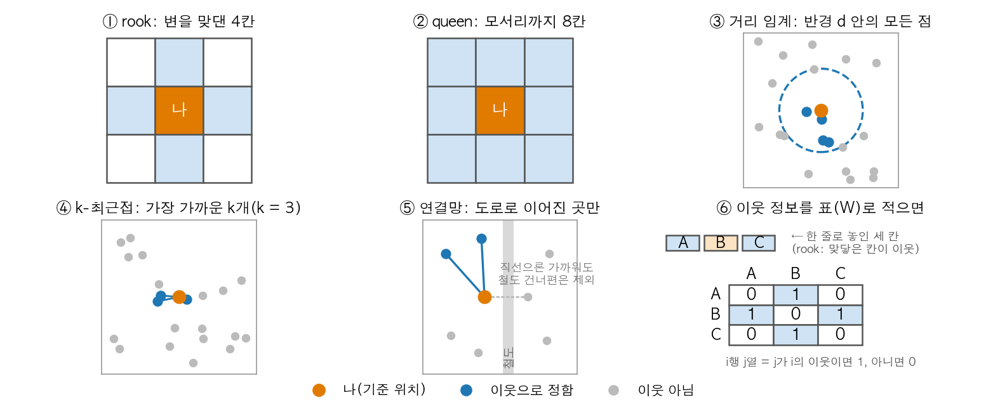
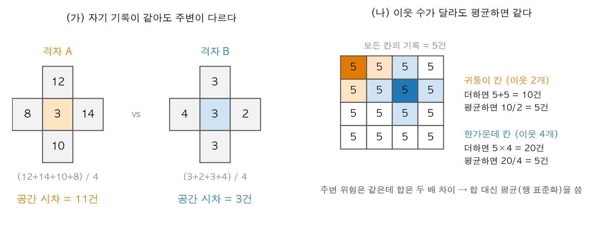
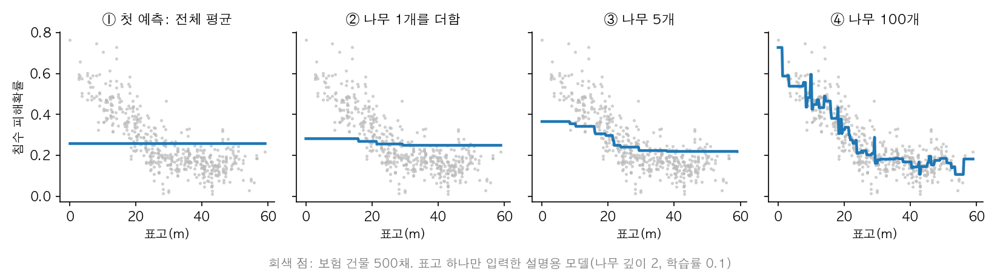
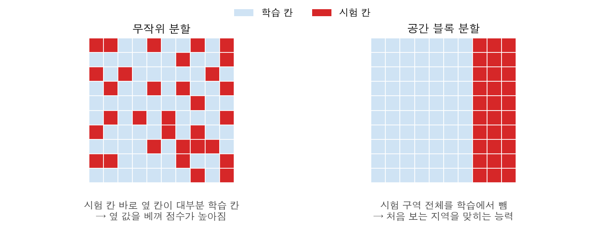
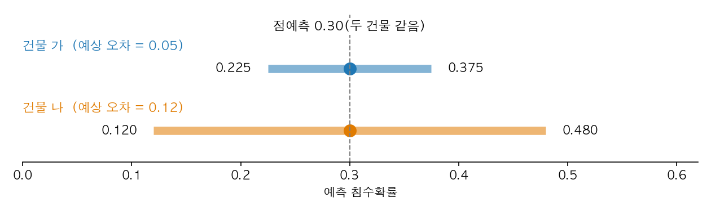
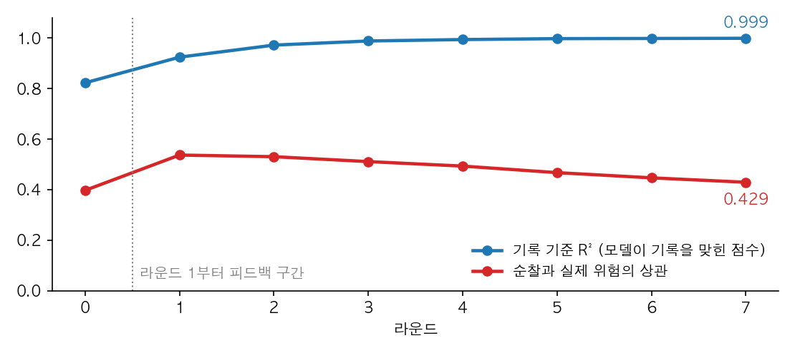
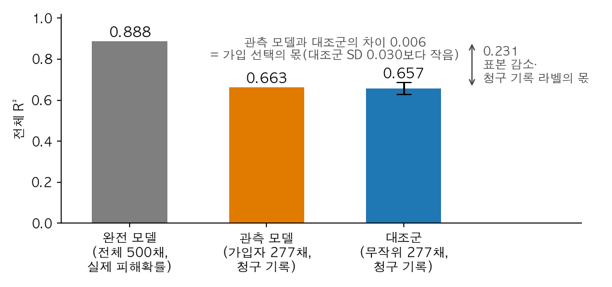
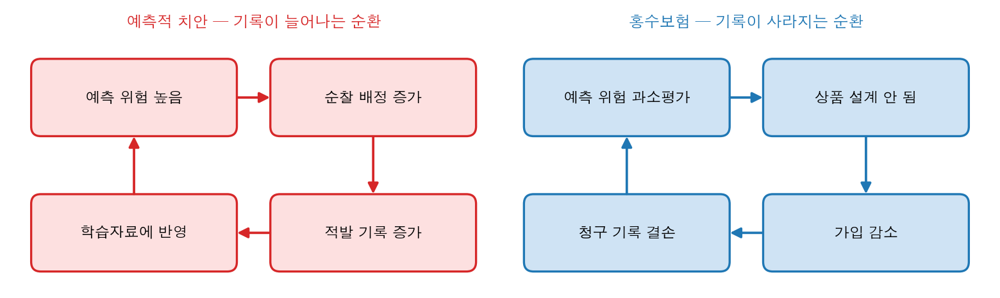

# 11장 공간 위험예측, 관측에서 결정까지

> - 이 장의 순찰 지표, 보험 등급, 편향 지표, 보험료 배수는 모두 `lecture_practice/chapter11/`의 코드를 실제로 실행해 얻은 값
> - 원리를 설명하려고 든 작은 계산 예는 "계산 예"라고 따로 표시함

## 1. 이 장의 핵심 질문

□ 경찰의 순찰 배치와 보험사의 보험료 산정은 같은 질문에서 시작함 — **"어느 위치가 얼마나 위험한가"**  
  ○ 두 문제 모두 위치별 과거 기록으로 모델을 학습해 위험 점수를 내고, 그 점수로 순찰이나 가격을 정함  
  ○ 그런데 **모델이 배우는 기록이 실제 위험과 같지 않음.** 경찰 기록에는 순찰이 많이 간 곳의 범죄가 더 많이 남고, 보험 기록에는 가입해 청구한 건물의 피해만 남음  

1. **모델이 기록을 정확히 맞히는 것과, 그 기록이 실제 위험을 담고 있는 것은 같은 말인가**
2. **예측값 하나로 순찰이나 보험료를 정해도 되는가.** 그 예측을 얼마나 믿을지는 무엇으로 아는가
3. **예측이 다음 순찰이나 다음 보험 가입을 바꾸면, 그 예측은 다음번에도 맞을 수 있는가**

○ 이 장의 결론 — **모델 성능이 좋아 보여도 실제 위험을 잘 잡아낸다는 뜻은 아님. 기록된 값과 실제 값이 같은지부터 확인해야 함**  

## 2. 도입 사례: 성능은 오르는데 배분은 나빠진다

```text
# 출처: lecture_practice/chapter11/results/11-2-predictive-policing-bias.log
  기록 기준 모델 R²: R0 0.823 → R7 0.999 (계속 높음 = 겉보기 정확)
  순찰-진짜위험 상관: R1 0.537 → R7 0.429 (-0.108, 라운드를 거듭할수록 진짜 수요와 멀어진다)
```

□ 치안 시뮬레이션은 "기록으로 위험 예측 → 예측에 비례해 순찰 → 순찰한 만큼 새 기록"을 8번 반복함  
  ○ **R²**는 모델이 기록을 얼마나 잘 맞히는지 나타낸 점수로, 1에 가까울수록 잘 맞힘. 이 점수는 0.823에서 0.999로 오름  
  ○ 같은 기간에 **순찰량과 실제 범죄 위험의 상관**(두 값이 함께 움직이는 정도)은 0.537에서 0.429로 내려감  
  ○ 두 숫자가 반대로 움직이는 이유는 모델이 맞히는 대상이 실제 범죄가 아니라 **경찰이 기록한 범죄**이기 때문임 — 3절에서 정의하고 10절에서 과정을 확인함  

## 3. 실제 값과 기록된 값을 구분한다

□ 실제 위험을 **y**, 기록된 값을 **yᵒᵇˢ**, 모델 예측을 **ŷ**로 씀. **모델은 yᵒᵇˢ를 정답으로 배우지만 결정에 필요한 값은 y임**  

| 사례 | 실제로 알고 싶은 값 y | 기록된 값 yᵒᵇˢ | y와 달라지는 경로 |
| --- | --- | --- | --- |
| 치안 | 지역별 실제 범죄 발생 | 신고·적발 기록 | **탐지** — 순찰이 많은 곳일수록 더 많이 발견·기록됨 |
| 홍수보험 | 건물별 실제 침수 피해확률 | 가입 건물의 청구 기록 | **선택** — 가입하지 않은 건물은 피해를 입어도 기록이 없음 |

○ 두 경로 모두 **기록하는 사람의 행동이 기록을 만듦.** 측정오차와 달리 자료를 더 모아도 줄지 않고 오히려 커질 수 있음  

□ **예측 단위와 집계 단위를 나눔** — 범죄는 골목 단위로 생기지만 순찰은 관할 구역 단위로 배정되고, 피해는 건물마다 생기지만 보험료는 등급 단위로 정함  
  ○ 작은 단위에서 예측하고 큰 단위로 모을 때 **무엇을 가중치로 쓰는지**에 따라 결과가 바뀜  
  ○ 계산 예 — 관할 구역 안 두 격자의 예측 범죄가 10건·2건, 인구가 100명·900명이면 단순 평균은 6건, 인구 가중 평균은 (100×10 + 900×2)/1000 = 2.8건  
  ○ 그래서 구역 평균을 낼 때 가중치(면적·인구·건물 수·건물가액)를 표 제목이나 각주에 함께 적음  

## 4. 이웃과 공간 시차

□ 공간 자료의 기본 성질은 **가까운 곳끼리 값이 비슷하다**는 것임. 이 성질을 모델에 넣으려면 "어느 위치가 이웃인가"를 정해야 함  
  ○ 이웃 정의를 표로 만든 것이 **공간가중행렬**임 — 변을 맞댄 4칸(rook), 모서리까지 8칸(queen), 반경 d 안, 가장 가까운 k개, 도로로 이어진 곳 등에서 고름  



**그림 11.1** 이웃을 정하는 방법(설명용 배치도). ①②는 격자, ③④는 점 자료, ⑤는 도로망에서 "나"의 이웃을 정하는 규칙임. ⑥은 한 줄로 놓인 세 칸에서 rook 규칙으로 정한 이웃을 표(공간가중행렬 W)로 적은 것으로, B는 A·C와 이웃이고 A와 C는 이웃이 아님

  ○ 이웃 값의 가중평균을 **공간 시차**라고 함 — "내 주변은 평균적으로 어떤가"를 나타내는 변수  

○ 계산 예 — 격자 A와 B의 기록은 둘 다 3건임. A의 네 이웃 기록은 12, 14, 10, 8건이라 공간 시차가 (12+14+10+8)/4 = 11건이고, B의 네 이웃 기록은 2, 3, 4, 3건이라 공간 시차가 3건임. A는 범죄가 많은 동네 안에서 기록만 적은 칸이고, B는 동네 전체가 조용한 칸임. **자기 기록(3건)만 입력하면 모델은 A와 B를 같은 칸으로 보고, 공간 시차를 함께 넣어야 두 칸을 구분함**  

□ **행 표준화** — 이웃 기록을 더하지 않고 평균함(각 행의 가중치 합 = 1)  
  ○ 문제 — 격자 한가운데 칸은 이웃이 4개이고 귀퉁이 칸은 2개뿐임. 이웃 칸의 기록이 모두 5건이면 두 칸의 주변은 똑같음  
  ○ 더하면 한가운데 칸은 5×4 = 20건, 귀퉁이 칸은 5×2 = 10건이 나와 모델이 두 배 차이로 읽음. 이 차이는 주변 위험이 아니라 이웃 칸의 개수에서 나온 것임  
  ○ 평균하면 두 칸 모두 5건이라 주변이 같으면 값도 같음. 과목 수가 다른 두 학생이 과목마다 80점이면 총점은 320점과 160점이지만 평균은 둘 다 80점인 것과 같음  
  ○ 치안 실습 코드는 이웃 4칸 기록의 **합**을 피처로 씀(`11-2-predictive-policing-bias.py`의 `neigh`). 이 장은 10절의 피드백을 보이려고 코드를 그대로 실행하지만, 실제 분석에서는 평균을 씀  



**그림 11.2** 공간 시차와 행 표준화. (가) 자기 기록이 3건으로 같아도 이웃 평균이 11건인 칸 A와 3건인 칸 B는 다른 칸임. (나) 모든 칸의 기록이 5건일 때 이웃 기록을 더하면 귀퉁이 칸 10건, 한가운데 칸 20건으로 갈라지고, 평균하면 둘 다 5건임

□ **예측하는 날 이미 알 수 있는 값만 입력함** — 결과가 나온 뒤에야 알 수 있는 값을 넣으면 **목표값 누수**가 생김  
  ○ 목표값은 모델이 맞히려는 값(보험은 이번 홍수의 피해, 치안은 이번 주 범죄 기록)이고, 목표값 누수는 그 값과 같은 때에 생기는 정보를 입력에 넣는 것임  
  ○ 예 — 가입 심사 날에는 이번 홍수의 이웃 청구액이 없음. 이 값을 넣으면 검증 점수는 오르지만 실제 심사에서는 값을 받을 곳이 없음  

| 사례 | 피처 | 판정 |
| --- | --- | --- |
| 보험 | 표고·하천거리·불투수면, 지하층·연식·구조 | 가입 심사 때 확보 가능 → 사용 |
| 보험 | 이번 홍수의 청구액(자기 건물·이웃 건물) | 홍수가 끝나야 생김 → 제외 |
| 치안 | 이웃 격자의 지난주 기록 | 다음 주 순찰을 짤 때 있음 → 사용 |
| 치안 | 이웃 격자의 이번 주 기록 | 이번 주 순찰을 짤 때 없음 → 제외 |

> - **목표값 누수는 오류 메시지 없이 지나감** — 코드는 정상 종료하고 검증 점수는 오히려 올라감
> - 피처마다 "이 값을 예측 시점에 어디서 받아 오는가"를 한 줄로 적고, 답할 수 없으면 뺌

## 5. 실습 준비와 모델

□ 패키지 설치와 자료 준비 — GPU·인터넷이 필요 없고 몇 초 만에 끝남  

```bash
cd geoai_public   # 저장소 루트
pip install -r lecture_practice/requirements-student.txt
python lecture_practice/chapter11/code/11-0-simdata-prep.py
```

```text
# 출처: lecture_practice/chapter11/results/11-0-simdata-prep.log
  침수 격자 300개(20×15) → flood_terrain.parquet
  치안 필드 256개(16×16) → policing_field.parquet
  보험 건물 500개 → insurance_buildings.parquet
    가입률: 55.4%, 저소득 비율: 28.4%
    소액 피해 미신고(가입자 중): 21건 (저소득 가입자의 35.0%)
    저소득 가입률: 42.3%, 고소득 가입률: 60.6%
```

○ `flood_terrain.parquet`은 보험 건물이 놓인 지형 격자임  
○ 이후 `11-2-predictive-policing-bias.py`(10절)와 `11-3-insurance-risk-grading.py`(6~8, 11절)를 실행하며, 둘 사이에 순서 의존은 없음  
○ **두 자료는 시드를 고정한 시뮬레이션이며 실제 지역·시장의 값이 아님.** 패키지 버전이 다르면 보험 숫자가 소수 셋째 자리에서 달라질 수 있음(본문은 scikit-learn 1.9.0, numpy 2.4.6, pandas 3.0.5로 실행)  

□ 두 실습은 모두 **그래디언트 부스팅**을 씀 — 얕은 회귀나무를 차례로 더해, 각 나무가 앞 단계까지 남은 오차를 조금씩 메우는 방법(Friedman, 2001)  

1. 전체 평균을 첫 예측으로 둠
2. 건물마다 실제값과 현재 예측의 차(잔차)를 구함
3. 잔차를 맞히는 작은 나무를 학습함 — "지금 모델이 어떤 조건에서 얼마나 틀리는가"를 배우는 단계
4. 그 나무의 예측에 학습률(보험 0.1, 치안 0.05)을 곱해 더함
5. 정한 나무 수(보험 100, 치안 150)까지 반복함



**그림 11.3** 그래디언트 부스팅이 예측을 쌓는 과정. ① 모든 건물에 전체 평균을 예측함 ② 첫 나무가 "표고가 낮으면 평균보다 높다"는 잔차 패턴을 조금 메움 ③ 나무가 5개가 되면 저지대 쪽이 올라가고 ④ 100개가 되면 표고에 따라 내려가는 점들의 모양을 따라감. 매 단계 새 나무는 앞 단계에서 남은 오차만 학습함

○ 선형모형 대신 쓰는 이유 — 실습 자료의 건물 피해확률은 격자 침수 위험에 지하층 배수(반지하 1.2배, 완전지하 1.4배)와 구조 배수(목조 1.15배)를 **곱해** 만듦. 선형모형은 이런 조건 결합을 곱셈항으로 하나하나 넣어야 하지만, 깊이 3~4인 나무는 "저지대이고 반지하이고 목조"인 조건을 스스로 나눠 학습함  
○ **나무 모델의 피처 중요도는 예측에 쓰인 정도이지, 그 변수를 바꿨을 때 위험이 바뀌는 크기(인과효과)가 아님**  

## 6. 검증: 무엇으로 채점했는가

□ 공간 자료를 **무작위로** 나눠 검증하면 시험 지점 바로 옆 관측치가 학습자료에 들어감. 모델은 새 지역을 예측하는 대신 옆 값을 베껴 점수가 높게 나옴  
  ○ 그래서 지도를 구역(블록)으로 나눠 통째로 시험자료로 쓰는 **공간 블록 교차검증**을 씀. 다른 시군에 모델을 옮겨 쓸 계획이면 시군 전체를 빼는 **지역외 검증**을 씀  



**그림 11.4** 무작위 분할(왼쪽)은 시험 칸 둘레의 대부분이 학습 칸이라 이웃 값을 베낄 수 있고, 공간 블록 분할(오른쪽)은 시험 구역 전체를 학습에서 빼서 처음 보는 지역을 예측하게 함(설명용 배치도)

□ 이 장의 두 실습은 공간 블록 검증을 하지 않으므로 그 점수 차이는 **측정하지 않음.** 대신 두 실습의 채점 방식을 그대로 읽어 둠  
  ○ 보험 실습은 건물 500채를 무작위 5조각(`KFold(n_splits=5, shuffle=True, random_state=42)`)으로 나눔. 300개 격자에 500채를 놓았으므로 같은 격자의 건물이 지형 값을 공유하고, 이 정보가 학습에서 시험으로 새어 들어갈 수 있음  
  ○ 치안 실습의 R²는 학습에 쓴 자료로 다시 채점한 값임(`model.fit(X, recorded)` 뒤 `model.predict(X)`)  
  ○ 그래서 두 점수는 "모델이 기록을 얼마나 따라가는가"로만 읽고, 실제 위험을 맞히는지는 10·11절에서 실제 위험과 직접 비교해 확인함  

□ 성능은 세 지표로 읽음  
  ○ **R²** — 평균으로 찍었을 때보다 오차를 얼마나 줄였는지. 계산 예: 평균 예측 오차 제곱합 100, 모델 20이면 1 − 20/100 = 0.8. 음수면 평균보다 나쁨  
  ○ **평균절대오차**(MAE) — 오차를 원래 단위로 평균한 값. 계산 예: 오차 0.02, 0.05, 0.08이면 0.05, 즉 침수확률을 평균 5%p 틀림  
  ○ **경계 주변 오분류** — 등급은 예측값이 경계를 넘는지로 정해지므로, 오차가 같아도 경계를 넘었는지에 따라 보험료가 달라짐  
    · 계산 예(경계를 0.30으로 가정) — 실제 침수확률이 0.32인 건물은 최고위험(3.0배)이어야 하는데 예측이 0.28이면 고위험(2.0배)이 됨. 오차는 0.04  
    · 같은 오차 0.04라도 실제 0.60인 건물을 0.56으로 예측하면 둘 다 경계 위라서 최고위험(3.0배)으로 그대로임  
    · 그래서 오차의 크기(MAE)와 별도로 "경계를 넘어 등급이 틀린 건물이 몇 %인가"를 계산함  

○ 오차가 **어디에 몰렸는지**는 잔차를 지도에 그리고 Moran I(이웃끼리 잔차가 비슷한 정도)로 확인함(Moran, 1950). 특정 동네에서만 계속 과소예측이 나오면 그 동네의 범죄가 적은 것이 아니라 신고가 적은 것일 수 있음. 이 장 실습에서는 측정하지 않음  

## 7. 예측에 불확실성을 붙인다

□ "침수확률 0.30"이라는 점예측만으로는 얼마나 틀릴 수 있는지 알 수 없음  
  ○ **정규화 conformal 예측구간**은 과거 오차만으로 "실제값이 90% 확률로 들어가는 범위"를 만들되, 건물마다 예상 오차 크기 σ̂가 다르다는 점을 반영함(Lei et al., 2018; Romano et al., 2019)  
  ○ 절차 — 학습에 안 쓴 자료의 절대오차를 구하고, 그 오차를 σ̂로 나눈 점수의 90% 분위수 q̂를 구함. 구간은 ŷ ± q̂·σ̂  
  ○ 계산 예 — 예측 0.30, σ̂ = 0.05, q̂ = 1.5면 구간은 0.225~0.375. σ̂ = 0.12면 0.12~0.48. **점예측이 같아도 결정에 쓸 수 있는 정보량이 다름**  



**그림 11.5** 점예측이 0.30으로 같아도 예상 오차가 작은 건물 가는 구간이 좁고, 큰 건물 나는 구간이 넓음. 위 계산 예의 숫자이며 실습 출력이 아님

```bash
python lecture_practice/chapter11/code/11-3-insurance-risk-grading.py
```

```text
# 출처: lecture_practice/chapter11/results/11-3-insurance-risk-grading.log
불확실성(정규화 conformal):
  q̂=1.567, 가입자 기준 포함률: 0.906 (목표 0.90)
  CI 반폭 중앙값: 0.115, 저신뢰 기준(상위 25%): 0.137
  구간폭-예측값 Spearman: 0.204 (1.000이면 '저신뢰=고위험'이 항등식)
  저신뢰 건물 수: 125개 (보험료 ×1.15 적용)
  저신뢰 건물의 최고위험 등급 비율: 40.8%
```

□ 화면에 나온 값에서 읽을 것  
  ○ 실제값이 구간 안에 든 비율(포함률)은 0.906으로 목표 0.90에 맞음. 다만 **가입자 277채로만 계산한 값**이며, 미가입 건물은 확인할 수 없음  
  ○ 구간 반폭이 상위 25%(0.137 이상)인 125채를 저신뢰로 보고 보험료에 1.15배를 곱함  
  ○ **순위상관**은 두 값의 크기 순서가 같이 움직이는 정도임(1이면 순서가 같고 0이면 무관). 구간 폭과 예측 침수확률의 순위상관은 0.204로 0에 가까움 — 예측 침수확률이 높은 건물이 반드시 구간도 넓은 것은 아님  
  ○ 저신뢰 125채 가운데 최고위험 등급은 40.8%(51채)이고 나머지 59.2%는 최고위험이 아님. 전체 건물 중 최고위험 비율은 25%이므로 겹침이 전혀 없지는 않으나, 대부분은 다른 건물임  
  ○ 두 값이 서로 다른 정보이므로 위험 배수(예측 위험)와 불확실성 할증(×1.15)을 따로 계산함  

○ 예측구간은 학습한 범위 안의 오차만 다룸. 학습자료에 없던 조건(예: 하천에서 아주 먼 산간 건물, 새로 생긴 상업지구)은 **적용가능영역**(Meyer & Pebesma, 2021) 밖으로 표시해, 예측값만으로 확정하지 않고 현장 조사 대상으로 돌림. 이 장 실습에서는 측정하지 않음  

## 8. 등급표를 읽는다

○ 관측 모델(가입자 청구 기록으로 학습, 11절)의 예측을 4분위로 나눈 등급표 — 로그의 `표 11.5` 구간  

| 등급 | 등급명 | 건물 수 | 평균 예측 침수확률 | 보험료 배수 | 저소득 비율 | 미가입 비율 |
| ---: | --- | ---: | ---: | ---: | ---: | ---: |
| 1 | 최고위험 | 125 | 0.405 | 3.0배 | 45.6% | 52.8% |
| 2 | 고위험 | 125 | 0.223 | 2.0배 | 24.8% | 43.2% |
| 3 | 중위험 | 125 | 0.144 | 1.5배 | 13.6% | 45.6% |
| 4 | 저위험 | 125 | 0.073 | 1.0배 | 29.6% | 36.8% |

□ 화면에 나온 값에서 읽을 것  
  ○ **등급표에는 위험 지표와 함께 집단 구성을 실음.** 그래야 그 가격이 누구에게 부과되는지 검토할 수 있음  
  ○ 최고위험 등급의 저소득 비율 45.6%는 다른 세 등급보다 높고, 이 등급 건물의 절반 이상(52.8%)이 보험사 기록에 없는 미가입 건물임  
  ○ 등급 경계 바로 위아래 건물의 예측 차이가 구간 반폭(중앙값 0.115)보다 작으면 그 등급 차이는 오차 범위 안에 있음 — 경계를 걸치는 건물은 현장 조사로 확정함  

## 9. 결정 규칙과 감사

□ 예측값은 위험 수준, 구간 폭은 예상 오차, 적용가능영역은 예측을 믿을 근거가 있는지를 알려 줌. 세 값을 함께 보고 조치를 정함  

| 예측 위험 | 구간 폭 | 적용가능영역 | 보험 조치 | 치안 조치 |
| --- | --- | --- | --- | --- |
| 높음 | 좁음 | 안 | 고위험 등급 확정 | 순찰 증원 확정 |
| 높음 | 넓음 | 안 | 등급 유지, 현장 조사 후 확정 | 증원하고 독립 조사로 확인 |
| 높음 | 무관 | 밖 | 인수 보류, 현장 조사 우선 | 증원 보류, 현장 조사 우선 |
| 낮음 | 넓음 | 안 | 표본 조사 후 등급 판정 | 탐색 순찰로 확인 |
| 낮음 | 좁음 | 안 | 일반 요율 | 일반 순찰 |

○ 적용가능영역 밖이면 결정을 미루되 손을 놓지 않음 — 보험료를 확정하는 대신 현장 조사 인력을, 순찰을 늘리는 대신 독립 조사를 먼저 보냄  
○ **탐색 순찰**은 예측과 무관하게 일부 순찰을 배정해, 기록이 적은 곳이 정말 안전한지 확인하는 방법임  

□ 운영 중에는 예측 성능만 보지 않고 다음을 함께 감사함  

| 범주 | 지표 |
| --- | --- |
| 예측 성능·공간 진단 | 공간 CV R², MAE, 경계 오분류율, 잔차 Moran I |
| 배분 결과 | 지역별 순찰량·보험료, 집중도 **Gini**(0이면 고르게, 1에 가까우면 한 곳에 몰림) |
| 집단 형평 | **차별적 영향**(집단이 받은 자원 비중 ÷ 그 집단의 실제 위험 비중, 1이면 위험만큼 받음) |
| 피드백 | 배분이 다음 기록에 미치는 영향 |

○ **마지막 행이 핵심임** — 예측으로 배분하고 그 배분이 다음 기록을 바꾸면 모델은 자기 결정이 만든 기록을 다시 학습함. 강우와 지형처럼 기록이 배분과 무관한 경우와 달리, 치안과 보험에서는 이 피드백이 중심 문제가 됨  

## 10. 예측이 다음 기록을 바꿀 때 ① 예측적 치안

□ 국내 경찰청은 범죄·신고·환경자료로 위험을 예측해 순찰을 지원하는 Pre-CAS를 2021년 전국으로 확대함(경찰청, 2021). 과거 체포기록과 예측 순찰이 특정 지역을 반복 표적화할 수 있다는 문제는 Lum과 Isaac(2016)이 오클랜드 사례와 시뮬레이션으로 제시함  

□ 실제 범죄 C, 순찰량 P, 기록 R로 쓰면 — **같은 C에서도 P가 늘면 R이 늘고**, 모델이 R을 예측해 다음 P를 정하면 **순찰 → 기록 증가 → 순찰 증가**의 순환이 생김  
  ○ 계산 예 — 실제 범죄가 같은 두 동네에서 A의 기록이 처음에 조금 많으면, A에 순찰이 더 가고, 더 많이 발견되고, 다음 예측에서 A가 더 위험하게 나옴  

```bash
python lecture_practice/chapter11/code/11-2-predictive-policing-bias.py
```

```text
# 출처: lecture_practice/chapter11/results/11-2-predictive-policing-bias.log
분석 단위: 256개 격자(16×16), 라운드 8회, 개인 식별 불가
진짜 범죄율 평균 8.5건 (관측 불가) | group A(과잉단속) 평균 진짜율 8.4 vs group B 8.5 → 진짜 위험은 거의 동일
```

○ 설정 — 두 집단의 실제 범죄율은 8.4건(A)과 8.5건(B)으로 거의 같고, 첫 기록만 A는 실제의 1.8배, B는 0.8배로 만듦. 이후 매 라운드 기록으로 학습 → 예측에 비례해 순찰 → 순찰이 많은 곳에서 더 많이 발견되는 새 기록을 만듦  

| 라운드 | 기록 기준 R² | 순찰–실제 위험 상관 | 순찰 Gini | 차별적 영향 |
| -----: | -----------: | ------------------: | --------: | ----------: |
| 0 | 0.823 | 0.397 | 0.247 | 1.370 |
| 1 | 0.924 | 0.537 | 0.436 | 1.574 |
| 3 | 0.988 | 0.511 | 0.753 | 1.893 |
| 5 | 0.998 | 0.467 | 0.875 | 1.971 |
| 7 | 0.999 | 0.429 | 0.917 | 2.001 |

(로그의 `[입증]` 구간 8개 라운드 가운데 5개 라운드를 옮김)



**그림 11.6** 위 표의 두 열을 8개 라운드 모두 선으로 그린 것(표에는 5개 라운드만 실음, `predictive_policing_bias.csv`). 모델이 기록을 맞히는 점수(파랑)는 1에 가까워지는데 순찰과 실제 위험의 상관(빨강)은 라운드 1 이후 내려감

□ 화면에 나온 값에서 읽을 것 — **네 열이 서로 다른 방향으로 움직임**  
  ○ 기록 기준 R²는 0.999까지 오름 — 성능표만 보면 모델이 계속 좋아짐  
  ○ 순찰–실제 위험 상관은 라운드 1의 0.537에서 0.429로 내려감. 라운드 0(0.397)은 첫 기록의 편향만 따라간 피드백 이전 상태이므로, 라운드 1부터를 피드백 구간으로 읽음  
  ○ 순찰 Gini는 0.247 → 0.917로 순찰이 소수 격자에 몰림  
  ○ **차별적 영향 2.001 — 마지막 라운드에서 집단 A는 실제 위험 비중의 두 배에 해당하는 순찰을 받음.** 실제 범죄율은 8.4 대 8.5로 거의 같았음  

□ 피드백을 끊는 장치  
  ○ **단속 노출 보정** — 기록을 순찰량으로 나눔. 다만 신고율과 범죄 유형별 발견 가능성도 지역마다 달라 이것만으로는 부족함  
  ○ **독립 피해조사** — 피해 설문처럼 순찰과 다른 경로로 모은 기록을 추가함  
  ○ **탐색 순찰** — 일부 순찰을 예측과 무관하게 배정함  
  ○ **집중 상한** — 지역별 최대 순찰량을 제한함  

## 11. 예측이 다음 기록을 바꿀 때 ② 홍수보험

### 11.1 가입이 기록을 지우는 구조

□ 실제 피해확률 Yᵗʳᵘᵉ, 가입 여부 S(가입 1), 청구 여부 Q(청구 1)로 쓰면 기록은 Yᵒᵇˢ = Yᵗʳᵘᵉ × S × Q  
  ○ S = 0(미가입)이면 피해가 있어도 기록이 없음 — **선택**  
  ○ 가입했어도 자기부담금보다 작은 피해를 청구하지 않으면 Q = 0 — **기록 왜곡**  
  ○ 실습 자료(5절 로그)는 저소득 가구가 저지대에 더 많이 살고 가입률이 낮게(42.3% 대 고소득 60.6%) 설계됨. 즉 **위험이 높은 건물일수록 가입이 적음.** 가입자 중 소액 피해 미신고 21건은 저소득 가입자의 35.0%임  

### 11.2 성능 차이의 원인을 대조군으로 분리한다

□ 보험사가 만들 수 있는 **관측 모델**(가입자 277채의 청구 기록으로 학습)의 성능이 떨어진다면 원인은 세 가지가 섞여 있음 — 가입 선택, 표본 감소(500 → 277채), 청구 기록 라벨  
  ○ 이를 나누려고 **대조군**(무작위 277채, 청구 기록 라벨, 20회 반복)을 둠. 관측 모델과 대조군은 가입 선택 여부만 다르므로, 둘의 차이가 선택의 몫임  
  ○ 세 모델을 모두 **같은 채점 대상**(500채 전체의 실제 피해확률)으로 비교함 — 로그의 `표 11.6`과 그 아래 대조군 줄  

| 지표 | 완전 모델(전체 500채, 실제 피해확률) | 관측 모델 | 대조군 |
| --- | --: | --: | --: |
| 전체 R² | 0.888 | 0.663 | 0.657(SD 0.030, 20회) |
| 저소득 건물 R² | 0.888 | 0.578 | — |
| 위험 과소평가 비율 | 2.0% | 20.2% | — |

○ **위험 과소평가 비율** — 건물 500채 가운데 "실제 침수확률 − 예측 침수확률"이 0.10을 넘는 건물의 비율임. 계산 예: 실제 0.35인 건물을 0.20으로 예측하면 차이가 0.15라서 과소평가로 셈. 0.35를 0.30으로 예측하면 차이가 0.05라서 셈하지 않음. 과소평가가 등급 경계를 넘으면 실제 위험보다 싼 보험료를 받게 됨  
○ 완전 모델은 현실에서 만들 수 없는 채점 기준임  



**그림 11.7** 위 표의 전체 R²를 막대로 그린 것. 관측 모델과 대조군의 차이(가입 선택의 몫)는 대조군 20회의 흩어짐(오차 막대)보다 작고, 완전 모델과의 차이가 큼

□ 화면에 나온 값에서 읽을 것  
  ○ 관측 모델과 대조군의 차이는 **0.006**으로 대조군의 흩어짐(SD 0.030)보다 작음 — **이 실습에서 가입 선택 자체의 몫은 구분할 수 없을 만큼 작음**  
  ○ 완전 모델과 대조군의 차이는 **0.231** — 성능을 떨어뜨린 주원인은 표본 감소와 청구 기록 라벨임  
  ○ **두 몫을 섞어 "가입자만 학습해서 나빠졌다"고 읽으면 틀림**  
  ○ 위험 과소평가 건물은 10채(2.0%)에서 101채(20.2%)로 늘고, 저소득 건물 R²(0.578)는 전체(0.663)보다 낮음. 설계상 소액 피해 미신고가 저소득 가입자에게만 생기므로 이것이 원인일 수 있으나, 실습은 두 원인을 분리해 측정하지 않음  

### 11.3 소득을 넣지 않아도 생기는 격차와 자료 공백

□ 모델 입력에는 **소득이 없음**(표고, 경사, 하천거리, 불투수면, 강우, 지하층, 연식, 구조). 그래도 8절 등급표에서 최고위험 등급의 저소득 비율은 45.6%였음  
  ○ 이 자료에서는 표고가 높을수록 소득이 높고 표고가 낮을수록 반지하가 많음. 표고와 지하층 유형이 소득을 대신하는 변수(대리변수)가 되어, 모델은 소득을 보지 않고도 저소득 건물을 높은 등급에 더 많이 넣음(Prince & Schwarcz, 2020)  
  ○ 다만 저지대가 실제로 더 위험하므로 이 격차가 모두 오류는 아님. 그래서 입력변수 목록이 아니라 **결과**를 감사함 — 등급·보험료가 집단별로 어떻게 나뉘는지, 오차가 한 집단 쪽으로 치우치는지를 확인함  

```text
# 출처: lecture_practice/chapter11/results/11-3-insurance-risk-grading.log
보험의 역설:
  진짜 고위험 건물 중 미가입: 70/125 (56.0%)
```

□ 실제 고위험 건물 125채 가운데 70채(56.0%)가 미가입이라 관측 모델의 학습자료에 없음  
  ○ 이 지역의 위험이 낮게 평가되면 상품이 설계되지 않고, 상품이 없으면 가입이 늘지 않고, 가입이 없으면 기록이 계속 부족함 — **자료 공백이 자료 공백을 키움**  



**그림 11.8** 기록이 예측을 바꾸고 예측이 다시 기록을 바꾸는 두 순환. **방향이 반대이므로 대응도 다름** — 왼쪽은 기록이 과잉 생성되므로 탐색 순찰과 집중 상한으로 배분을 넓히고, 오른쪽은 기록이 결손되므로 미가입 지역의 독립 피해조사로 빈 기록을 채움

## 12. 핵심 요약

○ **모델이 기록을 잘 맞히는 것과 실제 위험을 잘 잡는 것은 다름.** 치안은 순찰이 기록을 늘리고(탐지), 보험은 가입·청구한 건물만 기록됨(선택) (3절)  
○ **공간 시차는 행 표준화하고, 예측 시점에 받을 수 있는 값만 입력함** (4절)  
○ **무엇으로 채점했는지 먼저 확인함.** 무작위 분할과 학습자료 재채점은 점수를 높게 만들 수 있음 (6절)  
○ **예측에는 구간을 붙임.** 보험 실습에서 구간 폭과 예측 침수확률의 순위상관은 0.204로, 예측이 높은 건물과 불확실한 건물은 대체로 다름 (7절)  
○ **성능이 오르는 동안 배분이 나빠질 수 있음.** 치안에서 R²는 0.823 → 0.999로 올랐지만 순찰–실제 위험 상관은 0.537 → 0.429로 떨어졌고, 실제 범죄율이 같은 두 집단의 차별적 영향은 2.0배가 됨 (10절)  
○ **성능 저하의 원인은 대조군으로 나눔.** 보험에서 가입 선택의 몫은 0.006, 표본 감소·라벨의 몫은 0.231이고, 실제 고위험 건물의 56.0%가 미가입이라 자료 공백이 스스로 커짐 (11절)  

## 13. 과제

```bash
python scripts/submit.py 11 --id 학번 --name 이름
```

□ 실행하면 `submissions/` 폴더에 `제출_11장_학번.md`가 생성됨. 답은 `lecture_practice/chapter11/results/`의 `11-2-predictive-policing-bias.log`와 `11-3-insurance-risk-grading.log`를 보고 씀  

1. 두 로그에서 눈에 띈 숫자 하나를 그대로 옮겨 적고, 왜 눈에 띄었는지 한 문장으로
2. 그 숫자가 왜 그렇게 나왔는가
3. **기록 기준 R²가 0.999까지 오르는 동안 순찰–실제 위험 상관은 떨어졌다. 경찰이 실제 범죄를 관측할 수 없다면, 순찰 배분이 나빠지고 있다는 것을 무엇으로 알아낼 수 있는가?** (9절 감사표와 10절 피드백 차단 장치가 근거)


> - **막혀도 제출함.** 실행이 실패하면 오류 메시지가 파일에 담기고, 실행 성공 여부로 점수를 매기지 않음
