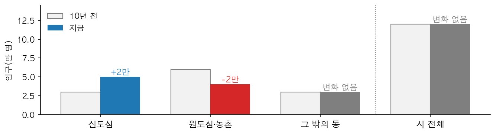
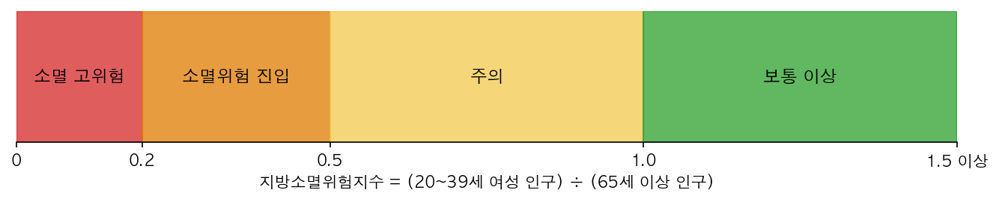
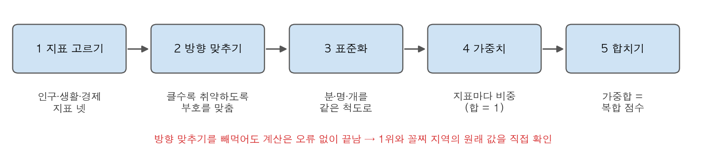
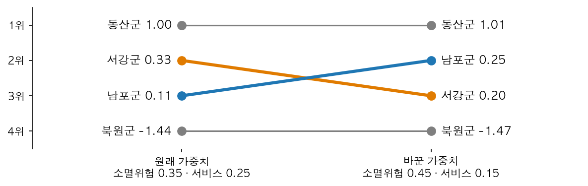
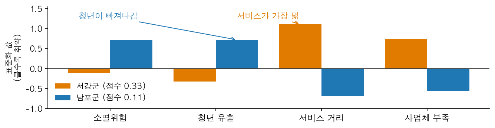
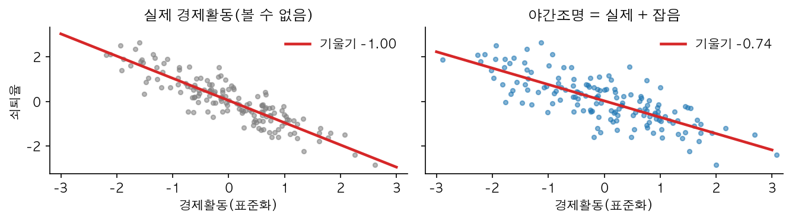
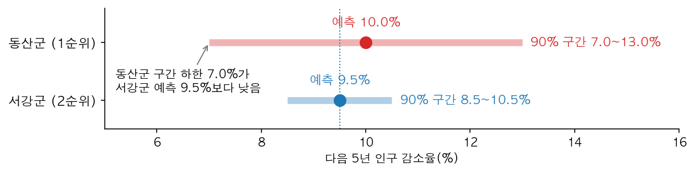
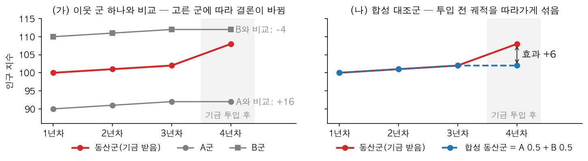
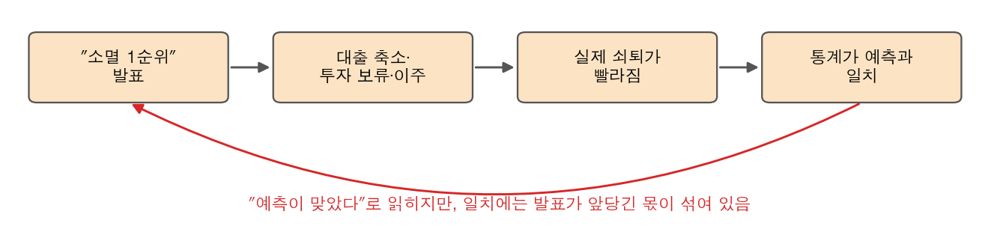
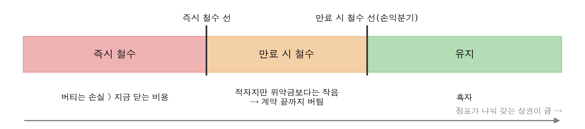

# 12장 지역 쇠퇴 진단과 자원 배분, 지표에서 배분 검증까지

> **12장 · 지역 쇠퇴와 자원 배분**
>
> 1~9절은 **가상 사례**로 설명한다. 누리도와 그 안의 네 군(동산군·서강군·남포군·북원군)은 실재하지 않으며, 1~9절의 인구·지표·예측값·금액·날짜는 설명을 위해 만든 숫자다. 1~9절의 그림은 `lecture/graphics/make_ch12_figures.py`로 그렸다.
>
> 10절 실습의 수치는 모두 `lecture_practice/chapter12/`의 코드를 실행해 얻은 값이며, 인용한 값의 출처 파일은 출력 블록 첫 줄이나 표 제목에 적었다.

□ 인구가 줄어드는 지역에 정부가 돈을 나눠 준다고 가정. 돈은 한정되어 있어 "어느 지역에 먼저, 무엇을" 줄지 정해야 함  
  ○ 지표 하나로 순위를 매기면 문제가 셋 생김. 순위를 매기는 방법을 조금 바꾸면 순서가 바뀌고, 예측은 틀릴 수 있고, 발표하는 순간 지역의 앞날이 바뀌기도 함  

## 1. 오늘의 질문

□ 시 전체 인구가 그대로인데 동네 절반이 비어 가고 있다면, 무엇으로 알아차릴까?  
□ 지표 네 개를 합쳐 지역의 순위를 매겼다. 가중치를 조금 바꿔도 그 순위는 그대로일까?  
□ 기금을 받은 군이 하나뿐일 때, 그 군이 정말 나아졌는지는 무엇과 비교해서 알까?  
□ 같은 군에서 정부는 지원을 늘리는데 편의점 본사는 점포를 닫으려 한다. 적자 점포는 왜 바로 닫지 않을까?  

## 2. 사례 — 누리도의 지방소멸대응기금 배분

□ 누리도는 인구가 줄어드는 군이 많은 가상의 도임  
  ○ 정부가 인구감소지역에 나눠 주는 **지방소멸대응기금**(2022년부터 10년간 매년 1조 원 규모로 배분하는 실제 제도)을 받아, 도 담당자가 군별 배분안을 만들어야 함  
  ○ 이 장은 담당자가 3월부터 이듬해 11월까지 겪는 문제 아홉 개를 순서대로 따라감  

| 문제 | 시기 | 무슨 일이 있었나 | 해결에 쓴 방법 | 절 |
|---|---|---|---|---|
| 1 | 3월 | 시 인구는 10년째 그대로인데 원도심이 비어 감 | 진단 단위를 읍면동으로 내림 | 3 |
| 2 | 4월 | 소멸위험지수로 순위를 매기니 절반 넘게 같은 등급에 몰림 | 지표 넷을 합친 복합 지수 | 4 |
| 3 | 4월 | 가중치를 조금 바꾸니 2위와 3위가 바뀜 | 가중치 민감도 검사 | 4 |
| 4 | 5월 | 점수가 비슷한 두 군에 같은 지원 묶음을 주려 함 | 유형화 | 5 |
| 5 | 6월 | 통계가 늦어 야간조명으로 대신했더니 관계가 약하게 나옴 | 측정오차 보정 | 6 |
| 6 | 7월 | 1순위로 예측된 군의 예측이 가장 불확실함 | 예측구간 | 6 |
| 7 | 이듬해 9월 | 기금을 한 군에 집중했는데, 비교할 군을 고르는 대로 결론이 바뀜 | 합성통제법 | 7 |
| 8 | 이듬해 10월 | "소멸 1순위" 보도 뒤 대출과 투자가 줄어듦 | 공표 원칙 | 8 |
| 9 | 이듬해 11월 | 같은 군에서 편의점 본사가 적자 점포를 바로 닫지 않음 | 두 철수 선 | 9 |

**표 12.1** 누리도 배분 담당자가 겪은 아홉 문제

□ 문제 1~6은 배분 **전**에 순위와 예측을 만드는 단계, 문제 7~8은 배분 **후**에 효과를 평가하고 발표하는 단계, 문제 9는 같은 지역을 기업 쪽에서 본 문제임  

## 3. 진단 — 어디서, 어떤 인구를 셀 것인가

### 문제 1 — 시 인구는 그대로인데 원도심이 비어 감 (3월)

□ 담당자가 도 안의 한 시를 먼저 봄. 시 인구가 10년 전에도 12만 명, 지금도 12만 명이라 "안정 지역"으로 분류됨  
□ 같은 시를 동 단위로 나누어 보니 사정이 달랐음(그림 12.1)  



**그림 12.1** 시 전체 인구는 그대로지만, 신도심이 늘어난 만큼 원도심이 줄었음

  ○ 신도심이 늘어난 2만 명이 원도심이 줄어든 2만 명을 덮어서 시 전체로는 변화가 0이 됨  
  ○ 같은 자료라도 묶는 단위를 바꾸면 결론이 달라지는 현상을 **가변적 공간단위 문제**(MAUP)라고 부름(4장)  
□ 그래서 돈을 받는 자격은 시군구 단위로 정해지더라도, 쇠퇴는 한 단계 아래인 읍면동에서 계산함  
□ 어떤 인구를 셀지도 정해야 함  
  ○ **주민등록인구**는 주소를 둔 사람 수이고, **생활인구**는 여기에 통근·통학·관광으로 머무는 사람을 더한 값임(「인구감소지역 지원 특별법」, 2023년 시행)  
  ○ 주소를 둔 사람은 줄었는데 머무는 사람은 그대로인 군에는 주거 지원보다 관광·체류 쪽 사업이 맞음. 그래서 두 인구로 순위를 각각 내고 차이가 큰 군을 따로 표시함  

## 4. 순위 매기기 — 복합 지수와 가중치

### 문제 2 — 절반 넘게 같은 등급에 몰림 (4월)

□ 담당자는 먼저 널리 쓰이는 **지방소멸위험지수**로 군의 순위를 매김. 20~39세 여성 인구를 65세 이상 인구로 나눈 값이며, 작을수록 위험함(이상호, 2015)  



**그림 12.2** 지방소멸위험지수의 등급 구간

□ 계산해 보니 누리도 군의 절반 이상이 '주의' 한 등급에 몰림  
  ○ 같은 등급 안에서는 누가 먼저인지 이 지수로 정할 수 없음  
  ○ 이 지수는 인구 구성만 셈. 병원까지 얼마나 먼지, 일자리가 있는지는 들어 있지 않음  
□ 그래서 담당자는 성격이 다른 지표 넷 — 소멸위험지수, 청년 순이동률, 생활서비스까지 이동시간, 사업체 밀도 — 을 점수 하나로 합침. 이것을 **복합 지수**라고 부름  



**그림 12.3** 복합 지수를 만드는 다섯 단계

□ 누리도는 가중치를 소멸위험 0.35, 청년유출 0.20, 서비스 이동시간 0.25, 사업체 0.20으로 정함. 네 군에 적용한 결과는 다음과 같음  

| 군 | 소멸위험지수 | 청년 순이동률(%) | 서비스 이동시간(분) | 사업체 밀도 | 복합 점수(클수록 취약) | 순위 |
|:--:|:--:|:--:|:--:|:--:|:--:|:--:|
| 동산군 | 0.42 | −2.8 | 38 | 22 | 1.00 | 1 |
| 서강군 | 0.75 | −0.5 | 41 | 30 | 0.33 | 2 |
| 남포군 | 0.50 | −2.2 | 22 | 55 | 0.11 | 3 |
| 북원군 | 1.20 | 1.4 | 16 | 70 | −1.44 | 4 |

**표 12.2** 네 군의 지표와 복합 점수

### 문제 3 — 가중치를 바꾸니 2위와 3위가 바뀜 (4월)

□ 도의회에서 "인구가 가장 중요하니 소멸위험 가중치를 올리라"는 요구가 나옴. 담당자가 소멸위험을 0.45로 올리고 서비스 이동시간을 0.15로 내려 다시 계산함  



**그림 12.4** 가중치를 바꾸자 2위와 3위가 자리를 바꿈

  ○ 서강군은 서비스가 멀고, 남포군은 인구 구조가 나쁨. 그래서 어느 쪽에 가중치를 더 주느냐에 따라 순서가 바뀜  
  ○ 동산군과 북원군은 다른 군과 점수 차이가 커서 자리가 그대로임  
□ 즉 2위와 3위의 순서는 자료가 아니라 **가중치를 고른 사람이 정한 것**임  
□ 그래서 순위를 배분 근거로 쓰려면 **가중치 민감도 검사**를 함께 보고함  
  ○ 각 가중치를 ±30% 범위에서 바꿔 가며 순위를 다시 계산하고, 상위 지역 목록이 얼마나 유지되는지 셈  
  ○ "상위 목록이 이만큼 유지되면 순위를 쓴다"는 기준은 **결과를 보기 전에** 적어 둠. 결과를 본 뒤에 정한 기준은 결과를 정당화하는 해석이 됨  

## 5. 무엇을 줄까 — 유형화

### 문제 4 — 점수가 비슷한 두 군에 같은 지원 묶음 (5월)

□ 담당자가 2위와 3위인 서강군과 남포군에 같은 지원 묶음을 배정하려 함. 그런데 두 군의 지표를 나란히 놓으면 부족한 것이 다름(그림 12.5)  



**그림 12.5** 서강군과 남포군의 표준화한 지표(0보다 클수록 네 군 평균보다 취약)

  ○ 서강군은 병원·보육 거점과 교통이, 남포군은 일자리와 주거가 먼저 필요함  
□ 복합 점수는 "**누구를 먼저**"에 답하고, 부족한 것이 비슷한 지역끼리 묶는 **유형화**는 "**무엇을**"에 답함  
□ 유형화에는 보통 **KMeans**를 씀. 지역마다 지표 값을 좌표로 보고, 서로 가까운 지역끼리 정해진 개수(k)의 묶음으로 나눔  
□ 묶음이 만들어졌다고 해서 그 유형이 실제로 있는 것은 아님. 세 가지를 확인함  

| 확인 | 방법 | 이런 결과면 유형을 쓰지 않음 |
|---|---|---|
| 잘 나뉘었나 | **실루엣 계수**(같은 묶음 안의 거리와 다른 묶음까지의 거리를 비교한 값, 1에 가까울수록 잘 나뉨) | 0에 가까움 |
| 다시 해도 같은가 | 시작값을 바꿔 다시 묶고 두 결과를 비교 | 할 때마다 다른 묶음이 나옴 |
| 규모 순서와 같은가 | 점포 수 같은 지표 하나를 크기순으로 자른 묶음과 비교 | 거의 같음 — 유형이 아니라 "규모 구간"임 |

**표 12.3** 유형이 실제로 있는지 확인하는 세 가지

## 6. 앞으로 — 예측과 불확실성

### 문제 5 — 야간조명으로 대신했더니 관계가 약하게 나옴 (6월)

□ 담당자는 앞으로 어느 군이 더 쇠퇴할지도 알고 싶음. 그런데 사업체 통계는 조사·집계에 시간이 걸려 2년 전 값이 최신임  
□ 대신 **위성 야간조명**을 씀. 공장이 돌고 간판이 켜지면 밤에 불빛이 밝아지므로, 위성이 찍은 밝기는 경제활동의 흔적임(Henderson 외, 2012)  
□ 그런데 야간조명에는 구름, 관측 각도, 가로등 교체 같은 **잡음**이 섞여 있음. 잡음은 값을 흔들기만 하고 쇠퇴와는 관계가 없으므로, 잡음이 섞인 만큼 관계(기울기)가 눕게 됨(그림 12.6). 이것을 **측정오차 편의**라고 부름  



**그림 12.6** 같은 지역들을 실제 경제활동(왼쪽)과 야간조명(오른쪽)으로 그린 것. 잡음 때문에 기울기가 −1.00에서 −0.74로 누움(설명용 난수로 그린 그림)

  ○ 야간조명과 실제 경제활동의 상관을 알면, 눕은 기울기를 그 상관으로 나눠 되돌릴 수 있음  
  ○ 다만 잡음이 지역 특성과 무관할 때만 맞음. 산간 군에서만 구름이 잦다면 보정하지 않고 다른 지표를 함께 씀  

### 문제 6 — 1순위 군의 예측이 가장 불확실함 (7월)

□ 담당자가 다음 5년 인구 감소율을 예측함. 동산군 10.0%로 1위, 서강군 9.5%로 2위임  
□ 그런데 "90% 확률로 실제 값이 들어갈 범위"(**예측구간**)를 함께 그려 보니 동산군의 범위가 훨씬 넓음(그림 12.7)  



**그림 12.7** 점예측(점)과 90% 예측구간(막대)

  ○ 동산군 범위의 아래쪽 끝이 서강군의 예측보다 낮음. 실제로는 서강군이 더 많이 줄 수도 있음  
□ 이때 할 일은 동산군의 순위를 내리는 것이 아님. **돈을 확정하기 전에 현장 조사와 추가 자료로 불확실성을 줄이는 것**임  
□ 그래서 누리도의 최종 우선순위표에는 순위 옆에 "예측을 얼마나 믿을 수 있나(신뢰등급)"와 "가중치를 바꾸면 순위가 얼마나 움직이나"를 함께 적음  

| 순위 | 신뢰등급 | 가중치에 따른 순위 변화 | 할 일 |
|---|---|---|---|
| 상위 | 높음 | 작음 | 배분 대상으로 확정 |
| 상위 | 낮음 | 작음 | 현장 확인 뒤 확정 |
| 상위 | 상관없음 | 큼 | 순위 대신 유형별 배분 |
| 하위 | 높음 | 작음 | 정기 감시 |

**표 12.4** 순위·신뢰등급·순위 변화에 따른 할 일

## 7. 효과 평가 — 합성통제법

### 문제 7 — 비교할 군을 고르는 대로 결론이 바뀜 (이듬해 9월)

□ 누리도는 기금을 동산군 한 곳에 집중 투입함. 1년 뒤 도의회가 "효과가 있었느냐"고 물음  
  ○ 효과를 알려면 **기금이 없었다면 동산군이 어땠을지**와 비교해야 함  
□ 담당자가 이웃 군 하나와 비교해 보니, A군과 비교하면 효과가 크고 B군과 비교하면 오히려 나빠진 것으로 나옴(그림 12.8 왼쪽). 결론이 **어느 군을 골랐는가**로 정해진 것임  



**그림 12.8** 이웃 군 하나와 비교(왼쪽)와 합성 대조군과 비교(오른쪽)

□ **합성통제법**(SCM)은 비교 대상을 사람이 고르지 않고, 기금을 받지 않은 군들을 섞어 "가상의 동산군"을 만듦(Abadie 외, 2010)  
  ○ 섞는 비율은 **투입 전 동산군의 궤적을 가장 잘 따라가도록** 정함. 그림 12.8 오른쪽에서는 A군과 B군을 반씩 섞자 투입 전 3년이 동산군과 겹침  
  ○ 투입 후 실제 동산군과 가상의 동산군의 차이를 효과로 읽음  
  ○ 섞는 비율은 모두 0 이상이고 합이 1이어야 함. 그래야 가상의 동산군이 실제로 관측된 군들의 범위 안에 놓임  
□ 결과를 믿으려면 두 가지를 확인함  
  ○ **투입 전 적합**: 투입 전부터 어긋났다면 투입 후의 차이를 효과로 읽을 수 없음  
  ○ **가짜 처치 비교**(placebo): 기금을 받지 않은 군 하나하나를 "받은 척" 놓고 같은 계산을 반복함. 동산군의 차이가 이 가짜 차이들보다 뚜렷하게 커야 효과로 읽음  
□ 이렇게 얻은 효과는 **동산군 한 곳**의 것임. 다른 군에 같은 돈을 넣어도 같은 효과가 난다는 뜻은 아님  

## 8. 공표 — 이름을 붙이면 결과가 바뀐다

### 문제 8 — "소멸 1순위" 보도 뒤 (이듬해 10월)

□ 누리도의 우선순위표가 언론에 나가 "동산군, 도내 소멸 1순위"로 보도됨. 그 뒤 은행은 대출을 줄이고, 기업은 투자를 미루고, 이사를 고민하던 가구는 결정을 앞당김  



**그림 12.9** 발표가 쇠퇴를 앞당기는 순환

□ 처음에는 틀렸던 예측이 발표된 뒤 사람들의 행동을 바꾸어 실제가 되는 현상을 **자기실현적 예언**이라고 부름(Merton, 1948)  
  ○ 11장의 예측적 치안에서는 예측이 **기록**을 왜곡했으므로 자료를 보정할 수 있었음. 이 장에서는 기록은 정확하고 **세상이 바뀌었으므로** 보정할 대상이 없음. 그래서 대응은 발표 단계에 놓임  

| 원칙 | 할 일 |
|---|---|
| 내부용과 공개용 분리 | 군별 점수·순위는 내부 배분에만 쓰고 그대로 공개하지 않음 |
| 이름 바꾸기 | "소멸 예정지" 대신 "우선지원 지역"처럼 지원을 담은 이름을 씀 |
| 지원과 함께 발표 | 순위만 따로 내보내지 않고, 확정된 지원 내용과 함께 발표함 |
| 포기 근거로 쓰지 않기 | 하위 군을 지원에서 빼는 근거로 쓰지 않음 |

**표 12.5** 공표 원칙

□ 성과지표에도 비슷한 일이 생김. 성과를 "전입자 수"로 측정하자 일부 군이 주소 이전 캠페인으로 **전입 신고만** 늘림  
  ○ 그래서 서류로 세는 지표(전입 신고)와 행동으로 세는 지표(생활인구 체류시간, 야간조명)를 함께 보고, 둘이 어긋나면 감사함  

## 9. 같은 군에서 기업은 점포를 닫는다

### 문제 9 — 적자 점포를 바로 닫지 않음 (이듬해 11월)

□ 같은 시기, 한 편의점 본사가 누리도 안의 적자 점포를 정리하기로 함  
  ○ 정부는 "어디가 가장 어려운가"를, 기업은 "어느 점포가 손해인가"를 물으므로 같은 군을 두고 반대 방향으로 결정함  
□ 본사가 따지는 것은 **지금 닫는 비용과 계약 끝까지 버티는 손실 중 어느 쪽이 큰가**임  
  ○ 계약 중간에 닫으면 위약금과 원상복구비(가게를 처음 상태로 되돌리는 공사비)를 내야 함  
  ○ 적자가 작은 점포는 남은 계약 기간의 손실을 다 더해도 이 비용보다 작음. 그런 점포는 적자여도 계약이 끝날 때까지 버티는 편이 나음  
□ 그래서 판정선이 두 개 생기고, 그 사이에 "**적자인데 아직 문을 닫지 않은 점포**"의 구간이 생김(그림 12.10). 되돌릴 수 없는 비용이 이 간격을 만듦(Dixit, 1989)  



**그림 12.10** 두 철수 선과 세 구간

□ 공표 원칙은 기업에도 해당함. "이 지역 점포는 정리 대상"이라는 내부 판단이 밖으로 알려지면 가맹 희망자·임대인·주민의 기대가 함께 움직임  

## 10. 실습 — 네 실행으로 같은 문제를 확인한다

□ 1~9절의 방법을 실제 코드로 실행함. 실습 A~C는 교육용 시뮬레이션 자료를, 실습 D는 실제 공공데이터를 씀  

| 실습 | 실행 파일 | 확인할 문제 |
|---|---|---|
| 준비 | `12-0-simdata-prep.py` | A~C가 쓸 시뮬레이션 자료를 만듦 |
| A | `12-1-decline-vulnerability-typology.py` | 문제 2·4 — 등급 쏠림, 복합 지수, 유형 |
| B | `12-2-nightlight-economic-decline.py` | 문제 5·6 — 야간조명, 예측구간 |
| C | `12-3-synthetic-control.py` | 문제 7 — 합성통제법 |
| D | `12-0b-trade-area-data-prep.py` → `12-4-trade-area-exit-decision.py` | 문제 4·9 — 실데이터 상권 유형과 편의점 철수 |

**표 12.6** 실습 파일과 확인할 문제

□ 실행하기 전에 아래 예측표를 먼저 채움. 출력을 먼저 보면 거기 적힌 값이 정답으로 보여 "왜 이 값인가"를 묻지 않게 됨  

| 예측할 것 | 내 예측 | 실제 |
|---|---|---|
| 300개 지역 중 '주의' 등급이 절반을 넘는가 | | |
| 야간조명으로 바꾸면 기울기가 몇 % 작아지는가(5% 미만 / 5~20% / 20% 이상) | | |
| 합성통제법이 추정한 첫해 효과의 부호가 참 효과와 같은가 | | |
| 편의점 중 "적자인데 만료까지 버티는" 비율은(10% 미만 / 10~30% / 30% 이상) | | |

**표 12.7** 예측표 — 실행하기 **전에** 채운다

```bash
cd geoai_public   # 저장소 루트 — 아래 명령은 모두 여기서 실행함
pip install -r lecture_practice/requirements-student.txt
python lecture_practice/chapter12/code/12-0-simdata-prep.py
python lecture_practice/chapter12/code/12-1-decline-vulnerability-typology.py
python lecture_practice/chapter12/code/12-2-nightlight-economic-decline.py
python lecture_practice/chapter12/code/12-3-synthetic-control.py
```

□ GPU는 필요 없음. 첫 명령(`12-0`)을 건너뛰면 다음 명령들이 `데이터가 없습니다`를 찍고 멈춤  

### 실습 A — 등급 쏠림과 복합 지수 (문제 2·4)

```text
# 출처: lecture_practice/chapter12/results/12-1-decline-vulnerability-typology.log (발췌)
  주의      : 169개 (56.3%)
...
        n  소멸위험지수  청년순이동  서비스접근분  사업체밀도   취약성
type
1      41    0.44  -2.66   37.26  24.84  1.23
3      89    0.57  -1.36   31.26  39.62  0.59
2     112    0.83   0.02   23.25  54.40 -0.24
0      58    1.32   1.53   15.42  68.16 -1.29
...
 region_id  decline_risk_index risk_grade  youth_netmove  service_access  biz_density  type  vulnerability  vuln_rank
       298                0.28       위험진입          -1.78           46.69         8.77     1           1.75          1
       281                0.22       위험진입          -2.09           43.44        19.43     1           1.61          3
```

| 출력 | 읽을 것 |
|---|---|
| 등급 | 300곳 중 169곳(56.3%)이 '주의' 한 등급에 몰림 — 문제 2와 같은 상황임 |
| 우선지원 상위 | 1위 지역 298은 소멸위험지수(0.28)가 3위 지역 281(0.22)보다 나은데도 앞섬. 서비스까지 더 멀고(46.69분) 사업체가 더 적기(8.77) 때문임 — 복합 점수의 순서는 등급 순서와 다름 |
| 유형 | 네 유형이 네 지표 모두에서 같은 순서로 늘어섬. 표 12.3의 세 번째 확인(규모 순서와 같은가)이 필요한 모양임 |

**표 12.8** 실습 A 출력에서 읽을 것

### 실습 B — 야간조명과 예측구간 (문제 5·6)

```text
# 출처: lecture_practice/chapter12/results/12-2-nightlight-economic-decline.log (발췌)
  상관 r = 0.872 (공유분산 r² = 0.760)
...
  쇠퇴~진짜경제 표준화계수(오라클)   = -0.962
  쇠퇴~야간조명 표준화계수(관측)     = -0.838  (attenuation 12.9% 0쪽 수축)
  attenuation 보정 후(÷ r)            = -0.961  (진짜계수 복원)
...
 region_id  pred_decline  priority_rank  pi_half  pi_low  pi_high confidence
       246        10.428              1    3.180   7.248   13.609         낮음
       204         9.600              2    0.948   8.652   10.548         높음
```

| 출력 | 읽을 것 |
|---|---|
| 기울기 | 실제 경제활동으로는 −0.962, 야간조명으로는 −0.838로 12.9% 누움(그림 12.6과 같은 현상). 상관 0.872로 나누면 −0.961로 되돌아옴 |
| 1·2순위 | 1순위 지역 246은 구간 아래쪽 끝(7.248)이 2순위 지역 204의 예측(9.600)보다 낮고 신뢰등급이 '낮음'임 — 문제 6의 동산군과 같은 상황임 |

**표 12.9** 실습 B 출력에서 읽을 것

### 실습 C — 합성통제법 (문제 7)

□ 이 시뮬레이션은 참 효과를 미리 심어 두었으므로(사후 평균 4.40), 합성통제법이 그 값을 되찾는지 채점할 수 있음  

```text
# 출처: lecture_practice/chapter12/results/12-3-synthetic-control.log (발췌)
  사전기간(1~20년) RMSPE = 1.090 지수  (관측 잡음 SD 1.3 수준)
...
    21 |   101.14 |   101.63 |      -0.49 |     0.80
...
  사후 평균 격차(SCM 추정) = 3.95 지수  (참 사후 평균 4.40)
...
  전체 31개 단위 중 처치 지자체 비율 순위 = 1위 → 유사 p값 = 0.032
```

| 출력 | 읽을 것 |
|---|---|
| 투입 전 적합 | 투입 전 20년 동안의 평균 차이(RMSPE) 1.090이 자료의 잡음 크기(1.3)보다 작음 → 투입 전 궤적을 잘 따라감 |
| 첫해 | 21년차 효과가 −0.49로 참 효과(+0.80)와 방향이 반대임 — 한 해만 보고 판단하면 안 됨 |
| 사후 평균 | 10년 평균 3.95로 참값 4.40에 가까움 |
| 가짜 처치 | 31개 군 중 처치 군의 차이가 1위 → 유사 p값 1/31 = 0.032 |

**표 12.10** 실습 C 출력에서 읽을 것


**그림 12.11** 실습 C — 처치 지역의 실제·합성 궤적(왼쪽)과 가짜 처치 군들의 격차(오른쪽)

### 실습 D — 실데이터 상권 유형과 편의점 철수 (문제 4·9)

□ 소상공인시장진흥공단 상가(상권)정보 2026년 6월 스냅숏을 씀. 포털이 자동 내려받기를 막으므로, 시도별 CSV 16개를 직접 내려받아 `lecture_practice/chapter12/data/raw/`에 둔 뒤 실행함(`lecture_practice/chapter12/README.md` 참조)  

```bash
python lecture_practice/chapter12/code/12-0b-trade-area-data-prep.py
python lecture_practice/chapter12/code/12-4-trade-area-exit-decision.py
```

□ 분석 대상은 인구감소지역 89곳과 비지정 군의 읍면동 1,151개, 그 안의 편의점 6,818개임  
  ○ 자료에 매출이 없으므로 점포의 수익은 **상권 배분 지수** s = (읍면동 전체 점포 수) ÷ (읍면동 편의점 수)로 대신함. 편의점 하나가 나눠 갖는 상권이 클수록 s가 큼  

| 확인 | 값 | 읽을 것 |
|---|---|---|
| 유형 수 | 실루엣 최대 k = 3(0.212) | 높지 않은 값 — 뚜렷한 덩어리보다 이어진 분포를 셋으로 자른 것에 가까움 |
| 규모 순서와 같은가 | 점포 수 순서 묶음과 일치도 0.320 | 규모와 같지 않음 → 유형으로 볼 수 있음 |
| 편의점 없는 읍면동 | 유형0 44.5% / 유형2 20.2% / 유형1 0.3% | 유형에 따라 생활서비스 공백이 크게 다름 |
| 철수 판정 | 즉시 35.7% / 만료 시 26.4% / 유지 37.9% | 두 철수 선 사이 1,799개(26.4%)가 "적자인데 버티는" 점포임 |

**표 12.11** 실습 D 출력에서 읽을 것(출처: `12-4-trade-area-exit-decision.log` [1]·[2]·[4])

□ 이 실습에서 가장 중요한 출력은 [5]임  
  ○ 즉시 철수 비율이 인구감소지역 32.5%, 비지정 군 45.3%로 나옴. 생활서비스 공백은 인구감소지역이 더 큰데 철수 판정은 반대 방향임  
  ○ 원인은 s를 만든 방법에 있음. 대도시 근처의 주거형 군은 편의점이 촘촘하지만 상가는 적어 s가 낮게 나오고, 모형은 이것을 "상권이 약하다"로 잘못 읽음(s와 편의점 비중의 상관 −0.768)  
  ○ 그래서 이 모형은 **같은 성격의 지역 안에서 어느 점포가 먼저인지**를 정하는 데만 씀. 이 잘못을 찾아낸 것은 더 복잡한 모형이 아니라, 결과를 다른 자료와 맞대어 본 확인이었음  


**그림 12.12** 실습 D — 읍면동 상권 유형(왼쪽)과 인구감소지역 편의점 철수 판정(오른쪽). 읍면동은 점포 좌표의 중앙값 점으로 표시함

## 11. 핵심 요약

□ **1. 진단은 한 단계 아래에서 한다.** 시 전체가 그대로여도 원도심은 줄 수 있음  
□ **2. 순위에는 가중치를 고른 사람의 선택이 들어 있다.** 민감도 검사와 판정 기준을 함께 보고함  
□ **3. 점수는 "누구 먼저", 유형은 "무엇을"에 답한다.** 단, 묶음이 규모 순서와 같다면 유형이 아님  
□ **4. 예측은 값과 범위를 함께 본다.** 대리 지표는 관계를 약하게 만들고(실습 12.9%), 1순위가 가장 불확실할 수 있음  
□ **5. 비교 대상은 고르지 않고 만든다.** 합성통제법은 투입 전 궤적을 따라가는 가상의 지역과 비교함(실습 3.95 대 참값 4.40)  
□ **6. 발표가 결과를 바꾼다.** 순위는 내부용과 공개용을 나누고, 지원 내용과 함께 발표함  
□ **7. 적자여도 버티는 편이 나은 구간이 있다.** 되돌릴 수 없는 철수 비용이 두 철수 선 사이의 간격을 만듦(실습 26.4%)  

## 12. 과제

```bash
python scripts/submit.py 12 --id 학번 --name 이름
```

□ 실행하면 `submissions/` 폴더에 `제출_12장_학번.md`가 생성되고 `12-4-trade-area-exit-decision.py`의 실행 결과가 붙어 있음  
  ○ **눈여겨볼 곳은 상권 유형별 단위 경제와 철수 판정이 갈리는 경계**  

○ 빈칸 세 개를 채움  

1. 눈에 띈 숫자 하나를 그대로 옮겨 적고, 왜 눈에 띄었는지 한 문장으로
2. 그 숫자가 왜 그렇게 나왔는가 — 즉시 철수와 만료 시 철수 사이의 구간이라면 되돌릴 수 없는 비용으로 설명하라
3. **철수로 판정된 지역 하나를 골라라. 그 판정을 뒤집으려면 어떤 값이 얼마나 달라져야 하는가?**

○ **3번이 이 과제의 핵심.** 1·2번은 표를 읽으면 나오지만 3번은 자기 실행 결과를 다시 열어 판단해야 함  

> - **막혀도 제출함.** 실행이 실패하면 오류 메시지가 파일에 담기고, 질문이 "어디서 막혔나"로 바뀜. 실행 성공 여부로 점수를 매기지 않음
> - **이 장의 상권 실습은 실데이터를 씀.** 학번 시드가 바꾸는 것은 표본 추출·초기값 같은 확률적 절차이며, 값이 조금 달라도 판정의 구조(즉시/만료/유지 세 구간, 대조군의 방향)는 같아야 정상

## 13. 더 알아보기

□ 이 장에서 줄인 내용은 아래에서 이어 볼 수 있음  
  ○ **합성통제법 가중치는 하나로 정해지지 않음** — 투입 전 궤적을 똑같이 따라가는 조합이 여럿일 수 있으므로, 가중치를 "이 군이 비교 대상으로 뽑혔다"로 읽지 않음(Abadie, 2021). `12-3-synthetic-control.log`의 [1]  
  ○ **철수 판정의 대조 실험과 민감도** — `12-4-trade-area-exit-decision.log`의 [6]·[7]. 가정값 6개를 ±30% 바꿔도 "어느 점포를 먼저 닫는가"는 거의 그대로임(판정 집합 일치도 최소 0.893)  
  ○ 접근성 계산은 10장, 공간 블록 교차검증과 예측구간 계산은 11장  
