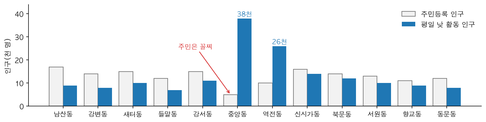
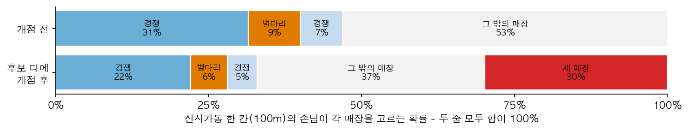
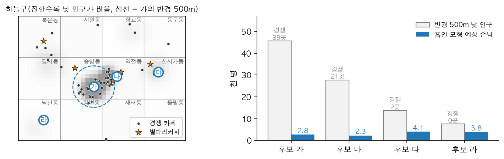
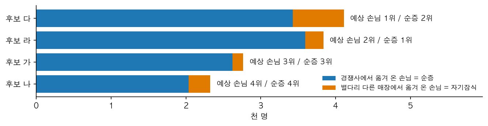
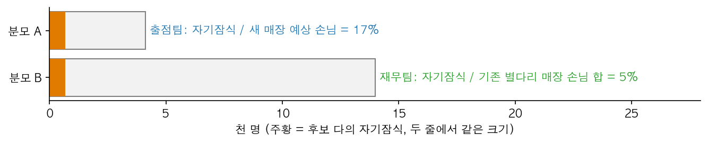
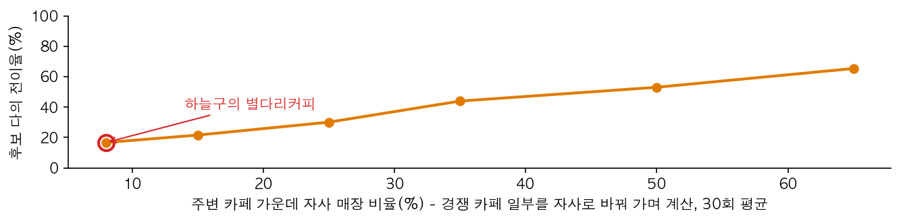
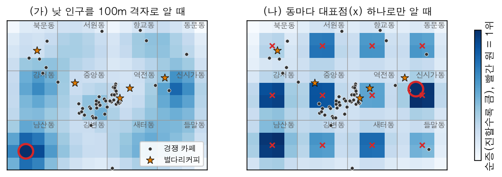
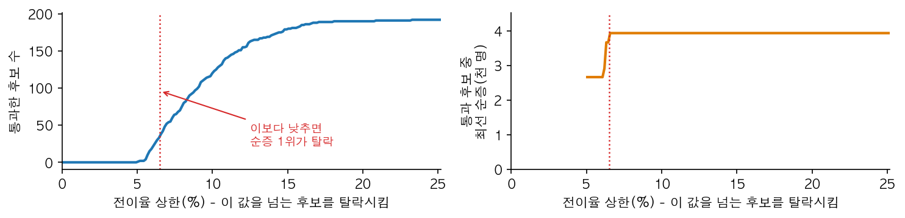
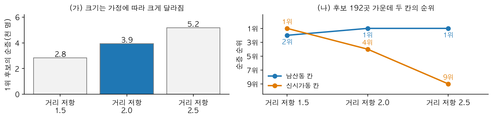
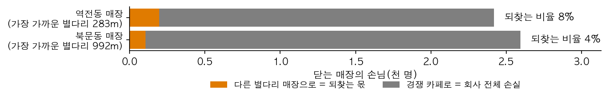

# 13장 입지 분석, 수요에서 자기잠식과 선택까지

> **13장 · 입지 분석과 자기잠식**
>
> 1~8절은 **가상 사례**로 설명한다. 하람시 하늘구와 카페 브랜드 별다리커피는 실재하지 않으며, 1~8절의 인구·매장 위치·날짜는 설명을 위해 만든 숫자다. 예상 손님·전이율·순증 같은 계산값은 그 숫자를 `lecture/graphics/make_ch13_figures.py`에 넣어 계산한 값이고, 1~8절의 그림도 이 파일로 그렸다.
>
> 9절 실습의 수치는 모두 `lecture_practice/chapter13/`의 코드를 실행해 얻은 값이며, 인용한 값의 출처 파일은 출력 블록 첫 줄이나 표 제목에 적었다.

□ 카페 본사가 "이 구에 매장을 하나 더 낸다"고 정했다고 가정함. 이때 답할 질문은 "어디가 좋아 보이는가"가 아니라 "**어디에 열어야 회사 전체 손님이 가장 많이 늘어나는가**"임  
  ○ 새 매장이 끌어온 손님 가운데 일부는 원래 우리 브랜드의 다른 매장에 가던 손님임. 이 몫을 빼지 않으면 회사 전체로는 늘지 않은 손님을 늘었다고 셈  
  ○ 임대차 계약은 보통 몇 년 단위로 묶이므로, 자리를 잘못 고르면 그 손해가 계약 기간 내내 쌓임  
□ 이 장의 순서  
  ○ 1~8절: 별다리커피 출점 담당자가 겪는 문제를 차례로 보면서 각 단계의 방법을 설명함  
  ○ 9절: 같은 방법을 서울 강남구 실데이터로 실행하고, 출력에서 같은 현상을 확인함  

## 1. 오늘의 질문

□ 사는 사람이 가장 적은 동에 점심마다 줄이 서는 이유는 무엇일까?  
□ 반경 500m 안에 사람이 가장 많은 자리가 손님도 가장 많이 받을까?  
□ 새 매장의 예상 손님이 가장 많은 자리가 회사에도 가장 좋은 자리일까?  
□ 계산에 넣은 가정을 바꾸면 1위 후보가 바뀔까? 바뀐다면 무엇을 믿을까?  

## 2. 사례 — 하늘구에 별다리커피 매장 하나 더 내기

□ 하람시 하늘구는 가로 4km, 세로 3km 크기에 행정동 12개가 있는 가상의 구임  
  ○ 구 안에 카페가 60곳 있고, 그중 별다리커피(자사)가 5곳, 경쟁 카페가 55곳임. 자사 매장 비율은 8.3%임  
  ○ 출점 담당자가 1월부터 이듬해 2월까지 겪는 문제 열 개를 순서대로 따라감  

| 문제 | 시기 | 무슨 일이 있었나 | 해결에 쓴 방법 | 절 |
|---|---|---|---|---|
| 1 | 1월 | 주민이 가장 적은 중앙동에 점심마다 줄이 섬 | 활동 인구 | 3 |
| 2 | 2월 | 반경 500m 인구 1위 후보 주변에 경쟁 카페가 39곳 | 흡인 모형 | 3 |
| 3 | 3월 | 예상 손님 1위 후보가 자사 매장 옆에 있음 | 자기잠식과 순증 | 4 |
| 4 | 3월 | 같은 후보의 자기잠식 비율을 두 팀이 다르게 보고함 | 전이율의 분모 | 4 |
| 5 | 4월 | 다른 브랜드보다 자기잠식이 작게 나옴 | 자사 점유율 | 4 |
| 6 | 5월 | 동 단위 자료로 다시 계산하니 1위 칸이 3km 넘게 옮겨 감 | 가장 거친 단위 | 5 |
| 7 | 6월 | 자기잠식 상한 30%를 걸었더니 후보가 하나도 안 걸러짐 | 제약과 포기하는 순증 | 6 |
| 8 | 6월 | 거리 저항 값을 모르는데, 바꾸면 1위가 바뀜 | 민감도 검사 | 6 |
| 9 | 7월 | 통신사가 개인 이동 궤적 자료를 팔겠다고 제안함 | 위치 자료 판정 | 7 |
| 10 | 이듬해 2월 | 실적이 나쁜 매장을 닫으면 손님이 옆 매장으로 온다는 주장 | 회수분 | 8 |

**표 13.1** 별다리커피 출점 담당자가 겪은 열 문제

□ 문제 1~2는 수요를 세는 단계, 문제 3~5는 회사 전체로 얼마나 느는지 따지는 단계, 문제 6~8은 계산 결과를 얼마나 믿을지 확인하는 단계, 문제 9~10은 자료 사용과 철수 결정임  

## 3. 수요 — 누구를, 어떻게 셀 것인가

### 문제 1 — 주민이 가장 적은 동에 점심마다 줄이 섬 (1월)

□ 담당자가 먼저 동별 주민등록 인구로 줄을 세움. 중앙동은 주민이 5천 명으로 12개 동 가운데 꼴찌임  
□ 그런데 중앙동의 경쟁 카페 앞에는 점심마다 줄이 섬. 평일 낮에 그 동에 머무는 사람을 세어 보니 사정이 달랐음(그림 13.1)  



**그림 13.1** 동별 주민등록 인구와 평일 낮 활동 인구

  ○ **정주 인구**는 그 동에 주소를 둔 사람 수이고, **활동 인구**는 특정 시간에 그 동에 실제로 있는 사람 수임  
  ○ 중앙동은 오피스 동이라 주민은 적어도 낮에는 3만 8천 명이 머묾. 점심 매출이 중심인 카페에는 이 사람들이 손님임  
□ 그래서 담당자는 **평일 낮 활동 인구**를 수요로 씀. 업종이 바뀌면 시간대도 바뀜 — 저녁 술집이면 평일 저녁, 나들이 상권이면 주말 오후를 씀  

### 문제 2 — 반경 500m 인구 1위 후보 주변에 경쟁 카페가 39곳 (2월)

□ 담당자가 후보지 네 곳(가·나·다·라)을 골라 각 후보 반경 500m 안의 낮 인구를 더함. 중앙동 오피스 한가운데의 후보 가가 압도적인 1위였음  
□ 그런데 그 원 안에는 경쟁 카페가 39곳 있음. 반경 안 인구를 더하는 방법(**원형 버퍼**)은 그 사람들이 모두 새 매장에 온다고 가정하므로, 경쟁이 심한 곳일수록 수요를 부풀림  
□ 그래서 담당자는 **흡인 모형**(Huff, 1963, 1964)으로 다시 계산함. 이 모형은 각 지점의 손님이 주변 매장 하나하나를 고를 확률을 계산함  
  ○ 손님은 가까운 매장일수록, 매력도(면적·좌석 수 등)가 큰 매장일수록 더 잘 고름. 거리가 멀어질 때 확률이 줄어드는 빠르기를 **거리 저항**(β)이라 부르고, 값이 클수록 손님이 먼 매장을 덜 감  
  ○ 한 지점에서 모든 매장을 고를 확률을 더하면 100%임. 그래서 매장이 하나 늘면 그 매장이 가져가는 만큼 **나머지 모든 매장의 확률이 함께 줄어듦**(그림 13.2)  



**그림 13.2** 신시가동 한 지점의 손님이 매장을 고르는 확률. 후보 다에 개점하면 새 매장이 30%를 가져가고, 그만큼 기존 매장의 몫이 모두 줄어듦

  ○ 경쟁을 따로 변수로 넣지 않아도, 확률을 계산할 때 "주변 매장 전체"로 나누는 단계에 경쟁이 들어 있음  
□ 각 지점의 인구에 새 매장을 고를 확률을 곱해 모두 더하면 **예상 손님**이 나옴. 네 후보에 적용한 결과는 그림 13.3과 같음  



**그림 13.3** 하늘구 지도(왼쪽)와 후보별 반경 500m 낮 인구 대 흡인 모형 예상 손님(오른쪽)

  ○ 반경 500m 인구로는 가 > 나 > 다 > 라 순이지만, 예상 손님으로는 다 > 라 > 가 > 나 순으로 거의 뒤집힘  
  ○ 가와 나는 사람이 많은 만큼 경쟁 카페도 많아서, 많은 사람을 많은 매장이 나눠 가짐  
## 4. 자기잠식 — 회사 전체로 얼마나 느는가

### 문제 3 — 예상 손님 1위 후보가 자사 매장 옆에 있음 (3월)

□ 예상 손님 1위는 후보 다였음. 그런데 후보 다에서 283m 떨어진 곳에 별다리커피 신시가동 매장이 이미 있음  
□ 새 매장이 받는 손님은 두 곳에서 옴  
  ○ 경쟁 카페에 가던 손님 — 회사 전체로 새로 늘어난 손님이며, 이것을 **순증**이라 부름  
  ○ 별다리커피 다른 매장에 가던 손님 — 회사 전체로는 늘지 않고 자리만 옮긴 손님이며, 이것을 **자기잠식**(cannibalization)이라 부름  
□ 계산 절차는 네 단계임  
  1. 새 매장 없이 각 지점의 확률을 계산하고, 자사 기존 매장의 손님을 기록함  
  2. 후보지에 새 매장을 넣고 다시 계산함  
  3. 자사 기존 매장에서 줄어든 손님만 더함. 경쟁 카페가 잃은 손님은 자기잠식에 넣지 않음  
  4. 순증 = 새 매장 예상 손님 − 자기잠식  



**그림 13.4** 후보별 예상 손님을 경쟁사에서 온 몫(순증)과 자사에서 온 몫(자기잠식)으로 나눈 것

  ○ 후보 다는 예상 손님은 1위지만 자사 매장 옆이라 자기잠식이 커서 순증은 2위로 내려감  
  ○ 후보 라는 주변에 자사 매장도 경쟁 카페도 없어 자기잠식이 작고, 순증 1위가 됨  
□ 그래서 후보는 **예상 손님이 아니라 순증으로 정렬함**. 예상 손님 순으로 정렬하면 자사가 이미 손님을 받고 있는 지역의 후보가 위로 올라옴  
□ 이 계산에는 한계가 하나 있음. 확률의 합이 늘 100%이므로 **지역 전체 손님 수는 고정**되어 있음  
  ○ 실제로는 카페가 늘면 그 거리를 찾는 사람 자체가 늘기도 함(시장 확대). 이 모형은 그 몫을 계산하지 못함  
  ○ 개점 후 실제로 손님이 어디서 왔는지 확인하는 방법은 14장에서 다룸  

### 문제 4 — 두 팀이 보고한 자기잠식 비율이 다름 (3월)

□ 후보 다의 자기잠식 비율을 출점팀은 17%로, 재무팀은 5%로 보고함. 둘 다 계산은 맞았음  
□ 자기잠식을 어떤 값으로 나눴는지(분모)가 달랐음(그림 13.5). 이 비율을 **전이율**이라 부름  



**그림 13.5** 같은 자기잠식(주황)을 새 매장 예상 손님으로 나눈 값(분모 A)과 기존 자사 매장 손님 합으로 나눈 값(분모 B)

| 분모 | 무엇을 묻는가 | 누가 주로 쓰나 |
|---|---|---|
| A. 새 매장 예상 손님 | 새 매장 손님 가운데 몇 %가 자사에서 왔는가 | 출점 검토 |
| B. 기존 자사 매장 손님 합 | 기존 매장들이 원래 손님의 몇 %를 잃는가 | 재무·가맹 관리 |

**표 13.2** 전이율의 두 정의

□ 이 장은 정의 A를 씀. 표나 보고서에 전이율을 적을 때는 "전이율(새 매장 손님 대비)"처럼 **분모를 열 이름에 함께 적음**. 가맹계약이나 회사 내부 기준이 다른 정의를 쓰고 있을 수 있음  

### 문제 5 — 다른 브랜드보다 자기잠식이 작게 나옴 (4월)

□ 재무팀이 "업계에서는 자기잠식이 30%를 넘는다는데, 17%는 너무 작지 않으냐"고 물음  
□ 담당자가 하늘구의 경쟁 카페 일부를 자사 매장으로 바꿔 놓고, 자사 비율을 높여 가며 후보 다의 전이율을 다시 계산함(그림 13.6)  



**그림 13.6** 주변 카페 가운데 자사 매장 비율과 후보 다의 전이율

  ○ 자사 비율이 8%일 때 전이율은 17%이고, 자사 비율이 65%면 전이율도 65%까지 오름  
  ○ 새 매장은 주변 매장 모두에서 손님을 조금씩 가져옴. 주변 매장 대부분이 경쟁 카페라면, 가져온 손님도 대부분 경쟁 카페 손님임  
□ 즉 **자사 점유율이 낮으면 자기잠식도 작게 나옴**. 매장 수가 많은 브랜드의 30%와 하늘구의 17%는 둘 다 맞는 값일 수 있음  
□ 실증 연구도 같은 방향을 보고함. Pancras, Sriram, Kumar(2012)는 한 체인의 출점 이력을 분석해 신규 매장 매출의 86.7%가 순증이고, 매장 사이 거리가 1마일 멀어질 때마다 잠식되는 매출이 28.1%씩 줄어든다고 보고함  

## 5. 해상도 — 가장 거친 단위가 답을 정한다

### 문제 6 — 동 단위 자료로 다시 계산하니 1위 칸이 3km 넘게 옮겨 감 (5월)

□ 본사가 같은 계산을 다른 구에도 쓰자고 함. 그런데 다른 구는 낮 인구가 **동 단위 합계**로만 있음  
□ 담당자가 하늘구에서 시험해 봄. 하늘구 전체에 250m 후보 칸 192개를 깔고, 낮 인구를 100m 격자로 알 때와 동마다 대표점 하나로만 알 때를 비교함(그림 13.7)  



**그림 13.7** 같은 후보 칸 192개의 순증. 낮 인구를 100m 격자로 알 때(왼쪽)와 동 대표점(x) 하나로만 알 때(오른쪽)

  ○ 오른쪽에서는 대표점 주변 칸이 모두 비슷하게 진하고, 1위 칸이 남산동에서 신시가동으로 3,250m 옮겨 감  
  ○ 후보 칸을 250m로 촘촘히 깔아도, 수요를 동 단위로만 알면 같은 동 안의 칸은 대표점까지의 거리만 다를 뿐 같은 인구를 나눠 받음  
□ 즉 수요 지점·후보지·매장 세 층위 가운데 **가장 거친 단위가 분석 전체의 해상도를 정함**  
□ 대응 방법은 두 가지임  
  ○ 동 안의 인구 분포를 반영할 보조 자료(건물 연면적 등)가 있으면 그것으로 동 인구를 나눔. 보조 자료 없이 동 인구를 격자에 똑같이 나눠 넣으면, 카페가 많은 동일수록 격자 수가 늘어 격자당 인구가 오히려 낮게 나옴  
  ○ 보조 자료가 없으면 결과를 "어느 동이 유망한가" 수준으로만 읽고, 동 안의 자리는 현장 답사로 고름  
□ 같은 자료라도 묶는 단위를 바꾸면 결론이 달라지는 현상을 **가변적 공간단위 문제**(MAUP)라고 부름(Openshaw, 1984; 4장). 후보 칸 크기를 두세 가지로 바꿔 1위 위치가 얼마나 움직이는지 함께 보고함  

## 6. 믿을 수 있는가 — 제약과 가정

### 문제 7 — 자기잠식 상한 30%를 걸었더니 하나도 안 걸러짐 (6월)

□ 가맹 본부가 "전이율이 30%를 넘는 후보는 빼라"는 규칙을 줌. 임대료 예산처럼 넘으면 다른 조건이 아무리 좋아도 안 되는 조건을 **제약**이라 부름  
□ 담당자가 192개 칸에 적용해 보니 하나도 걸러지지 않음. 하늘구 후보의 전이율은 중앙값 8.8%, 최대 23.2%였기 때문임  
□ 그래서 상한을 낮춰 가며 무엇이 남는지 봄(그림 13.8)  



**그림 13.8** 전이율 상한별 통과 후보 수(왼쪽)와 통과 후보 가운데 최선 순증(오른쪽). 점선은 순증 1위 칸의 전이율(6.5%)

  ○ 상한 10%에서는 72개 칸이 탈락하지만 순증 1위 칸(전이율 6.5%)은 남으므로 잃는 순증이 없음  
  ○ 상한 6%에서는 순증 1위 칸이 탈락하고, 남은 후보의 최선 순증이 32.3% 줄어듦  
□ 이 그림은 "상한을 몇 %로 하라"고 정해 주지 않음. **상한을 낮추는 일이 순증을 얼마나 포기하는 일인지** 보여 줄 뿐임  
  ○ 실제 상한은 자기잠식을 허용할 때의 비용(가맹점 매출 감소, 계약 분쟁)과 좋은 자리를 포기할 때의 비용(순증 손실, 경쟁사 선점)을 비교해 정함  
  ○ 그리고 상한이 정말 후보를 거르는지는 자사 점유율에 달려 있음(문제 5)  

### 문제 8 — 거리 저항 값을 모르는데, 바꾸면 1위가 바뀜 (6월)

□ 거리 저항(β)은 원래 실제 방문 자료(회원 앱 위치, 카드 결제 기록 등)로 추정함(Nakanishi & Cooper, 1974). 별다리커피에는 그런 자료가 없어 2.0을 썼음  
  ○ 매력도도 자료가 없어 모든 매장을 같은 값으로 둠  
□ 담당자가 거리 저항을 1.5, 2.0, 2.5로 바꿔 다시 계산함(그림 13.9)  



**그림 13.9** 거리 저항별 1위 후보의 순증(왼쪽)과 두 칸의 순위(오른쪽)

  ○ 1위 후보의 순증이 2,838명에서 5,182명까지 움직임. **순증의 크기는 가정이 정한 값**이므로 매출 예측처럼 쓰지 않음  
  ○ 남산동 칸은 세 값 모두에서 2위 안에 들지만, 신시가동 칸은 1위에서 9위까지 움직임  
□ 그래서 담당자는 순증의 크기 대신 **순위**를 보고하고, 가정을 바꿔도 상위에 남는 남산동 칸을 고름  
  ○ 가정을 바꿔도 1위가 그대로라면 순위를 그대로 쓸 수 있음. 바뀐다면 흔들리지 않는 후보를 고르거나, 흔들리는 후보 둘을 함께 현장 조사함  
□ 마지막으로 결과가 **인구 지도를 되풀이할 뿐인지**도 확인함(퇴화 검사). 순증과 낮 인구의 상관이 0.9처럼 높다면, 모형 없이 인구 상위 지역을 고르는 것과 같음  

## 7. 위치 자료를 써도 되는가

### 문제 9 — 통신사가 개인 이동 궤적 자료를 팔겠다고 제안함 (7월)

□ 거리 저항을 추정하려면 손님이 실제로 얼마나 걸어서 오는지 알아야 함. 통신사가 "이름을 지운 개인별 이동 궤적"을 팔겠다고 제안함  
□ 위치 자료는 **이름을 지워도 이동 궤적 자체가 사람을 특정함**. de Montjoye 외(2013)는 150만 명의 이동 자료에서 시공간 지점 네 개만 알면 95%의 사람이 한 명으로 특정된다는 것을 보였고, 해상도를 낮춰도 특정되는 비율이 그만큼 줄지는 않는다고 보고함  
□ 담당자는 네 물음으로 판정함  

| # | 물음 | "예"일 때 처리 |
|--:|---|---|
| 1 | 이 해상도에서 개인의 하루 궤적이 복원되는가 | 시간·공간 해상도를 낮춘 뒤 다시 판정 |
| 2 | 다른 자료와 결합하면 해상도가 사실상 올라가는가 | 결합하지 않거나, 결합한 자료로 1번을 다시 판정 |
| 3 | 산출물이 개인·가구 단위 처우로 내려가는가 | 산출 단위를 집계 단위로 올림 |
| 4 | 라이선스가 이 용도를 허용하는가 | 허용 범위 안으로 한정 |

**표 13.3** 위치 자료 사용 판정의 네 물음

□ 개인 궤적은 1번에서 걸림. 담당자는 개인 궤적 대신 "동별·시간대별로 집계한 방문자 수"만 사겠다고 답함  
  ○ 별다리커피의 산출물(후보 칸 순위)은 개인이 아니라 칸을 대상으로 하므로 3번은 통과함. 다만 같은 계산이 나중에 지역별 배달비 차등처럼 개인 처우로 이어지면 그때 다시 판정함  

## 8. 같은 계산의 반대 방향 — 철수

### 문제 10 — 매장을 닫으면 손님이 옆 매장으로 온다는 주장 (이듬해 2월)

□ 역전동 매장의 실적이 나빠 철수를 검토함. 영업팀은 "283m 옆에 별다리가 또 있으니, 닫아도 손님은 그쪽으로 간다"고 주장함  
□ 철수는 출점 계산을 거꾸로 돌린 것임. 매장 하나를 빼고 다시 계산하면 그 매장의 손님이 나머지 매장으로 흩어짐  
  ○ 그중 다른 자사 매장으로 가는 몫을 **회수분**이라 부르고, 회사 전체 손실 = 닫는 매장의 손님 − 회수분임  



**그림 13.10** 매장을 닫을 때 그 매장 손님이 가는 곳

  ○ 바로 옆에 자사 매장이 있는 역전동 매장도 손님의 8%만 되찾음. 나머지는 주변의 경쟁 카페로 감  
  ○ 문제 5와 같은 이유임. 자사 점유율이 낮으면 출점할 때 자기잠식이 작고, 철수할 때 회수분도 작음  
□ 회수분도 모형이 가정한 값임. 폐점 후 실제로 손님이 어디로 갔는지는 관측 자료로 확인해야 하며, 이 확인은 14장에서 다룸  
□ 자사 매장이 하나도 없는 지역에 처음 진출할 때도 계산은 같음. 자사 매장 목록이 비어 있으므로 자기잠식이 0이 되고 순증 = 예상 손님이 됨. 비교할 자사 실적이 없으므로 예상 손님의 크기는 더 조심해서 다룸  

## 9. 실습 — 강남구 카페로 같은 문제를 확인한다

□ 1~8절의 방법을 서울 강남구 실데이터로 실행함. 이 장은 시뮬레이션 자료가 아니라 국내 공개 자료를 씀  
  ○ 자사는 강남구에서 점포 수가 가장 많은 카페 브랜드(스타벅스)로 놓고, 나머지 카페를 경쟁 매장으로 놓음  

| 실습 | 실행 파일 | 확인할 문제 |
|---|---|---|
| A | `13-0-data-prep.py` | 문제 1·6 — 활동 인구와 자료 결합 |
| B | `13-1-huff-location-cannibalization.py` | 문제 2·3·5·6 — 배분, 자기잠식, 해상도 |
| C | (B와 같은 실행의 뒷부분) | 문제 7·8 — 상한, 민감도, 퇴화 검사 |

**표 13.4** 실습 파일과 확인할 문제

□ 실행하기 전에 아래 예측표를 먼저 채움. 출력을 먼저 보면 거기 적힌 값이 정답으로 보여 "왜 이 값인가"를 묻지 않게 됨  

| 예측할 것 | 내 예측 | 실제 |
|---|---|---|
| 강남구 카페 가운데 가장 큰 브랜드의 점포 비율은(5% 미만 / 5~20% / 20% 이상) | | |
| 순증 1위 후보의 전이율은(5% 미만 / 5~15% / 15% 이상) | | |
| 전이율 상한 30%가 후보를 거르는가 | | |
| 거리 저항을 1.5에서 2.5로 바꾸면 1위 후보의 위치가 바뀌는가 | | |

**표 13.5** 예측표 — 실행하기 **전에** 채운다

□ 원자료 두 개를 먼저 내려받아야 함. 이 단계는 건너뛸 수 없음  
  ○ 소상공인시장진흥공단 상가(상권)정보 서울 파일(약 300MB)과 서울 열린데이터광장 행정동 단위 생활인구 파일(약 180MB)임  
  ○ 두 포털 모두 로그인 없이 받을 수 있지만 다운로드가 자바스크립트로 처리되어 자동 내려받기 스크립트로는 못 받음. 한 번은 직접 페이지에서 눌러 받아 `lecture_practice/chapter13/data/raw/`에 둠  
  ○ 절차는 `lecture_practice/chapter13/README.md`와 `lecture_practice/chapter13/data/raw/README.md`에 있음  

```bash
cd geoai_public   # 저장소 루트 — 아래 명령은 모두 여기서 실행함
pip install -r lecture_practice/requirements-student.txt
python lecture_practice/chapter13/code/13-0-data-prep.py
python lecture_practice/chapter13/code/13-1-huff-location-cannibalization.py
```

□ GPU는 필요 없고, 인터넷은 원자료를 받을 때만 필요함. `13-1`은 `13-0`이 만든 `cafes.parquet`·`demand_dong.parquet`을 읽으므로 `13-0`을 먼저 실행함  
□ 실행 로그는 `lecture_practice/chapter13/results/`에, 후보지별 계산 결과는 `location_candidates.csv`에 남음  

### 실습 A — 자료 준비와 활동 인구 (문제 1·6)

```text
# 출처: lecture_practice/chapter13/results/13-0-data-prep.log
[1/2] 상가(상권)정보
  원본: 소상공인시장진흥공단_상가(상권)정보_서울_202606.csv (302 MB, utf-8-sig)
  강남구 '카페' 점포 2123개, 행정동 22개
  상호명 상위: {'스타벅스': np.int64(102), '투썸플레이스': np.int64(12), '매머드익스프레스': np.int64(7)}

[2/2] 생활인구(행정동)
  원본: 행정동 단위 서울 생활인구(내국인).csv (179 MB, cp949)
  행정동 424개 | 기간 20260612~20260731 | 11~15시 평균

결합 점검: 점포의 행정동코드 중 생활인구와 매칭 99.5% (2113/2123)
저장: cafes.parquet(2123행), demand_dong.parquet(424행), SOURCES.txt
```

| 출력 | 읽을 것 |
|---|---|
| 카페 수 | 강남구 한 구에 카페가 2,123개임. 점포가 가장 많은 스타벅스도 102개로 전체의 5%에 못 미침 |
| 생활인구 | 11~15시 평균을 수요로 씀 — 문제 1의 평일 낮 활동 인구와 같은 선택임 |
| 결합 점검 | 두 자료를 행정동코드로 붙인 비율이 99.5%(2,113/2,123)임. 붙지 않은 10개는 뒤 계산에서 빠짐 |
| 기준 시점 | 상가정보 2026년 6월판, 생활인구 2026-06-12~07-31. 공개 자료가 갱신되면 수치가 달라지므로 이 기준과 함께 인용함 |

**표 13.6** 실습 A 출력에서 읽을 것

### 실습 B — 배분, 자기잠식, 해상도 (문제 2·3·5·6)

```text
# 출처: lecture_practice/chapter13/results/13-1-huff-location-cannibalization.log
대상: 강남구 카페 2113개 | 자사 102개 / 경쟁 2011개 (자사 점포 점유율 4.8%)
  수요 단위: 행정동 21개 | 낮 활동 인구 합계 993,215명
  후보지: 250m 격자 540개 | 자사 최근접 거리 중앙값 301m
```

| 총배분 순위 | 자사 최근접(m) | 예상 배분(명) | 자기잠식(명) | 전이율 | 순증(명) |
|--:|--:|--:|--:|--:|--:|
| 1 | 129 | 1,228 | 80 | 6.5% | 1,148 |
| 2 | 180 | 1,221 | 80 | 6.6% | 1,141 |
| 3 | 338 | 1,214 | 80 | 6.6% | 1,134 |
| 4 | 416 | 1,213 | 80 | 6.6% | 1,134 |
| 5 | 373 | 1,208 | 79 | 6.6% | 1,129 |

**표 13.7** 후보지 상위 5곳(출처: `13-1-huff-location-cannibalization.log`의 상위 10곳 표에서 발췌, 거리 저항 2.0·매력도 상수)

| 출력 | 읽을 것 |
|---|---|
| 자사 점유율 | 2,113개 가운데 자사 102개, 점유율 4.8%. 하늘구(8.3%)보다도 낮음 |
| 전이율 | 순증 1위 후보의 전이율이 6.5%에 그침. 자사 점유율이 낮으면 자기잠식도 작다는 문제 5와 같은 결과임 |
| 순위 | 상위 10곳에서 예상 배분 순위와 순증 순위가 모두 같음. 자기잠식이 71~80명으로 좁은 범위에 있어 순위를 뒤집지 못함 — 하늘구의 후보 다처럼 순위가 바뀌려면 자기잠식의 차이가 커야 함 |
| 해상도 | 후보지는 540개인데 수요 지점은 행정동 21개뿐임. 실습 A의 22개 동 가운데 하나는 결합되지 않은 점포 10개가 몰려 있던 동이라 통째로 빠짐 — 문제 6의 오른쪽 그림과 같은 조건임 |
| 거리대 | 자사 최근접 거리~전이율 상관은 −0.333으로 "멀수록 잠식이 작다"는 방향은 맞지만, 거리대별 평균 전이율은 ~300m 4.9%, 300~500m 5.0%, 500~800m 5.3%로 오히려 올라가다 1200~2000m에서 3.7%로 내려감. 같은 동 안의 후보가 비슷한 값을 받아 거리 차이가 동 경계에 묻히기 때문임. 그래서 거리는 이격 거리 제약으로만 쓰고 순증의 대리 지표로는 쓰지 않음 |

**표 13.8** 실습 B 출력에서 읽을 것(거리대 값의 출처: `13-1-huff-location-cannibalization.log`의 거리대별 표)

### 실습 C — 상한, 민감도, 퇴화 검사 (문제 7·8)

| 전이율 상한 | 통과 후보 | 통과율 | 판정 | 대안 순증 |
|--:|--:|--:|---|---|
| 30% | 540/540 | 100.0% | 구속하지 않음 | 1,148명(최선 후보 유지) |
| 10% | 540/540 | 100.0% | 구속하지 않음 | 1,148명(최선 후보 유지) |
| 6% | 490/540 | 90.7% | 구속함 | 872명(−24.0%) |
| 5% | 312/540 | 57.8% | 구속함 | 872명(−24.0%) |
| 4% | 36/540 | 6.7% | 구속함 | 872명(−24.0%) |

**표 13.9** 자기잠식 상한의 구속력(출처: `13-1-huff-location-cannibalization.log`의 "결정 — 자기잠식 상한은 언제 구속력을 갖는가")

| 구분 | 설정 | 평균 전이율 | 최선 후보 순증 | 기준 대비 위치 이동 |
|---|---|--:|--:|--:|
| 거리 저항 β | 1.5 | 4.9% | 721명 | 0m |
| | 2.0(기준) | 4.9% | 1,148명 | 0m |
| | 2.5 | 4.9% | 1,478명 | 0m |
| 매력도 A | 상수(기준) | — | 1,148명 | 0m |
| | 집적도(50m 내 점포수) | — | 1,501명 | 0m |

**표 13.10** 가정 민감도(출처: `13-1-huff-location-cannibalization.log`의 거리 저항·매력도 민감도 표 두 개를 합침)

```text
# 출처: lecture_practice/chapter13/results/13-1-huff-location-cannibalization.log
퇴화 검사 — 결과가 '사람 많은 곳'을 되풀이하는 데 그치는가
  총배분 ~ 최근접 행정동 낮인구 상관: -0.051
  순증  ~ 최근접 행정동 낮인구 상관: -0.052
  순증  ~ 자사 최근접 거리 상관    : -0.046
```

| 출력 | 읽을 것 |
|---|---|
| 상한 | 전이율 분포가 중앙값 4.8%, 최대 6.6%이므로 30%와 10% 상한은 후보를 하나도 거르지 못함. 6%에서 처음으로 순증 1위가 탈락하고 대안의 순증이 24.0% 낮아짐 — 문제 7과 같은 모양임 |
| 크기 | 거리 저항을 1.5에서 2.5로 바꾸면 최선 후보의 순증이 721명에서 1,478명으로 두 배가 됨. 크기는 인용하지 않음 |
| 위치 | 다섯 설정 모두에서 최선 후보의 위치가 0m 이동임. 하늘구(문제 8)와 달리 강남구에서는 순위를 결정 근거로 쓸 수 있음 — 가정을 바꿔 확인하기 전에는 둘 중 어느 쪽인지 알 수 없음 |
| 퇴화 검사 | 세 상관이 모두 0에 가까움. 사람이 많은 동에는 카페도 많아 큰 수요를 많은 매장이 나눠 가지므로, 결과가 인구 지도를 되풀이하지 않음 — 문제 2에서 원형 버퍼 1위가 흡인 모형에서 밀려난 것과 같은 이유임 |

**표 13.11** 실습 C 출력에서 읽을 것

□ 이 실습에는 학습 모델이 하나도 쓰이지 않음  
  ○ 학습 모델이 필요한 조건은 셋임 — 관측되지 않은 값을 추정해야 할 때, 변수 사이 관계가 심하게 휘어 있을 때, 이웃 지역의 상태가 이 지역 결과를 만들 때  
  ○ 반경 안 인구를 더하고 거리로 확률을 계산하는 일은 답이 하나로 정해지므로, 이 실습은 세 조건 어디에도 해당하지 않음  

## 10. 핵심 요약

□ **1. 수요는 그 시간에 그곳에 있는 사람으로 센다.** 오피스 동은 주민이 적어도 낮 손님이 많음  
□ **2. 경쟁은 확률의 분모에 들어간다.** 매장이 하나 늘면 나머지 모든 매장의 몫이 함께 줄고, 원형 버퍼 1위가 흡인 모형에서 밀려날 수 있음  
□ **3. 후보는 순증으로 정렬한다.** 자사 매장 옆 후보는 예상 손님이 많아도 순증이 작을 수 있음  
□ **4. 전이율은 분모와 함께 적는다.** 같은 자기잠식도 분모에 따라 17%와 5%로 갈림  
□ **5. 자사 점유율이 낮으면 자기잠식도, 철수 시 회수분도 작다.** 실습의 강남구 점유율 4.8%에서 전이율은 6.5%였음  
□ **6. 가장 거친 단위가 해상도를 정한다.** 수요가 동 단위면 동 안의 자리는 모형이 아니라 현장 답사로 고름  
□ **7. 크기는 가정이 정하고, 순위는 가정을 바꿔 확인한다.** 실습에서 순증은 721명에서 1,478명까지 움직였지만 최선 후보는 0m 이동이었음  
□ **8. 이름을 지운 위치 자료도 사람을 특정한다.** 개인 궤적 대신 집계 자료를 씀  

## 11. 과제

```bash
python scripts/submit.py 13 --id 학번 --name 이름
```

□ 이 명령이 대신 처리하는 작업: `13-0-data-prep.py`와 `13-1-huff-location-cannibalization.py` 실행, 제출용 파일 생성  
  ○ **원자료 두 개를 먼저 받아야 하므로** `lecture_practice/chapter13/data/raw/README.md`의 절차를 먼저 밟음  
  ○ 끝나면 `submissions/` 폴더에 `제출_13장_학번.md` 파일이 생김  
  ○ **눈여겨볼 곳은 후보지별 배후 수요와 기존 점포에서 옮겨 오는 몫(전이율)**  

○ 빈칸 세 개를 채움  

1. 눈에 띈 숫자 하나를 그대로 옮겨 적고, 왜 눈에 띄었는지 한 문장으로
2. 그 숫자가 왜 그렇게 나왔는가 — 전이율이나 순증이라면 문제 5(자사 점유율)의 논리로 설명하라
3. **순증이 가장 큰 후보가 곧 최선인가? 이 계산에 학습 모델이 하나도 쓰이지 않았다는 사실은 무엇을 말하는가?**

○ **3번이 이 과제의 핵심.** 1·2번은 로그를 보면 답이 나오지만 3번은 판단이 필요함  

> - **막혀도 제출함**
> - 원자료 내려받기가 막혀 13-0을 못 돌렸다면, 어느 단계에서 막혔는지(포털 접속, 파일 형식, 인코딩 등)를 적은 제출도 온전한 제출임

> - **이 장의 계산은 원자료가 갱신되면 수치가 달라짐**
> - 그래서 옆 사람과 정확히 같은 숫자가 안 나올 수 있음
> - 대신 **구조**(총배분 순위와 순증 순위가 거의 일치하는가, 거리~전이율 상관이 음수인가, β를 바꿔도 최선 후보 위치가 고정되는가)가 같은지 확인함

## 12. 더 알아보기

□ 이 장에서 줄인 내용은 아래에서 이어 볼 수 있음  
  ○ **결정 유형마다 최대화할 값이 다름** — 신규 출점은 순증 최대, 이전은 이전 후 순증에서 이전 전 손님을 뺀 값, 철수는 손실 최소, 배송 권역 설계는 커버리지 최대 또는 배송 원가 최소임  
  ○ **상권을 긋는 방법** — 원형 버퍼, 행정 경계, 티센 다각형(가장 가까운 매장 기준으로 나눈 영역), 고객점표법(실제 손님 거주지를 찍어 보는 방법, 영업 중인 매장에만 씀; Applebaum, 1966), 흡인 모형의 확률 등고선. 고객을 거리순으로 세워 누적 60~70%에 이르는 범위를 1차 상권이라 부름  
  ○ **입지 점수** — 순증 외에 접근성·임대료·규제를 함께 볼 때는 변수를 고르고, "클수록 좋다"로 방향을 맞추고, 표준화하고, 가중합을 냄(12장의 복합 지수와 같은 절차). 넘으면 안 되는 조건은 점수가 아니라 제약으로 처리하고, 상관이 높은 두 변수를 함께 넣으면 그 축이 두 번 계산됨  
  ○ **자료 점검 다섯 항목** — 공간 단위, 갱신 시점, 결측 구조, 구조적 편향, 라이선스(분석·결과 공개·원자료 재배포를 각각 확인). 실습 자료는 분석과 결과 공개는 허용하지만 원자료 재배포는 허용하지 않음  
  ○ **결과가 나온 뒤의 감사** — 점수가 낮게 나온 지역에서 서비스가 빠져나가면 그 지역의 다음 입력 자료가 나빠지고 점수가 더 낮아지는 되먹임이 생길 수 있음. 지역별 점수 분포, 철수 누적, 입력 자료 변화를 정기적으로 보고, 입력 자료의 시점을 이전 결정이 적용되기 전으로 고정하는 방법이 있음  
  ○ 흡인 모형 계산 코드는 `13-1-huff-location-cannibalization.py`의 `huff_weights`·`evaluate` 함수, 개점 후 실제 효과 확인은 14장  
