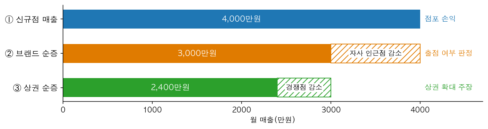
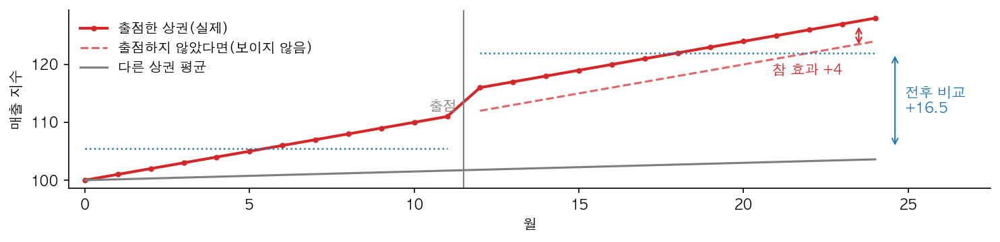
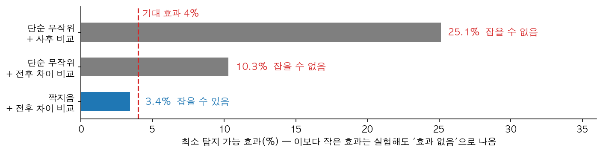
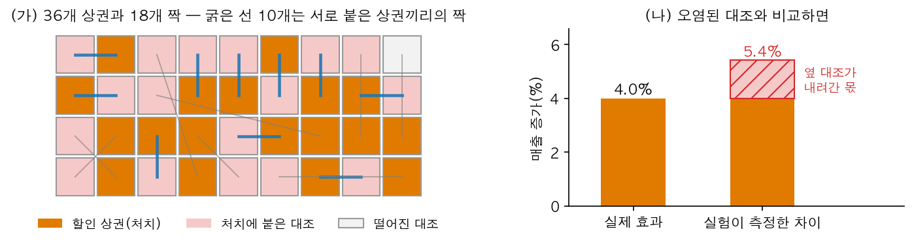
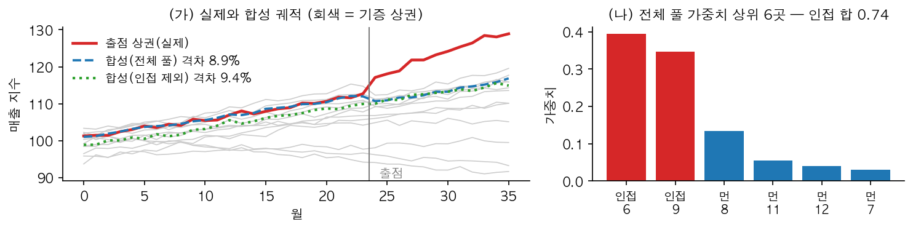
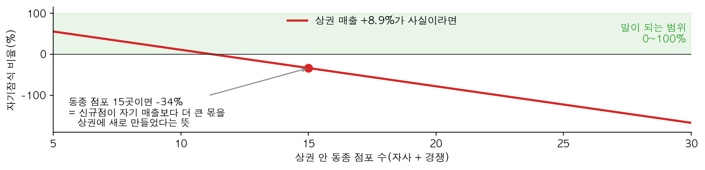
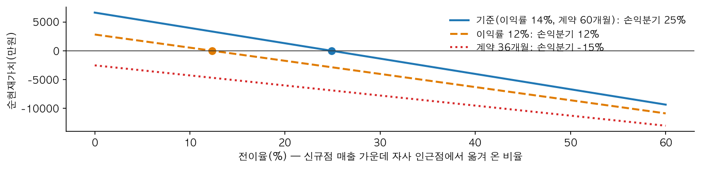
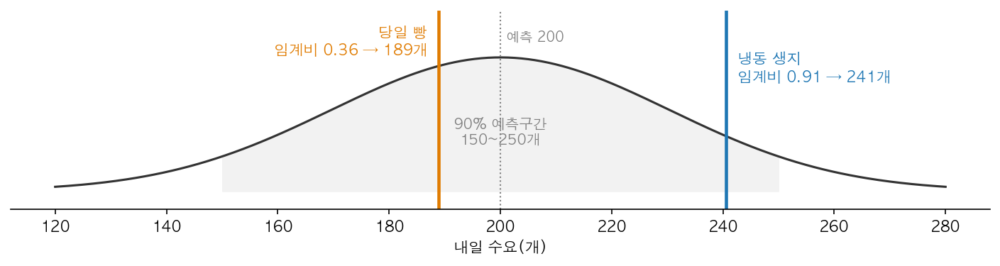

# 14장 공간 실험과 비즈니스 인과추정, 설계에서 결정까지

> **14장 · 공간 실험과 비즈니스 인과추정**
>
> 1~6절은 **가상 사례**로 설명한다. 새벌시와 한올베이커리 본부는 실재하지 않으며, 1~6절의 매출·효과·비용·점포 수·날짜는 설명을 위해 만든 숫자다. 1~6절의 그림과 그림 속 숫자는 `lecture/graphics/make_ch14_figures.py`로 계산해 그렸다.
>
> 7절 실습의 수치는 모두 `lecture_practice/chapter14/`의 코드를 실행해 얻은 값이며, 인용한 값의 출처 파일은 출력 블록 첫 줄에 적었다.

□ 기업이 매장을 열거나 할인 행사를 하면 "그래서 매출이 얼마나 늘었나"를 물음. 이 질문에 답하는 일이 **비즈니스 인과추정**임  
  ○ 방법은 9장의 정책 인과추정과 같지만 조건이 다름. 정책은 법이 시행일을 정하고, 기업은 **잘될 자리와 시점을 스스로 고름**  
  ○ 또 매장은 이웃 매장의 손님을 가져감. 그래서 비교 대상으로 삼은 옆 상권이 이미 영향을 받아 있음  
□ 이 장의 순서: 1~6절은 한올베이커리 본부 분석팀이 한 해 동안 겪는 문제를 차례로 보며 방법을 설명하고, 7절은 같은 방법을 실습 코드로 실행해 출력에서 같은 현상을 확인함  

## 1. 오늘의 질문

□ 새 매장 매출이 월 4,000만 원이다. 회사 매출도 4,000만 원 늘었을까?  
□ 할인 행사를 한 상권과 옆 상권을 비교했다. 옆 상권 손님이 행사 상권으로 건너갔다면 그 비교는 무엇을 보여 줄까?  
□ 실험을 시작하기 전에 "이 실험으로는 답이 안 나온다"를 미리 알 수 있을까?  
□ 통계 검정을 모두 통과한 추정치를 그대로 출점 결정에 넣어도 될까?  

## 2. 사례 — 한올베이커리 본부의 한 해

□ 한올베이커리는 새벌시의 36개 상권에 가맹점을 둔 가상의 베이커리 본부임  
  ○ 본부 분석팀은 "출점과 행사가 매출을 얼마나 늘렸는가"를 보고하고, 그 값으로 다음 출점과 발주를 정해야 함  
  ○ 이 장은 분석팀이 1월부터 11월까지 겪는 문제 아홉 개를 순서대로 따라감  

| 문제 | 시기 | 무슨 일이 있었나 | 해결에 쓴 방법 | 절 |
|---|---|---|---|---|
| 1 | 1월 | 신규점 매출을 그대로 "출점 효과"로 보고함 | 세 값을 구분해 적음 | 3 |
| 2 | 2월 | 잘될 자리에 연 매장의 전후 비교가 너무 큼 | 배정 규칙을 문서로 적음 | 3 |
| 3 | 3월 | 할인 행사 실험을 짜는데 효과가 잡힐지 모름 | 최소 탐지 가능 효과, 짝지음 | 4 |
| 4 | 4월 | 실험 결과가 기대보다 큼 | 공간 파급과 대조군 노출률 | 4 |
| 5 | 5월 | 오염된 짝을 결과를 보고 뺐더니 "유의"가 늘어남 | 배제 규칙을 배정 전에 확정 | 4 |
| 6 | 7월 | 되돌릴 수 없는 출점의 효과를 알아야 함 | 시장 단위 합성통제 | 5 |
| 7 | 8월 | 검정을 통과한 추정치가 이상하게 큼 | 경제적 정합성 검산 | 5 |
| 8 | 9월 | 다음 출점을 할지 정해야 함 | 순현재가치와 손익분기 전이율 | 6 |
| 9 | 11월 | 같은 수요 예측으로 품목마다 발주량을 정해야 함 | 임계비 | 6 |

**표 14.1** 한올베이커리 분석팀이 겪은 아홉 문제

## 3. 무엇을 셀 것인가

### 문제 1 — 신규점 매출을 "출점 효과"로 보고함 (1월)

□ 분석팀이 작년 말 문을 연 매장의 월 매출 4,000만 원을 "출점 효과"로 보고함. 영업본부장이 "근처 우리 매장 매출은 줄지 않았느냐"고 물음  
□ "출점 효과"라는 말 하나에 서로 다른 세 값이 들어 있음(그림 14.1)  



**그림 14.1** "출점 효과"에 들어 있는 세 값. 빗금은 다른 매장에서 옮겨 온 매출

  ○ ① **신규점 매출**: 새 매장 계산대에 찍힌 매출. 점포 하나의 손익을 따질 때 씀  
  ○ ② **브랜드 순증**: ①에서 근처 자사 매장이 잃은 매출을 뺀 값. 신규점이 자사 매출을 가져가는 현상을 **자기잠식**이라 부름. 출점을 할지 말지는 이 값으로 정함  
  ○ ③ **상권 순증**: ②에서 경쟁 매장이 잃은 매출까지 뺀 값. "상권이 커졌다"고 주장할 때 씀  
□ 출점 판정에 ①을 쓰면 자기잠식이 없는 것처럼 계산되어, 이 사례에서는 순증을 3분의 1만큼 크게 셈  
□ 그래서 분석팀은 보고서 첫 줄에 "어느 값을 셌는가"를 적고, 결과를 보고할 때 같은 줄을 다시 적기로 함  

### 문제 2 — 잘될 자리에 연 매장 (2월)

□ 분석팀이 출점 전 1년과 출점 후 1년의 상권 매출을 비교하니 크게 늘어 있음. 그런데 본부는 이 상권을 "매출이 오르고 있어서" 골랐음  
□ 그림 14.2의 상권은 출점 전부터 매달 오르고 있었음. 출점하지 않았어도 계속 올랐을 것이므로, 전후 비교는 원래 오르던 몫까지 효과로 셈  



**그림 14.2** 원래 오르던 상권에 출점하면 전후 비교(+16.5)가 참 효과(+4)의 몇 배로 나옴. 점선은 현실에서는 보이지 않는 "출점하지 않았다면"의 궤적

□ 두 문장을 나란히 놓으면 차이가 보임  
  ○ "3월 1일부터 이 구역에 규제가 적용된다" — 3월은 상인의 매출 전망과 상관없이 법이 정한 날짜임  
  ○ "매출이 오를 것 같아 3월에 저 자리에 열었다" — 3월은 **기대 매출이 정한 날짜**임  
  ○ 뒤 문장처럼 처치(출점)를 받을지가 결과(매출)의 전망에 따라 정해지는 상태를 **내생적 처치**라 부름  
□ 그래서 분석팀은 통계보다 기록을 먼저 확인함. 출점 규칙("규모 상위 절반 중 성장률 1위" 같은)과 그때 본 후보지 평가서가 남아 있으면 그 변수를 비교에서 맞추고, 없으면 모든 추정에 "선택이 섞여 있을 수 있음"을 적음  

## 4. 실험으로 알아낸다 — 지역 실험

### 문제 3 — 할인 행사 실험, 답이 나올까 (3월)

□ 본부가 아침 세트 할인 행사를 전국으로 넓힐지 정하려 함. 할인은 껐다 켤 수 있으므로 **실험**을 할 수 있음  
□ 그런데 손님 한 명 한 명에게 할인을 따로 줄 수 없음. 할인은 매장 단위로 걸리고, 손님은 옆 매장으로 옮겨 다님  
  ○ 그래서 **상권을 단위로** 할인 상권과 비할인 상권을 무작위로 나눔. 지역을 단위로 무작위 배정하는 실험을 **지역 실험**이라 부름(Vaver & Koehler, 2011)  
□ 문제는 상권이 36개뿐이라는 것. 단위 수가 적으면 우연한 차이가 커서 작은 효과는 실험해도 "효과 없음"으로 나옴  
□ 그래서 실험을 시작하기 **전에** "이 설계로 잡을 수 있는 가장 작은 효과"를 계산함. 이 값을 **최소 탐지 가능 효과**(MDE)라 부름  
  ○ MDE는 추정치가 우연히 흔들리는 폭(표준오차)의 약 2.8배임. 흔들림을 줄이면 MDE가 작아짐  
  ○ 본부가 기대하는 할인 효과는 4%임. MDE가 4%보다 크면 이 실험은 시작할 이유가 없음  



**그림 14.3** 같은 36개 상권에서 설계만 바꾼 최소 탐지 가능 효과. 빨간 선(기대 효과 4%)보다 왼쪽에 있어야 효과를 잡을 수 있음

□ 그림 14.3의 세 설계는 상권 수가 같고 분석 방법만 다름  
  ○ **사후 비교**: 행사 기간 매출만 비교함. 원래 매출이 큰 상권과 작은 상권의 차이가 그대로 남아 흔들림이 큼  
  ○ **전후 차이 비교**(이중차분): 상권마다 "행사 후 − 행사 전"을 먼저 구하고 그 차이를 비교함. 상권 규모의 차이가 지워짐  
  ○ **짝지음**: 행사 전 매출 흐름이 닮은 상권끼리 짝을 짓고, 짝마다 하나를 무작위로 할인 상권으로 뽑음. 짝의 두 상권은 같은 날씨·같은 경기를 겪으므로 그 흔들림이 짝 안에서 상쇄됨  
□ 분석팀은 짝지음 + 전후 차이 비교로 실험을 설계함. 상권을 늘리지 않고 **설계만 바꿔** 답이 나오는 실험이 됨  

### 문제 4 — 결과가 기대보다 큼 (4월)

□ 한 달 실험 결과, 할인 상권의 매출이 비할인 상권보다 5.4% 더 늘었음. 기대 4%보다 큼  
□ 지도를 그려 보니 원인이 보임(그림 14.4)  



**그림 14.4** (가) 18개 짝 가운데 10개가 서로 붙은 상권끼리의 짝이고, 비할인 상권의 94%가 할인 상권에 붙어 있음. (나) 붙은 비할인 상권이 손님을 뺏겨 내려가면, 측정한 차이(5.4%)가 실제 효과(4.0%)보다 커짐(설명용 난수와 가상 숫자)

  ○ 가까운 상권끼리는 매출 흐름이 닮음(공간 자기상관, 11장). 그래서 "닮은 상권"을 찾으면 **옆 상권**이 나옴  
  ○ 짝의 한쪽만 할인하면 옆 상권 손님이 할인 상권으로 건너감. 할인 상권은 올라가고 비할인 상권은 내려감  
  ○ 한 상권의 처치가 다른 상권의 결과를 바꾸는 현상을 **공간 파급**이라 부름  
□ 파급이 있을 때 추정치가 틀리는 **방향**은 미리 알 수 있음  
  ○ 비교 대상이 내려간 만큼 차이가 벌어지므로, 추정치는 항상 "효과가 있다"는 쪽으로 커짐  
  ○ 그래서 "잡음이 좀 섞였으니 보수적으로 읽으면 된다"는 해석이 성립하지 않음  
□ 짝지음은 흔들림을 줄이려고 고른 설계인데, 닮은 상권이 곧 이웃이라 **오염을 늘림**. 그래서 분석팀은 할인 상권에 붙은 비할인 상권의 비율(**대조군 노출률**)을 세고, 여기에 파급 크기의 상한을 곱한 "최대 부풀림"을 추정치와 함께 보고함  

### 문제 5 — 결과를 보고 오염된 짝을 뺌 (5월)

□ 팀원 한 명이 "오염된 짝을 빼고 다시 계산하자"고 제안함. 붙은 짝을 빼니 추정치가 4% 근처로 내려왔고, 이 방식을 다른 행사 실험에도 적용함  
□ 그런데 효과가 없던 행사들까지 "유의함"으로 나오기 시작함  
  ○ 어느 짝이 오염되었는지는 **무작위 배정 결과**에 달려 있음. 그래서 결과를 보고 빼면 남는 짝의 수가 실험마다 달라지고, 검정이 가정하는 "표본 크기는 미리 정해져 있다"는 조건이 깨짐  
  ○ 그 결과 효과가 없어도 "효과 있음"으로 판정하는 비율(**1종 오류율**)이 정해 둔 5%를 크게 넘음  
□ 같은 "오염된 단위 빼기"라도 **언제 정했는가**가 결과를 가름  

| 배제 규칙을 정한 시점 | 예 | 결과 |
|---|---|---|
| 배정 **전** | "서로 붙은 상권은 같은 짝으로 묶지 않는다", "처치 상권에서 1km 안은 대조에서 뺀다" | 검정이 정상 작동함 |
| 배정 **후** | 결과를 본 뒤 오염된 짝을 골라 뺌 | 점추정은 맞아 보이지만 "유의" 판정을 믿을 수 없음 |

**표 14.2** 배제 규칙을 정한 시점과 결과

□ 그래서 분석팀은 결과변수·분석 방법·배제 규칙·유의수준을 **자료를 보기 전에** 문서로 남기기로 함(사전등록)  

## 5. 실험할 수 없을 때 — 시장 단위 합성통제

### 문제 6 — 되돌릴 수 없는 출점 (7월)

□ 동림 상권에 낸 신규점의 효과를 알아야 함. 출점은 할인처럼 껐다 켤 수 없고, 무작위로 열 수도 없음  
□ 그래서 9장·12장의 **합성통제법**을 상권에 적용함. 출점하지 않은 상권들을 섞어 "출점하지 않은 동림 상권"을 만들고, 출점 후 실제와의 차이를 효과로 읽음  
  ○ 섞는 비율(가중치)은 출점 **전** 동림의 매출 궤적을 가장 잘 따라가도록 정함. 가중치는 모두 0 이상이고 합이 1임  
  ○ 섞는 데 쓰는 상권들을 **기증 풀**이라 부름  
□ 여기서 문제 4의 파급이 다시 나타남(그림 14.5)  



**그림 14.5** (가) 출점 상권과 두 합성 궤적. (나) 전체 기증 풀의 가중치 상위 여섯 곳. 빨간 막대가 출점 상권에 붙은 상권이며 가중치 합이 0.74임(설명용 난수)

  ○ 동림의 출점 전 궤적을 가장 잘 따라가는 것은 **옆 상권**임. 그래서 가중치의 0.74가 붙은 상권 세 곳에 몰림  
  ○ 그런데 옆 상권은 출점 후 손님을 뺏겨 내려감. 합성 대조가 같이 내려가므로 차이가 커짐  
  ○ 붙은 상권을 빼고(인접 제외) 다시 만들면 오염은 사라지지만, 출점 전 궤적을 덜 따라감. 그림 14.5 (가)에서 초록 점선이 출점 전부터 빨간 선 아래에 있음  
□ 즉 **가장 좋은 기증 상권이 가장 오염된 상권**임. 인접 상권을 뺄지는 관행으로 정하지 않고, 인접 상권에 준 가중치의 합과 파급 크기를 먼저 확인한 뒤 정함  
□ 결과를 믿으려고 분석팀은 두 가지를 확인함  
  ○ **출점 전 적합**: 출점 전에 합성 궤적이 실제를 잘 따라갔는가  
  ○ **가짜 처치 비교**(placebo): 출점하지 않은 상권 하나하나를 "출점한 척" 놓고 같은 계산을 반복함. 동림의 차이가 이 가짜 차이들보다 뚜렷하게 커야 효과로 읽음  
□ 두 확인을 모두 통과했고, 전체 풀 추정치는 상권 매출 +8.9%였음  

### 문제 7 — 검정은 통과했는데 값이 이상함 (8월)

□ 재무팀이 이 +8.9%를 받아 계산하다가 이상한 점을 찾음  
□ 같은 순증을 두 길로 셀 수 있음  
  ○ **매장 쪽에서**: 신규점 매출 가운데 자사·경쟁 매장에서 옮겨 오지 않은 몫이 순증임  
  ○ **상권 쪽에서**: 상권 전체 매출에 추정 효과(+8.9%)를 곱한 값이 순증임. 상권 전체 매출은 대략 "동종 점포 수 × 점포 하나 매출"임  
  ○ 두 값은 같아야 함. 같다고 놓으면 추정치가 말하는 **자기잠식 비율**이 나옴  
□ 동림 상권에는 동종 점포가 15곳 있음. 이 수를 넣으면 자기잠식 비율이 음수가 됨(그림 14.6)  



**그림 14.6** 상권 매출 +8.9%가 사실이라고 할 때, 동종 점포 수에 따라 추정치가 말하는 자기잠식 비율. 초록 띠(0~100%) 밖이면 추정치·점포 수·자기잠식 가운데 하나가 틀린 것임

  ○ 자기잠식이 음수라는 말은 "신규점이 **자기 매출보다 더 큰** 매출을 상권에 새로 만들었다"는 뜻임. 불가능하지는 않지만 별도의 증거 없이 받아들일 수 없음  
  ○ 이 사례의 원인은 문제 2와 같음. 동림은 아파트 입주로 원래 더 오를 자리였고, 기증 상권 어디에도 그런 흐름이 없어서 합성 대조가 그 몫을 따라가지 못함  
□ **통계적 유의성은 효과가 0이 아니라는 뜻이지, 크기가 맞다는 뜻이 아님**. 분석팀은 순서를 "추정 → 유의성 → 경제적 정합성 → 결정"으로 정하고, 세 번째 칸을 비우지 않기로 함  
□ 이 검산에 들어간 동종 점포 수도 가정값임. 실무에서 먼저 할 일은 더 정교한 추정이 아니라 **상권 안에 매장이 몇 개인지 세는 것**임  

## 6. 추정치를 결정으로 바꾼다

### 문제 8 — 다음 출점을 할까 (9월)

□ 다음 출점 후보 매장의 예상 월 매출은 4,000만 원, 매출 중 이익으로 남는 비율(기여이익률)은 14%, 초기 투자는 2억 원, 임대 계약은 60개월, 본부가 요구하는 수익률은 연 10%임  
□ 출점은 한 번 돈을 쓰고 여러 해에 걸쳐 회수하는 투자이므로, 앞으로 들어올 이익을 지금 가치로 바꿔 모두 더한 뒤 투자금을 뺀 **순현재가치**(NPV)로 판단함. 0보다 크면 출점함  
□ 여기에 문제 1의 자기잠식이 들어감. 신규점 매출 가운데 자사 매장에서 옮겨 온 비율을 **전이율**이라 부르면, 전이율만큼은 회사 전체의 이익이 아님  



**그림 14.7** 전이율에 따른 순현재가치. 선이 0을 지나는 점이 손익분기 전이율임(가상 숫자)

  ○ 기준 조건에서는 전이율 25%까지 출점이 이득임. 이 값이 **손익분기 전이율**임  
  ○ 이익률이 14%에서 12%로 2%포인트만 내려가도 손익분기가 12%로 반 토막 남  
  ○ 계약이 36개월이면 자기잠식이 전혀 없어도 순현재가치가 음수임. 투자금을 회수하기 전에 계약이 끝나기 때문임  
□ 그래서 "자기잠식 25%까지는 괜찮다" 같은 업계 관행값을 브랜드·업종을 가로질러 그대로 쓰지 않고, 자기 원가와 계약 조건으로 손익분기를 거꾸로 계산함  
□ 제도도 선택지를 자름. 「가맹사업거래의 공정화에 관한 법률」 제12조의4에 따라 가맹본부는 계약 기간 중 정당한 사유 없이 가맹점의 영업지역 안에 같은 업종의 자기 또는 계열회사 매장을 낼 수 없음. 순증이 가장 큰 후보가 기존 가맹점 영업지역 안이면 실행할 수 없음  

### 문제 9 — 같은 예측, 다른 발주 (11월)

□ 새 매장의 내일 수요 예측이 200개, 90% 예측구간이 150~250개로 나옴. 점장은 "그럼 200개를 만들면 되느냐"고 물음  
□ 200개를 만들면 절반 확률로 모자라고 절반 확률로 남음. 모자랄 때의 손해와 남을 때의 손해가 다르면 200개가 답이 아님  
  ○ **결품 손실**(Cu): 하나가 모자라 못 판 손해. 판매 이익과 단골 이탈이 들어감  
  ○ **잉여 손실**(Co): 하나가 남은 손해. 재료비와 폐기비가 들어감  
  ○ 최적 발주량은 수요 분포에서 "Cu ÷ (Cu + Co)"에 해당하는 위치(분위수)임. 이 비율을 **임계비**라 부름  



**그림 14.8** 같은 수요 예측에서 품목마다 다른 발주량(가상 숫자)

  ○ **당일 빵**은 남으면 버려야 하므로 잉여 손실이 큼. 임계비가 0.5보다 작아 예측보다 적게 만듦  
  ○ **냉동 생지**는 남아도 다음 날 팔리므로 잉여 손실이 작음. 임계비가 0.9를 넘어 예측보다 훨씬 많이 준비함  
□ 두 품목의 차이를 만든 것은 예측 모형이 아니라 **두 손실의 비율**임. 그래서 분석팀은 예측구간만 넘기지 않고 "이 비용 구조이면 이만큼"이라는 결정값을 함께 넘김  

## 7. 실습 — 네 실행으로 같은 문제를 확인한다

□ 1~6절의 방법을 실습 코드로 실행함. 자료는 시장 40개, 104주의 **시뮬레이션 자료**임  
  ○ 참 효과(+5.02%)와 파급(−1.49%)을 코드가 미리 심어 두었으므로, 각 방법이 참값을 되찾는지 채점할 수 있음. 실제 자료에는 정답이 없어 이런 채점이 불가능함  

| 실습 | 실행 파일 | 확인할 문제 |
|---|---|---|
| 준비 | `14-0-simdata-prep.py` | 시장 40개 패널을 만듦 |
| A | `14-1-geo-experiment-power.py` | 문제 3·4·5 — 설계 다섯 가지, 파급, 사후 제외 |
| B | `14-2-market-synthetic-control.py` | 문제 2·6 — 합성통제, 인접 제외, 선택의 영향 |
| C | `14-3-decision-economics.py` | 문제 7·8·9 — 두 길 검산, 손익분기, 임계비 |

**표 14.3** 실습 파일과 확인할 문제

□ 실행하기 전에 아래 예측표를 먼저 채움. 출력을 먼저 보면 거기 적힌 값이 정답으로 보여 "왜 이 값인가"를 묻지 않게 됨  

| 예측할 것 | 내 예측 | 실제 |
|---|---|---|
| 짝지음은 단순 무작위보다 대조군 노출률이 높은가 낮은가 | | |
| 결과를 보고 오염된 짝을 빼면 1종 오류율은(5% 근처 / 10% 근처 / 20% 이상) | | |
| 합성통제 추정치가 참값(+0.049)에 가장 가까운 단계는 어느 것인가 | | |
| 추정치를 넣은 두 길 검산에서 자기잠식 비율이 0~100% 안에 드는가 | | |

**표 14.4** 예측표 — 실행하기 **전에** 채운다

```bash
cd geoai_public   # 저장소 루트 — 아래 명령은 모두 여기서 실행함
pip install -r lecture_practice/requirements-student.txt
python lecture_practice/chapter14/code/14-0-simdata-prep.py
python lecture_practice/chapter14/code/14-1-geo-experiment-power.py
python lecture_practice/chapter14/code/14-2-market-synthetic-control.py
python lecture_practice/chapter14/code/14-3-decision-economics.py
```

□ GPU와 인터넷은 필요 없고, 네 개를 합쳐 몇십 초 안에 끝남. 번호 순서대로 실행해야 함. `14-1`·`14-2`는 `14-0`이 만든 패널을, `14-3`은 `14-2`가 남긴 `results/14-2-estimate.json`을 읽음  

### 실습 A — 설계 다섯 가지와 파급 (문제 3·4·5)

□ 설계 다섯 가지를 각각 1,000번 무작위 배정해 평균을 냄. `편향`은 참값 0.0490에서 벗어난 크기, `노출률`은 대조 시장 가운데 처치 시장에 붙은 비율, `MDE`는 로그 단위 값임  

```text
# 출처: lecture_practice/chapter14/results/14-1-geo-experiment-power.log (발췌)
[짝지음] 사전 52주 궤적 거리로 20개 쌍 구성
  이 중 지리적으로 인접한 쌍 = 11개 / 20개
...
설계                           평균추정       편향     경험SD     평균SE     기각률   ±1SE      MDE    단위     노출률
설계1 단순+사후비교                0.0657   0.0167   0.0881   0.0875   0.100  0.009   0.2518  40.0   0.904
설계2 단순+DID                 0.0617   0.0127   0.0379   0.0378   0.358  0.015   0.1087  40.0   0.904
설계3 짝지음+DID                0.0639   0.0149   0.0129   0.0131   1.000  0.000   0.0386  40.0   0.959
설계4 짝지음+오염제외               0.0465  -0.0025   0.0586   0.0414   0.167  0.028   0.3515   4.6   0.000
설계5 군집무작위+DID              0.0585   0.0095   0.0744   0.0758   0.080  0.009   0.2453  10.0   0.617
...
  설계3 짝지음+DID              0.052 ± 0.014(95% CI 반폭)  가짜 효과 +0.0005  → 명목 수준 포함
  설계4 짝지음+오염제외             0.233 ± 0.063(95% CI 반폭)  가짜 효과 -0.0025  → **부풀림 — 없는 효과를 유의하다고 말한다**
```

| 출력 | 읽을 것 |
|---|---|
| MDE | 참 효과는 로그 단위 0.049임. 사후 비교의 MDE 0.2518은 이보다 커서 잡을 수 없고, 짝지음 + 전후 차이 비교의 0.0386은 이보다 작아 잡을 수 있음 — 문제 3의 그림 14.3과 같은 현상임 |
| 짝과 노출률 | 짝 20개 중 11개가 붙은 시장끼리의 짝이고, 노출률이 단순 무작위 0.904에서 짝지음 0.959로 오름. 흔들림(경험SD)은 0.0129로 가장 작은데 편향은 +0.0149로 남음 — 문제 4 |
| 군집 무작위 | 붙은 시장 네 개씩을 한 덩어리로 배정하면(설계5) 노출률이 0.617로 내려가는 대신 단위가 10개로 줄어 기각률이 0.080으로 떨어짐 |
| 사후 제외 | 결과를 보고 오염된 짝을 빼면(설계4) 편향은 −0.0025로 사라지지만, 남는 단위가 평균 4.6개로 매번 달라짐. 효과가 없는 세계에서 1종 오류율이 0.233으로 명목 5%의 네 배를 넘음 — 문제 5 |

**표 14.5** 실습 A 출력에서 읽을 것

□ 같은 로그 안에서 `±1SE` 열은 표준오차이고, 아래 판정 블록의 `±`는 그 두 배(95% 구간 반폭)임. 숫자를 인용할 때는 둘 중 어느 쪽인지 적음  


**그림 14.9** 실습 A — 시장 수에 따른 MDE(왼쪽)와 기각률(오른쪽). 파급이 있으면 MDE는 그대로인데 기각률만 올라감

□ 그림 14.9 오른쪽에서 시장 20개의 기각률은 파급이 없을 때 0.644, 있을 때 0.910임. 파급은 추정치를 위로 밀 뿐 흔들림을 줄이지 않으므로, **기각률이 올라간 것을 실험이 좋아진 신호로 읽지 않음**. 왼쪽에서는 시장 20개(5.51%)보다 30개(5.84%)의 MDE가 큼. 새로 넣은 시장이 기존 시장과 닮지 않으면 짝의 품질이 떨어지기 때문임  

### 실습 B — 시장 단위 합성통제 (문제 2·6)

□ 진출 후보 20개 가운데 사전 성장률이 가장 높은 시장 하나를 처치 시장으로 고름. 문제 2처럼 "잘될 자리"를 고른 것임. 추정을 네 단계로 올려 가며 참값(+0.0490)과 비교함  

```text
# 출처: lecture_practice/chapter14/results/14-2-market-synthetic-control.log (발췌)
처치 시장 = 35번 (격자 3,5) · 진출 후보 20개 중 선택 · 인접 시장 [25, 34, 36]
사전 관측 성장률 = +0.00247 (전체 8위)

추정 계단                     추정 ATT     참값 대비    사전RMSPE      격차기울기    기증수     가중집중     인접가중
① 사후 단순 비교                0.0884    0.0394          —          —     39        —        —
② DID (전체 기증 풀)           0.1317    0.0827          —          —     39        —        —
③ SCM (전체 기증 풀)           0.1129    0.0639     0.0376   -0.00009     39    0.172    0.276
④ SCM (인접 제외 풀)           0.1092    0.0602     0.0377   +0.00001     36    0.241    0.000
```

```text
# 출처: lecture_practice/chapter14/results/14-2-market-synthetic-control.log (발췌)
처치 시장 사후/사전 RMSPE 비율 = 3.051
기증 36개의 가짜 처치 비율: 중앙값 1.208 · 최대 1.796
유사 p값 = 0.027  (유의, 명목 0.05 기준)
...
  ③ 전체 풀 : 세계 A +0.1129 − 세계 B +0.1087 = +0.0041
  예측값     : 인접 가중 합 0.276 × 파급 0.0150 = +0.0041
...
  전체 풀   평균 절대편향 0.0250 · 사전 RMSPE 평균 0.0454
  인접 제외 평균 절대편향 0.0389 · 사전 RMSPE 평균 0.0654
```

| 출력 | 읽을 것 |
|---|---|
| 추정 계단 | 네 단계 모두 참값보다 큼. 가장 정교한 ④도 참값보다 0.0602 크고, 가장 단순한 ①(0.0394)보다 나을 것도 없음 |
| 출점 전 적합·가짜 처치 | 사전 RMSPE 0.0376은 관측 잡음(0.035)과 비슷하고, 가짜 처치 36개의 비율이 모두 처치 시장(3.051)보다 작아 유사 p값이 0.027임. 진단을 모두 통과했는데 ④의 추정치는 참값보다 0.0602 큼 — 문제 7로 이어짐 |
| 인접 가중치 | 인접 시장 세 곳에 준 가중치 합 0.276 × 파급 0.0150 = 0.0041이 파급을 없앤 세계와의 차이와 정확히 같음. 오염의 크기는 붙은 시장에 준 가중치가 정함 — 문제 6 |
| 인접 제외 | 후보 20개 전체로 반복하면 인접을 뺀 쪽의 평균 절대편향(0.0389)이 전체 풀(0.0250)보다 큼. 이 자료에서는 인접 제외가 평균적으로 손해임 |

**표 14.6** 실습 B 출력에서 읽을 것

□ 파급이 만든 몫(0.0041)은 ③의 전체 편향 0.0639 가운데 작은 일부임. 나머지는 **선택**에서 옴. 같은 실행이 선택 규칙을 한 겹씩 벗긴 결과를 함께 찍음  

```text
# 출처: lecture_practice/chapter14/results/14-2-market-synthetic-control.log (발췌)
  C1 = 전체 40개 시장에서 무작위 선택 (선택 규칙을 완전히 제거)
  C2 = 진출 후보(시장 규모 상위 절반) 20개에서 무작위 선택 (규모 필터만 남김)
  A  = 후보 중 사전 성장률 1위 (실제 의사결정 규칙, 단일 사례)

추정 계단                      C1 평균     C2 평균      A 편향    C2 SD     C2 절댓값
① 사후 단순 비교                0.0013    0.2186    0.0394   0.1856     0.2220
② DID (전체 기증 풀)           0.0013   -0.0925    0.0827   0.0991     0.1188
③ SCM (전체 기증 풀)           0.0104    0.0094    0.0639   0.0321     0.0250
④ SCM (인접 제외 풀)          -0.0016    0.0105    0.0602   0.0519     0.0389
```

  ○ 무작위로 고르면(C1) 단순 비교와 전후 차이 비교의 편향이 0.0013으로 사라짐. 편향의 원인은 선택임  
  ○ 합성통제(③)는 무작위 선택에서는 편향이 C1 0.0104, C2 0.0094로 작은데, 성장률 1위를 고른 실제 규칙(A)에서 0.0639로 뜀. 성장이 가장 빠른 시장은 기증 시장들이 섞어서 만들 수 있는 범위의 가장자리에 있기 때문임  
  ○ 즉 **평균적으로 잘 맞는 방법이, 기업이 실제로 고르는 시장에서 가장 부정확할 수 있음**(문제 2·7)  


**그림 14.10** 실습 B — 처치 시장의 실제·합성 궤적(왼쪽)과 가짜 처치 비율 분포(오른쪽). 처치 시장은 분포 밖에 있지만 그 격차는 참값보다 훨씬 큼

### 실습 C — 두 길 검산과 결정 (문제 7·8·9)

□ `14-3`은 실습 B의 추정치(+11.54%)를 읽어 결정 단위로 바꿈. 비용·투자 값은 전부 **가정값**이며, 결론은 절대값이 아니라 가정을 바꿨을 때 결론이 얼마나 움직이는지(민감도)임  

```text
# 출처: lecture_practice/chapter14/results/14-3-decision-economics.log (발췌)
[신선식품] Cu 1,200원 / Co 2,000원
  임계비 = 1,200 / (1,200 + 2,000) = 0.375
  최적 발주량 = 수요분포의 37.5% 분위수 = 94.2 → 94단위
...
[내구재] Cu 15,000원 / Co 1,500원
  임계비 = 15,000 / (15,000 + 1,500) = 0.909
  최적 발주량 = 수요분포의 90.9% 분위수 = 124.4 → 124단위
...
**손익분기 전이율 = 26.9%**
...
기여이익률 15% → 12%                       8.6%
...
계약 60개월 → 36개월                       -9.7%  ← 음수 = 자기잠식이 0이어도 기각
```

```text
# 출처: lecture_practice/chapter14/results/14-3-decision-economics.log (발췌)
14-2의 추정: 시장 매출 +11.54% (placebo p=0.027, 유의)
14-2의 참값: 시장 매출 +5.02%
...
20                                       -0.4%               -130.7%
...
   N      참값 전이율     참값 NPV     판정        추정 전이율     추정 NPV     판정  결론
  10       49.8%     -4,698     기각        -15.4%      5,515     통과  **뒤집힌다**
```

| 출력 | 읽을 것 |
|---|---|
| 두 길 검산 | 시장 내 동종 매장 20개를 넣으면 참값(+5.02%)이 말하는 전이율은 −0.4%로 0에 가깝지만, 추정치(+11.54%)가 말하는 전이율은 −130.7%로 성립할 수 없음. 유의(p=0.027)한 추정치를 이 검산이 잡아냄 — 문제 7 |
| 판정 뒤집힘 | 매장 수가 10개이면 참값으로는 순현재가치 −4,698만 원으로 기각인 출점을, 부풀린 추정치는 +5,515만 원으로 통과시킴 |
| 손익분기 | 기준 가정에서 손익분기 전이율은 26.9%. 기여이익률이 15%에서 12%로 내려가면 8.6%, 계약이 36개월이면 −9.7%로 자기잠식이 없어도 기각임 — 문제 8 |
| 임계비 | 같은 예측구간 [70, 130]에서 신선식품(임계비 0.375)은 94단위, 내구재(0.909)는 124단위를 발주함 — 문제 9 |

**표 14.7** 실습 C 출력에서 읽을 것

## 8. 핵심 요약

□ **1. "출점 효과"에는 세 값이 들어 있다.** 출점 판정에는 신규점 매출이 아니라 자기잠식을 뺀 브랜드 순증을 씀  
□ **2. 기업은 잘될 자리를 고른다.** 배정 규칙을 문서로 적을 수 있는지부터 확인함. 실습에서 선택 규칙을 없애면 단순 비교의 편향이 0.0013으로 사라짐  
□ **3. 실험 전에 MDE를 계산한다.** 같은 시장 40개에서 설계만 바꿔 MDE가 로그 단위 0.2518에서 0.0386으로 내려감  
□ **4. 파급은 효과를 부풀리는 쪽으로만 작용한다.** 닮은 시장이 곧 이웃이라 짝지음이 노출률을 0.904에서 0.959로 올림. 기각률이 오른 것을 좋은 신호로 읽지 않음  
□ **5. 배제 규칙은 배정 전에 정한다.** 결과를 보고 빼면 1종 오류율이 0.233이 됨  
□ **6. 합성통제의 가장 좋은 기증 시장이 가장 오염된 시장이다.** 오염량은 인접 가중치 × 파급으로 계산되며(0.276 × 0.0150 = 0.0041), 인접 제외가 늘 이득은 아님  
□ **7. 통계가 통과시킨 것을 산수가 잡는다.** 유의한 추정치(+11.54%)가 참값(+5.02%)의 2.3배였고, 두 길 검산에서 전이율 −130.7%로 드러남  
□ **8. 결정을 정하는 것은 모형이 아니라 비용 구조와 제도다.** 손익분기 전이율은 이익률 3%포인트에 26.9%에서 8.6%로 움직이고, 같은 예측에서 발주량이 94와 124로 갈림  

## 9. 과제

```bash
python scripts/submit.py 14 --id 학번 --name 이름
```

□ 실행하면 `submissions/` 폴더에 `제출_14장_학번.md`가 생성되고 `14-2-market-synthetic-control.py`의 실행 결과가 붙어 있음  
  ○ **눈여겨볼 곳은 합성통제 추정치와 참값의 격차, 그리고 통계 진단을 통과했는지**  

○ 빈칸 세 개를 채움  

1. 눈에 띈 숫자 하나를 그대로 옮겨 적고, 왜 눈에 띄었는지 한 문장으로
2. 그 숫자가 왜 그렇게 나왔는가 — 추정 계단의 값이라면 실습 B의 선택 층 분해(C1·C2·A)로 설명하라
3. **이 추정치는 통계 진단을 통과했다. 그대로 결정에 넣겠는가, 한 칸을 더 두겠는가? 그 한 칸은 무엇인가?**

○ **3번이 이 과제의 핵심.** 1·2번은 로그를 보면 답이 나오지만 3번은 문제 7과 실습 C의 두 길 검산을 근거로 스스로 답해야 함  

> - **막혀도 제출함.** 실행이 실패하면 오류 메시지가 파일에 담기고, 질문이 "어디서 막혔나"로 바뀜. 실행 성공 여부로 점수를 매기지 않음
> - **이 장의 실습은 시드를 고정한 시뮬레이션임.** 같은 코드를 다시 실행해도 같은 값이 나와야 정상이며, 값이 다르면 코드를 수정했거나 환경이 다른 것임

## 10. 더 알아보기

□ **내생적 처치의 실제 사례** — Blake, Nosko & Tadelis(2015)는 eBay 검색 광고를 끄고 켜는 현장실험에서 실험으로 얻은 수익률이 관측 추정값의 일부에 그침을 보였음(온라인 광고 연구이므로 같은 구조의 선례이며 출점의 직접 선례는 아님)  
□ **볼록껍질 점검** — `14-2-market-synthetic-control.log`의 [볼록껍질 점검]. 처치 시장보다 사전 추세가 가파른 기증 시장이 39개 중 7개뿐이어서 합성 대조가 추세를 따라가기 어려움  
□ **용량 제약** — `14-3-decision-economics.log`의 (4). 매장 처리 능력이 상한을 만들면 수요가 늘어난 이익은 잘리고 줄어든 손실은 그대로 남음(순현재가치 상방 +3,419만 원 대 하방 −4,103만 원)  
□ **위치정보와 법령** — 자체 앱으로 위치를 수집해 상품화하면 「위치정보의 보호 및 이용 등에 관한 법률」의 사업자 등록·신고 대상이 됨(제5조·제5조의2·제9조). 지역별 보험요율 차등의 허용 범위는 확인하지 못했으므로 변호사 검토 대상임(2026년 8월 확인 기준)  
□ 공간 자기상관은 11장, 합성통제의 기본은 9장·12장, 출점 최적화와 자기잠식 상한 관행은 13장  
